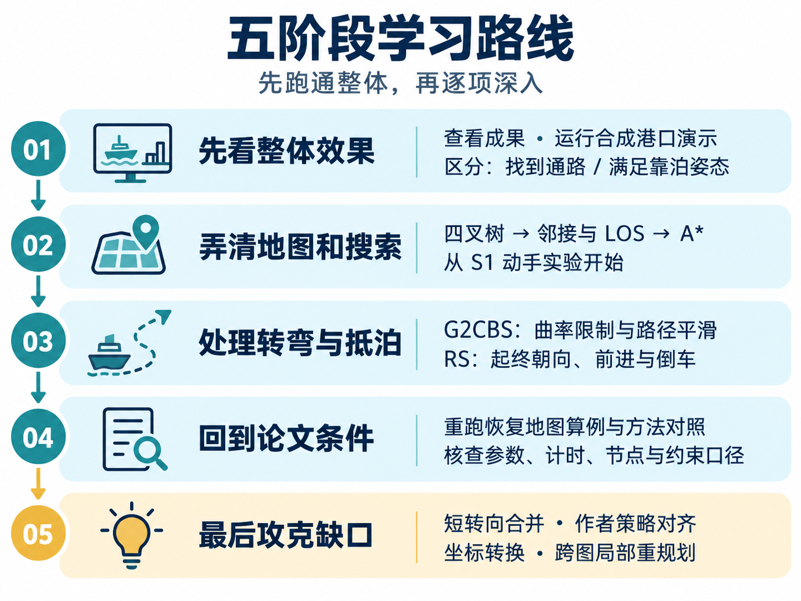

# 文献---实验部分复现

**韩旭（2023）博士论文《船舶靠泊路径规划与模型预测航迹保持控制》**

第三章：基于多尺度 A* 算法的靠泊路径规划 · Python 独立学习复现

当前应用主线：真实海图上的不规则区域覆盖，已扩展至 1 艘 USV 与 2 艘 UUV 的二维分工与时间回放。

**---主要做的三件事：靠离泊路径规划、障碍规避、运动控制**

**---一句话理解：给船舶做一套“靠泊导航”——先在开阔处粗、近岸处细的地图找出避障通路，再把转弯变平滑，安排最后的朝向和进退动作，让船按要求抵达泊位。**

[框架图](#1框架图) · [项目结构](#2项目结构) · [学习路线](#3学习路线) · [文献实验解读](#4文献实验解读) · [成果展示](#5实验复现结果展示) · [完成清单](#6未完成部分说明)

## 1、框架图


## 2、项目结构

```text
hanxu-berthing-reproduction/
├── README.md                     项目首页：方法、成果、进度与运行入口
├── configs/                      地图、算法参数、固定随机种子
├── src/berthing_planner/
│   ├── quadtree.py               四叉树与几何查询
│   ├── raster_map.py             恢复地图与规划图接口
│   ├── search.py                 普通 A*、父节点连接改进
│   ├── curves.py                 基本 G2CBS 与曲线检查
│   ├── g2_bisection.py           短航段角度二分构造
│   ├── g2_merge.py               明确标注的短转向工程合并
│   ├── reeds_shepp.py            RS 接口与候选检查
│   ├── rs_families.py            RS 解析路径族
│   ├── stitching.py              平滑前段与 RS 的组合接入
│   ├── stern_axis.py             船艉轴线接入补充策略
│   ├── jps.py                    JPS 对照
│   ├── smooth_rrt.py             Smooth-RRT 对照
│   ├── coordinates.py           墨卡托投影与栅格坐标
│   ├── gshhg.py                 真实海岸线读取与裁剪环
│   ├── occupancy.py             填陆地图四叉树与几何查询
│   ├── replanning.py            细图受阻航段局部替换
│   ├── coverage.py              扫描航线与关闭扫描的避障连接
│   ├── cooperative_allocation.py  两艘 UUV 的任务分带与路线
│   ├── mission_timing.py        路线赋时、等待与连续间距核查
│   └── pipeline.py               合成港口学习流程
├── scripts/                      地图恢复、实验运行、对照与绘图
├── tests/                        标准库算法检查
├── research_tests/               地图预处理检查
├── docs/                         原文对齐、来源、复现协议、首页图示
├── reports/                      阶段报告与固定基线回放
├── third_party/                  第三方代码来源与许可
├── requirements-reconstruction.txt  地图恢复／绘图环境版本记录
├── data/                         本地原始／处理数据目录
└── outputs/                      每次运行的结果、配置、快照与哈希
```

## 3、学习路线



## 4、文献实验解读

### 为什么要把这些方法组合起来？

靠泊规划同时面临三个问题：

1. 地图划得太细会增加搜索量。
2. 直接找到的折线可能转不过去。
3. 抵达终点时还要满足船头朝向和倒车要求。

因此，本章依次处理“地图规模、路径转弯、抵泊姿态”，为后续运动规划与控制提供路径。

### 各个模块具体解决什么？

| 模块与原文位置 | 通俗解释 | 本项目如何拆成实验 |
| --- | --- | --- |
| 四叉树，图 3.1—3.4 | 空旷水域少放节点，靠近障碍时细分，把计算用在需要精细判断的位置 | 1、恢复障碍地图；<br>2、检查区块、邻接、端点归属与可达性。 |
| A* 与 LOS，图 3.5—3.7 | A* 找整体通路；能直接连通时，减少沿区块逐级连接造成的绕折 | 1、先用 Dijkstra 核查普通 A*；<br>2、再比较两种父节点规则解释（当前采用明确标注的 Theta 式回退）。 |
| G2CBS，图 3.8 | 把保留的折角变成受曲率限制的弯道；转弯空间不足时还需处理相邻转向 | 1、检查基本构造与角度二分；<br>2、通航工程合并与全段检查通过；<br>3、船艉完整平滑及作者合并规则仍待解决。 |
| RS，图 3.9—3.13 | 用直线和圆弧组合起终姿态，允许前进、倒车，并惩罚过长倒车 | 1、检查位姿、半径与方向切换；<br>2、核查 RS 接入；<br>3、船艉算例采用明确补充的轴线策略。 |
| 坐标与重规划，第 3.3 节 | 将经纬度、平面距离和栅格位置统一；精细海图发现新障碍后修正局部路线 | 1、核对来源与公式；<br>2、投影与栅格转换通过独立验证；<br>3、真实 GSHHG 跨图局部重规划通过（独立条件，作者原图待对齐）。 |


## 5、实验复现结果展示

### 当前应用 A3：USV / UUV 分工与时间回放


- **任务分工**：原有 86 条扫描任务完整保留，UUV 1 承担 **39 条、75.16 km**，UUV 2 承担 **47 条、75.71 km**；USV 沿 **3.10 km** 的航线转场并驻点支援。
- **时间效果**：UUV 设为 **1.5 m/s**、USV 设为 **3 m/s**；预部署后的任务时长为 **14.02 h**。同样任务排序的单 UUV 对照为 **28.23 h**，双 UUV 使用两个覆盖平台。
- **全程核查**：三平台原始阻塞格碰撞均为 **0**；全时钟最小水平间距 **445 m**，最大 USV–UUV 支援距离 **2760 m**，满足本次 **25 m / 3000 m** 设定。
- **覆盖与边界**：仍为 **99.900%**，保留 **8763 m²** 漏扫；已生成可拖动时间、播放与暂停的本地回放。当前验证二维几何与时序，部署／回收、转弯、动力学、深度和真实声学通信继续待做。[阶段报告与回放入口](reports/A3_USV_UUV任务分配与时间回放.md)

### 应用基线 A2：单平台区域覆盖


- **覆盖效果**：理想扫宽 **100 m**、间距 **80 m**；66 条常规扫描腿加 20 条补扫腿后，覆盖 **99.900%**，剩余漏扫 **8763 m²**，重复覆盖 **24.862%**。
- **完整路线**：扫描 **109.570 km**，避障与转场连接 **57.385 km**，总长 **166.955 km**；连接腿不计扫描，整条路径未检出阻塞格碰撞。
- **保留边界**：原始 **8.767 km²** 目标没有缩小；离散小区的漏扫单独保留。当前是几何折线与理想足迹，转弯、动力学和深度仍待验证。[阶段报告](reports/A2_单平台区域覆盖规划.md)

### 成果图


左侧为通航到达，右侧为船艉倒车抵泊。灰色为实验实际使用的恢复障碍栅格，青色为前进、红色虚线为倒车；深色箭头标出起终船头朝向，空心圆为换向点。


### 关键数据

<table width="840">
  <thead>
    <tr>
      <th width="170">恢复港口图算例</th>
      <th width="125">路径长度</th>
      <th width="115">倒车距离</th>
      <th width="110">方向切换</th>
      <th width="125">最大曲率</th>
      <th width="195">中心线几何检查</th>
    </tr>
  </thead>
  <tbody>
    <tr>
      <td align="left">通航到达</td>
      <td align="right"><strong>4908.3 m</strong></td>
      <td align="right">0 m</td>
      <td align="right">0 次</td>
      <td align="right">0.005 /m</td>
      <td align="left">通过</td>
    </tr>
    <tr>
      <td align="left">船艉倒车抵泊</td>
      <td align="right"><strong>4142.3 m</strong></td>
      <td align="right"><strong>989.4 m</strong></td>
      <td align="right">1 次</td>
      <td align="right">0.005 /m</td>
      <td align="left">通过</td>
    </tr>
  </tbody>
</table>

方法对照共 **77 次正式试验、15 次预热**；下表为基线地图中位数。RRT 每组 10 个固定种子，确定性方法各重复 5 次。

<table width="840">
  <thead>
    <tr>
      <th width="275">独立重建的方法</th>
      <th width="125">路径长度</th>
      <th width="115">本机时间</th>
      <th width="325">计时内容</th>
    </tr>
  </thead>
  <tbody>
    <tr>
      <td align="left">多尺度 A*＋RS</td>
      <td align="right">4908.3 m</td>
      <td align="right">1.474 s</td>
      <td align="left">搜索、平滑前段、两端 RS 及内部检查</td>
    </tr>
    <tr>
      <td align="left">JPS，10 m 网格</td>
      <td align="right">4705.6 m</td>
      <td align="right">0.136 s</td>
      <td align="left">网格搜索</td>
    </tr>
    <tr>
      <td align="left">Smooth-RRT，30° 转角限制</td>
      <td align="right">6032.0 m</td>
      <td align="right">1.703 s</td>
      <td align="left">树生长＋贪心简化</td>
    </tr>
    <tr>
      <td align="left">Smooth-RRT，60° 转角限制</td>
      <td align="right">6004.5 m</td>
      <td align="right">0.251 s</td>
      <td align="left">树生长＋贪心简化</td>
    </tr>
  </tbody>
</table>

JPS 与同网格普通 A* 最短路一致。JPS 和当前 Smooth-RRT 输出仍是折线，不满足本次连续曲率与起终航向要求；各方法的计时与节点口径也不同，不能据此直接排名靠泊效果或宣称同约束速度优势。[完整方法对照](reports/R7_方法对照与来源差异.md)

### 本轮新增：跨图局部重规划


- **真实数据**：GSHHG 2.3.7 粗、细岸线；图中填充陆地，并保守外扩 50 m 裕度。
- **实际效果**：初次路径进入细图后穿过 191 个阻塞格，局部修正后为 0；全程由 **481.501 km** 变为 **484.451 km**。
- **保留原路线**：只替换原路径中 **23.871 km** 航段，全球起终点、图外前后段不变，裕度没有放宽。
- **复现边界**：端点是图 3.16 的近似读数，海图分辨率为独立设置；栅格裕度比精确矢量 50 m 更保守，结果尚未与作者原图严格对齐。[实验报告](reports/R8_GSHHG跨图重规划.md)

### 应用扩展 A1：真实海图与任务区域


根据导师建议，开始将已有方法用于真实海域中的区域搜索。已读取两幅 **1:12,000 NOAA ENC**，任务范围 **10.031 km²**，筛选后得到 **8.767 km²**、保持连通的几何候选水域。

- **地图准备完成**：保留真实岸线、岛屿、浅水与障碍；候选区域与原始障碍最小间距 **50.48 m**。
- **边界说明**：任务范围、5 m 水深下界和至少 50 m 裕度为仿真设定；海图管制信息单独保留，当前只评价几何空间。
- **阶段关系**：本地图已作为 A2 单平台覆盖实验的固定输入。[地图阶段报告](reports/A1_开放海图与任务区域.md)

## 6、未完成部分说明


### 已完成

- ✅ 来源与地图：完成文献、参数来源登记，以及三阈值港口地图恢复与检查。
- ✅ 地图搜索：实现四叉树、普通／改进 A*，普通 A* 已与同图 Dijkstra 核对。
- ✅ 平滑与组合：基本 G2CBS、角度二分及既有两类靠泊组合通过相应检查；新增通航工程合并及经典 RS 集成，保留失败与作者差异。[续核报告](reports/R4_短转向合并续核.md)
- ✅ 方法对照：保留 77 次正式试验与 15 次预热；139 项标准库测试、70 项科研预处理与审计检查通过。
- ✅ 坐标转换：1648 组独立 PROJ 正逆比较通过；原文轴向和单位疑点另行登记。[坐标核查](reports/R8_坐标公式核查.md)
- ✅ 跨图重规划：真实 GSHHG 数据算例通过，独立复核没有漏陆或路径碰撞，明确保留栅格与作者条件差异。
- ✅ 应用地图：完成长滩 NOAA ENC 选区、不规则任务区域与候选水域检查。
- ✅ 单平台覆盖：完成往复扫描、A* 连接、显式补扫及独立覆盖／碰撞核查，达到声明的 99.9% 几何目标，保留剩余漏扫。
- ✅ 多平台几何回放：完成两艘 UUV 分工、USV 水面支援、固定速度时钟与连续间距核查，提供可交互回放。

### 待完成任务

- ☐ 加入部署／回收流程、水下深度及通信约束，扩展当前几何支援模型。
- ☐ 处理细颈可达性与剩余漏扫；补扫已插入任务排序，连接效率仍需继续改进。
- ☐ 加入平台转弯与运动约束，验证几何覆盖路径的可执行性。
- ☐ 对齐作者 G2CBS 合并规则，解决船艉位置路径的完整平滑；通航工程分支不替代原文验收。
- ☐ 核实作者原始地图、搜索规则、RS 接入与倒车权重。
- ☐ 明确作者 Smooth-RRT 曲率处理及评价条件，严格复现表 3.3。
- ☐ 对齐图 3.16 精确端点、海图／栅格尺度和裕度条件，完成严格算例核对。
- ☐ 完成第三章逐项严格验收与整体复跑。

### 当前难点

- **细颈离散断联**：保守格区仍有小区无法连接，漏扫未从目标中删除。
- **连接效率待改进**：补扫已按高度插入，障碍附近的转场与任务顺序仍有优化空间。
- **运动约束未齐**：覆盖折线转向、船艉平滑及 RS 曲率接入仍需分别核验。
- **协同模型待深化**：水平距离尚不能代表水下通信质量，部署／回收与深度需补建模型。
- **原文条件缺口**：原始代码／地图、关键参数及对照统计口径仍待确认。

最新验证和验收边界见[完整复现协议](docs/08_full_reproduction_protocol.md)；暂停时的历史状态见[检查点](reports/暂停检查点_2026-10-29.md)。
