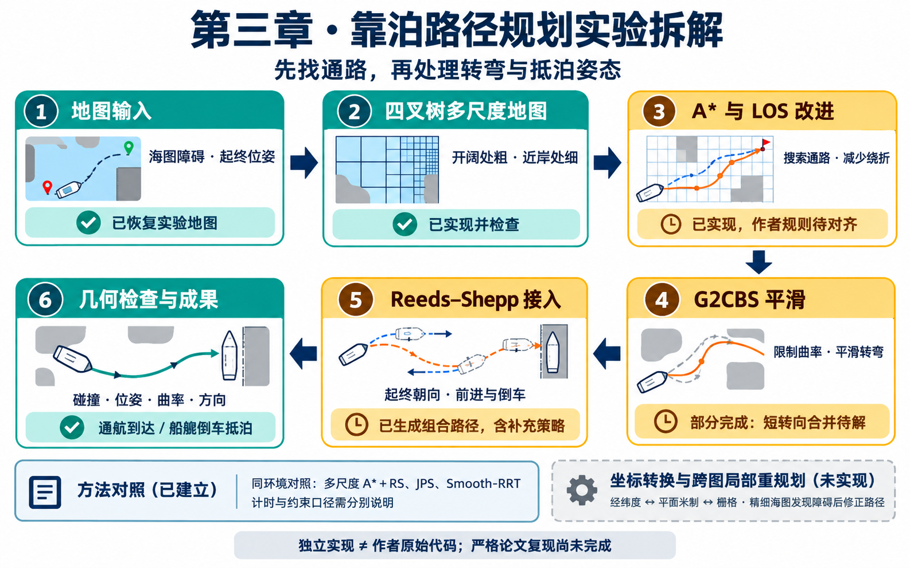
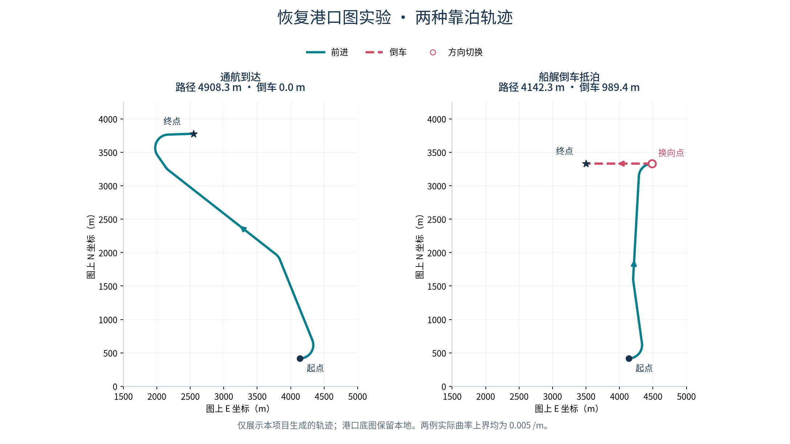
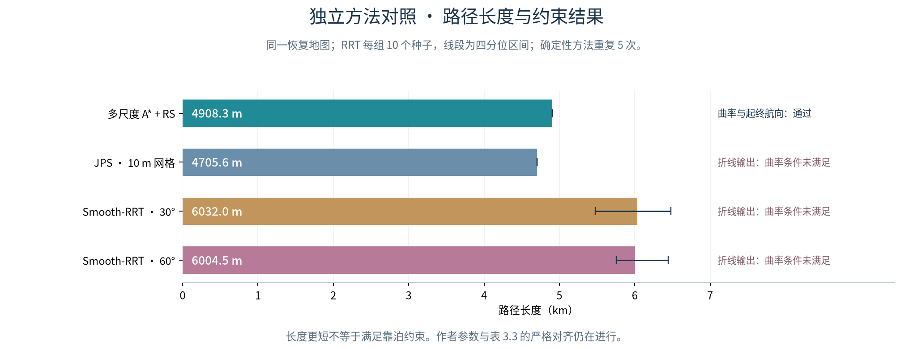

# 文献实验

**韩旭（2023）博士论文《船舶靠泊路径规划与模型预测航迹保持控制》**

第三章：基于多尺度 A* 算法的靠泊路径规划 · Python 独立学习复现

**一句话理解第三章：给船做一套“靠泊导航”——先用开阔处粗、近岸处细的地图找出避障通路，再把转弯变平顺，安排最后的朝向和进退动作，让船按要求抵达泊位。**

[框架图](#1框架图) · [项目结构](#2项目结构) · [学习路线](#3学习路线) · [文献实验解读](#4文献实验解读) · [成果展示](#5实验复现结果展示) · [完成清单](#6未完成部分说明) · [运行指南](#7项目运行指南)

## 1、框架图



## 2、项目结构

```text
hanxu-berthing-reproduction/
├── README.md                     项目首页：方法、成果、进度与运行入口
├── HANDOFF.md                    暂停状态与跨会话续接说明
├── configs/                      地图、算法参数、固定随机种子
├── src/berthing_planner/
│   ├── quadtree.py               四叉树与几何查询
│   ├── raster_map.py             恢复地图与规划图接口
│   ├── search.py                 普通 A*、父节点连接改进
│   ├── curves.py                 基本 G2CBS 与曲线检查
│   ├── g2_bisection.py           短航段角度二分构造
│   ├── reeds_shepp.py            RS 接口与候选检查
│   ├── rs_families.py            RS 解析路径族
│   ├── stitching.py              平滑前段与 RS 的组合接入
│   ├── stern_axis.py             船艉轴线接入补充策略
│   ├── jps.py                    JPS 对照
│   ├── smooth_rrt.py             Smooth-RRT 对照
│   └── pipeline.py               合成港口学习流程
├── scripts/                      地图恢复、实验运行、对照与绘图
├── tests/                        标准库算法检查
├── research_tests/               地图预处理检查
├── docs/                         原文对齐、来源、复现协议、首页图示
├── reports/                      阶段报告与固定基线回放
├── third_party/                  第三方代码来源与许可
├── requirements-reconstruction.txt  地图恢复／绘图环境版本记录
├── data/                         本地原始／处理数据目录
└── outputs/                      每次运行的结果、配置、快照与哈希
```

`outputs/`、原始 PDF、恢复地图和本机路径配置不上传 GitHub；仓库保留代码、报告、来源元数据及允许展示的生成成果。论文与第三方代码的来源见[来源说明](docs/05_sources.md)和[许可说明](third_party/README.md)。

## 3、学习路线

1. **先看整体效果：**阅读第 5 部分，再运行合成港口演示，分清“找到通路”和“满足靠泊姿态”的区别。
2. **弄清地图和搜索：**从 [S1 四叉树动手实验](docs/04_S1动手实验.md)开始，理解粗细区块、邻接、LOS 和 A*。
3. **逐个处理转弯与抵泊：**学习 G2CBS 的曲率限制，再看 RS 如何安排起终朝向、前进和倒车。
4. **回到论文条件：**比较恢复地图上的路径与方法对照，逐项检查参数、计时、节点和约束口径。
5. **最后攻克缺口：**短转向合并、作者策略对齐，以及第 3.3 节坐标转换与跨图局部重规划。

## 4、文献实验解读

### 为什么要把这些方法组合起来？

靠泊规划同时面临三个问题：地图划得太细会增加搜索量，直接找到的折线可能转不过去，抵达终点时还要满足船头朝向和倒车要求。因此，本章依次处理“地图规模、路径转弯、抵泊姿态”，为后续运动规划与控制提供路径。

### 各个模块具体解决什么？

| 模块与原文位置 | 通俗解释 | 本项目如何拆成实验 |
| --- | --- | --- |
| 四叉树，图 3.1—3.4 | 空旷水域少放节点，靠近障碍时细分，把计算用在需要精细判断的位置 | 恢复障碍地图，检查区块、邻接、端点归属和可达性 |
| A* 与 LOS，图 3.5—3.7 | A* 找整体通路；能直接连通时，减少沿区块逐级连接造成的绕折 | 先用 Dijkstra 核查普通 A*，再比较两种父节点规则解释；当前采用明确标注的 Theta 式回退 |
| G2CBS，图 3.8 | 把保留的折角变成受曲率限制的弯道；转弯空间不足时还需处理相邻转向 | 检查基本构造、角度二分、曲率和碰撞；多个短转向的合并仍未完成 |
| RS，图 3.9—3.13 | 用直线和圆弧组合起终姿态，允许前进、倒车，并惩罚过长倒车 | 检查位姿、半径、方向切换和接入；船艉算例另含明确补充的轴线策略 |
| 坐标与重规划，第 3.3 节 | 将经纬度、平面距离和栅格位置统一；精细海图发现新障碍后修正局部路线 | 已核对来源和公式，轴向／单位待独立验证；尚未实现实验 |

其中，**四叉树的“多尺度”**指同一规划图内区块大小不同；**跨海图的“多比例尺”**指不同海图覆盖范围与细节程度不同，二者需要分别验证。

### 应该怎样看论文结果？

原文用路径图和表 3.3 展示规划能力与方法对照。阅读时既要看路径长度和时间，也要看是否满足起终姿态、曲率及进退要求；表 3.3 没有单独分离每个模块的贡献。规划出的几何路径，也不能直接证明船已完成动力学跟踪或实船靠泊。

本项目第 5 部分展示的是**独立实现的实测输出**，不能替代论文报告值，也尚未完成表 3.3 的严格复现。

## 5、实验复现结果展示

### 成果图



上图来自已保存实验：左侧为通航到达，右侧为船艉倒车抵泊。仅展示生成轨迹，恢复港口底图保留本地。



### 关键数据

| 恢复港口图算例 | 路径长度 | 倒车距离 | 方向切换 | 最大曲率 | 中心线几何检查 |
| --- | ---: | ---: | ---: | ---: | --- |
| 通航到达 | **4908.3 m** | 0 m | 0 次 | 0.005 /m | 通过 |
| 船艉倒车抵泊 | **4142.3 m** | **989.4 m** | 1 次 | 0.005 /m | 通过 |

方法对照共 **77 次正式试验、15 次预热**；下表为基线地图中位数。RRT 每组 10 个固定种子，确定性方法各重复 5 次。

| 独立重建的方法 | 路径长度 | 本机时间 | 计时内容 |
| --- | ---: | ---: | --- |
| 多尺度 A*＋RS | 4908.3 m | 1.474 s | 搜索、平滑前段、两端 RS 及内部检查 |
| JPS，10 m 网格 | 4705.6 m | 0.136 s | 网格搜索 |
| Smooth-RRT，30° 转角限制 | 6032.0 m | 1.703 s | 树生长＋贪心简化 |
| Smooth-RRT，60° 转角限制 | 6004.5 m | 0.251 s | 树生长＋贪心简化 |

JPS 与同网格普通 A* 最短路一致。JPS 和当前 Smooth-RRT 输出仍是折线，不满足本次连续曲率与起终航向要求；各方法的计时与节点口径也不同，不能据此直接排名靠泊效果或宣称同约束速度优势。[完整方法对照](reports/R7_方法对照与来源差异.md)

## 6、未完成部分说明

**当前停在 R7 之后；R8 仅做了只读核对。**以下勾选表示所写的具体任务已完成，不表示整章已通过严格复现验收。

- ✅ 来源与参数登记：论文、期刊及 G2CBS／Smooth-RRT 参考文献已核查并记录。
- ✅ 地图与搜索：三阈值图像恢复、四叉树、普通 A* 与同图 Dijkstra 核查已完成。
- ✅ 改进搜索试验：两种父节点解释已比较，回退规则及差异已公开记录。
- ✅ 基本平滑：G2CBS 基本构造、角度二分及相应曲率检查已实现。
- ✅ 受控组合路径：通航到达、含倒车的船艉抵泊已生成并通过当前几何检查。
- ✅ 独立方法对照：JPS、Smooth-RRT 已运行；保存 77 次正式试验、15 次预热，最近 65 项标准库测试通过。
- ☐ **完成 G2CBS 多个相邻短转向的合并**，通过图 3.8 所对应的完整平滑验收。
- ☐ 取得或明确作者原始地图、邻域／父节点规则、RS 接入和倒车权重，补齐作者条件对齐。
- ☐ 明确作者 Smooth-RRT 的曲率处理、参数及统计口径，完成**表 3.3 严格对照**。
- ☐ 实现并独立验证经纬度／平面／栅格转换，解决轴向和比例单位疑点。
- ☐ 获取并核查 GSHHG 数据，完成第 3.3 节跨图与局部重规划实验。
- ☐ 完成第三章各项验收与整体复跑；个人理论理解验收另行记录。

续接时先读 [HANDOFF](HANDOFF.md) 和[暂停检查点](reports/暂停检查点_2026-10-29.md)，完整验收标准见[复现协议](docs/08_full_reproduction_protocol.md)。

## 7、项目运行指南

### 环境

| 用途 | 环境与依赖 |
| --- | --- |
| 合成演示、规划算法、标准库测试 | Python **3.12**，无第三方运行依赖，使用项目 `.venv` |
| 论文地图恢复、预处理与绘图 | Python 3.12＋PyMuPDF、NumPy、Pillow、SciPy、Matplotlib；版本见 [requirements-reconstruction.txt](requirements-reconstruction.txt) |

以下命令从项目根目录运行，适用于 macOS／Linux。Windows 将 `.venv/bin/python` 换成 `.venv\Scripts\python.exe`；PowerShell 测试前设置 `$env:PYTHONPATH="src"`。

### 流程 A：先运行可随仓库复跑的合成港口演示

```bash
git clone https://github.com/xxz007/hanxu-berthing-reproduction.git
cd hanxu-berthing-reproduction
python3.12 -m venv --without-pip .venv
.venv/bin/python scripts/check_environment.py
.venv/bin/python scripts/run_demo.py
```

私有仓库需要有访问权限；已有本地项目时跳过克隆，已有 `.venv` 时跳过创建环境。运行后打开新生成的 `outputs/<UTC时间>_full_demo/index.html`，可回放各阶段和进退过程。该流程无需论文 PDF，使用**自建合成港口**。

标准库测试：

```bash
PYTHONPATH=src .venv/bin/python -m unittest discover -s tests -v
```

### 流程 B：从本地论文重建港口场景并运行组合实验

**准备材料与科研环境。**需要与[来源登记](docs/source_manifest.json)哈希一致的学位论文 PDF；文件不同会停止，需重新核对图像与标定。本机已具备科研环境，可直接指定：

```bash
source /Users/omo/Documents/AI-Research-Workbench/activate-research-env.zsh
research_python=/Users/omo/Documents/AI-Research-Workbench/.venv/bin/python
```

其他电脑可另建科研环境；以下是需要安装预处理／绘图库时的准备命令，不影响标准库规划环境：

```bash
python3.12 -m venv venv/reconstruction
venv/reconstruction/bin/python -m pip install -r requirements-reconstruction.txt
research_python=venv/reconstruction/bin/python
```

**按顺序运行。**将第一行改为自己的学位论文路径；本组命令在同一个终端执行。时间标记使每次运行写入新目录。

```bash
thesis_pdf="/填写你的路径/船舶靠泊路径规划与模型预测航迹保持控制_韩旭.pdf"
run_tag=$(date -u +%Y%m%dT%H%M%SZ)
paper_run="outputs/${run_tag}_paper_rerun"

# 1. 提取与标定 → 2. 中心线恢复，生成三种阈值地图
"$research_python" scripts/reconstruct_paper_map.py \
  --source-pdf "$thesis_pdf" --output-dir "${paper_run}_r0"
"$research_python" scripts/refine_paper_map.py \
  --input-dir "${paper_run}_r0" --output-dir "${paper_run}_r1"

# 3. 普通与改进搜索 → 4. 平滑前段与 RS 组合
.venv/bin/python scripts/run_paper_search.py \
  --map-dir "${paper_run}_r1" --output-dir "${paper_run}_r2_r3"
.venv/bin/python scripts/run_paper_combination.py \
  --map-dir "${paper_run}_r1" --search-dir "${paper_run}_r2_r3" \
  --output-dir "${paper_run}_r5_r6"

# 5. 绘制组合路径 → 6. 运行并绘制方法对照
"$research_python" scripts/plot_paper_combination.py --input-dir "${paper_run}_r5_r6"
.venv/bin/python scripts/run_comparison_r7.py \
  --map-dir "${paper_run}_r1" --output-dir "${paper_run}_r7"
"$research_python" scripts/plot_comparison_r7.py --input-dir "${paper_run}_r7"
```

若某一步失败，先检查该步输出与报告，再继续后续命令。组合脚本保留失败候选，不会因此把未完成的短转向合并算作通过。地图预处理检查可用 `"$research_python" -m unittest discover -s research_tests -v` 单独执行。

各阶段在指定的 `outputs/` 子目录保存结果及相应配置、输入／源码哈希；脚本拒绝覆盖已有运行目录。地图恢复、平滑审计与验收细节见[完整复跑协议](docs/08_full_reproduction_protocol.md)。
