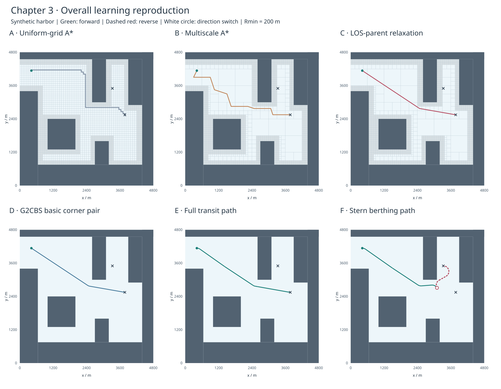

# 船舶靠泊路径规划 · 第三章学习复现

以韩旭 2023 年博士论文《船舶靠泊路径规划与模型预测航迹保持控制》第三章为依据，使用 Python 学习并复现路径规划流程。

**首版已跑通整体流程：四叉树 → 多尺度 A* → LOS 父节点候选改进 → G2CBS 基本转角平滑 → Reeds–Shepp 起终位姿衔接与船艉抵泊。**

当前是**替代地图上的方法流程复现**，尚未完成长滩港原图或表3.3的严格数值复现。理论窗口继续精读、推导和手动验收；本项目先看整体效果，再逐块攻坚。代码运行通过不代表学习者已理解或通过验收。

**原图复现进展：**全局中心线恢复已通过重建地图的拓扑、端点和可见网格对照检查；普通A*在两个算例、三个阈值上与同图Dijkstra一致。父节点改进保留两种解释，作者一致性尚未确认。见[完整执行顺序](docs/08_full_reproduction_protocol.md)、[R1–R3阶段记录](reports/R1_R3_原图搜索阶段记录.md)和[父节点解释审计](docs/09_parent_policy_audit.md)。此前[R1粗墨迹失败](reports/R1_原图恢复初检.md)及v0.1基线保留不动。预处理／研究绘图使用现有workbench环境，与下方标准库主规划环境分开。

**G2CBS原文已补齐：**用户提供的2010论文共8页，核心构造已交叉检查，标准库测试43项通过。原图试算分开保留了短段重叠、曲线碰撞和简化后通过的结果；短转角合并仍未解决。见[R4原文核查与试算](reports/R4_G2CBS原文核查与原图试算.md)。

**原图组合诊断：**直接使用原始搜索点的有效平滑前段，通航约4908.3 m；船艉约4142.3 m、倒车989.4 m，后者需要明确补充的轴线接入候选。56项测试通过。经典候选失败、航向／阈值敏感性和曲率跳变均保留，完整短转角合并仍未解决。见[原图组合阶段报告](reports/R5_R6_原图组合路径阶段记录.md)。



绿色实线为前进，红色虚线为倒车，白圈为前进／倒车切换位置。地图为自建矩形港口，不是论文长滩港地图。船形与回放是几何示意，未模拟船体、速度或动力学。

## 先运行起来

需要 **Python 3.12**。算法、测试和网页报告只使用标准库，无需安装第三方依赖。

```bash
# 已下载或克隆仓库后，进入仓库目录
python3.12 -m venv --without-pip .venv
.venv/bin/python scripts/run_demo.py
```

Windows 可使用 `py -3.12 -m venv --without-pip .venv`，再用 `.venv\Scripts\python.exe` 替代上述解释器路径。

命令会打印一个新的 `outputs/<UTC时间>_full_demo/` 目录。**打开其中的 `index.html`**，可选择通航／船艉抵泊算例，播放、暂停或拖动路径进度，并查看六张阶段对照图。报告不访问外部服务，不上传数据。GitHub 文件预览不执行 HTML，克隆后本地打开即可。

- 在本机当前项目中，独立 `.venv` 已建立，可直接运行第二条命令。
- [固定基线回放](reports/baseline/v0.1/index.html)随代码保存，方便和重跑结果对照。
- [首版实验报告](reports/整体流程基线_v0.1.md)解释数据、指标、验证和限制。
- 先单看四叉树：`.venv/bin/python scripts/run_s1.py`，配套 [S1 动手指南](docs/04_S1动手实验.md)。

运行测试：

```bash
PYTHONPATH=src .venv/bin/python -m unittest discover -s tests -v
```

Windows PowerShell 可先设置 `$env:PYTHONPATH="src"`，再执行 `.venv\Scripts\python.exe -m unittest discover -s tests -v`。

## 目前看到了什么

默认配置 [harbor_demo.json](configs/harbor_demo.json) 的本机实际结果：

| 算例 | 路径长（m，近似） | 倒车长度（m） | 方向切换 | 最大曲率（m⁻¹） | 几何检查 |
| --- | ---: | ---: | ---: | ---: | --- |
| 通航到达 | 3796.1 | 0.0 | 0 | 0.005 | 通过 |
| 船艉抵泊 | 4265.2 | 1129.5 | 1 | 0.005 | 通过 |

路径长度按不超过 5 m 的采样折线近似；倒车长度按 RS 基元精确相加。检查包括起终位置、船首角、相邻段衔接、方向要求、曲率数值极值与连续曲线中心线碰撞。**RS 衔接允许曲率跳变，完整路径不保证 G² 连续。**

两算例分别使用原文的终点 `(3777,2548,0)` 与 `(3330,3500,0)`，起点均为 `(417,4138,0)`；程序角度单位为弧度。坐标数值一致不代表地理场景一致。

## 与论文对齐到哪里

| 环节 | 首版实现 | 证据边界 |
| --- | --- | --- |
| 地图、四叉树 | 矩形障碍港口，最大深度6，最小单元75 m | 原文图3.4为深度7；原始地图未取得；陆地内部填充占据 |
| 邻接、LOS | 正长度共边邻接；整段与闭矩形相交 | 原文用外缘搜索点和采样／平行线LOS；此处为几何参照实现 |
| A* | 均匀网格基线、多尺度A* | 同图、同最小尺度、欧氏代价；没有以理论节点少代替实测加速 |
| 父节点改进 | Theta* 风格候选松弛；另行记录贪心LOS简化 | 第37页没有完整伪代码；不声称是作者更新规则 |
| G2CBS | 对称双三次 Bézier 螺旋转角对，Rmin=200 m | 参考 MIT MATLAB 实现；缺少论文提到的短转角合并，遇到重叠则拒绝 |
| RS | 12个解析族及时间反转／镜像；按前进＋2×倒车筛选无碰撞候选 | 解析族来自固定版本 PythonRobotics；权重2为工程设置；有限候选不保证加权全局最优 |
| 靠泊接入 | 后1/3路径上约100 m间隔尝试末段RS；起段也用RS满足初始朝向 | 锚点按采样弧长近似，不是在线船舶航行；起段选择策略为工程补全 |
| 碰撞余量 | 搜索图膨胀150 m；曲线验证对障碍加30 m余量 | 均为首版设置，不是论文船型参数，不代表船体安全 |
| 坐标转换、重规划、对比算法 | 待后续补齐 | 尚未实现3.3节实图标定、Smooth-RRT、JPS或表3.3复现 |

详细页码、来源和差异见 [原文对齐表](docs/03_paper_alignment.md) 与 [第三方来源](docs/05_sources.md)。第4、5章的 MPC、MHE 和闭环动力学不在本版范围内。

## 项目结构

```text
.
├── README.md
├── AGENTS.md / HANDOFF.md       # 实验规范与跨窗口交接
├── pyproject.toml              # Python 3.12；零第三方运行依赖
├── configs/                    # 可运行配置、论文参考值（分开）
├── data/raw/                   # 本地原始资料，不入Git
├── docs/                       # 来源、对齐、动手步骤与复现计划
├── src/berthing_planner/
│   ├── quadtree.py             # S1：分区、查询、邻接、LOS
│   ├── search.py               # A*、LOS父节点候选、独立简化
│   ├── curves.py               # G2CBS、解析曲线、曲率与碰撞检查
│   ├── rs_families.py          # 有来源和许可的RS解析族
│   ├── reeds_shepp.py          # 候选枚举、方向和倒车代价
│   └── pipeline.py             # 两个算例的整体衔接
├── scripts/                    # run_demo.py、run_s1.py、来源检查
├── tests/                      # 标准库 unittest
├── third_party/                # MIT许可与版本说明
├── reports/baseline/v0.1/       # 固定配置、轨迹、指标、图与网页
└── outputs/                    # 每次运行的独立证据目录，不入Git
```

## 改一个变量，再观察

复制配置后使用：

```bash
.venv/bin/python scripts/run_demo.py --config configs/my_experiment.json
```

建议每次只改一个量：四叉树深度、`reverse_weight`、障碍位置或最小转向半径（`maximum_curvature=1/Rmin`）。先记录预测，再看路径、方向切换、展开节点、曲率和失败原因。不是所有地图和参数都有可行结果；平滑转角重叠、曲线碰撞或RS接入失败会明确报错，不会强行画一条通过的路径。

每次运行保存完整配置、代码快照与SHA-256、Python／平台版本、Git状态、轨迹CSV、解析基元JSON、指标与HTML报告。不覆盖已有运行目录。时间指标是单次运行诊断，尚不是重复测量的性能基准。

## 学习路线

1. 先运行整体报告，比较A*折线、父节点简化、平滑和RS各自解决的问题。
2. 回到S1，手算四叉树、点查询、邻接与LOS，对照程序输出。
3. 拆S2：open／closed、`g+h`、路径父节点与空间父节点，逐次展开。
4. 拆S3／S4：G2CBS控制点、曲率、RS归一化、正负长度、倒车代价与接入。
5. 补齐原始地图、作者算法细节、短转角合并和3.3节坐标关系，再做论文图表对齐。

## 原文与许可

韩旭，大连海事大学，工学博士，2023；导师张显库。第三章正文33–48页，对应PDF物理45–60页。PDF仅本地阅读，仓库不分发论文或理论笔记。[来源清单](docs/source_manifest.json)记录题录与哈希；可用 `scripts/check_environment.py --source-pdf <本地PDF路径>`核验自己持有的文件。

这是个人学习项目。第三方解析族与G2CBS参考实现按各自MIT许可注明；自编代码暂未设置开源许可证。私有仓库的可见性不赋予论文、地图或其他资料的再分发许可。
