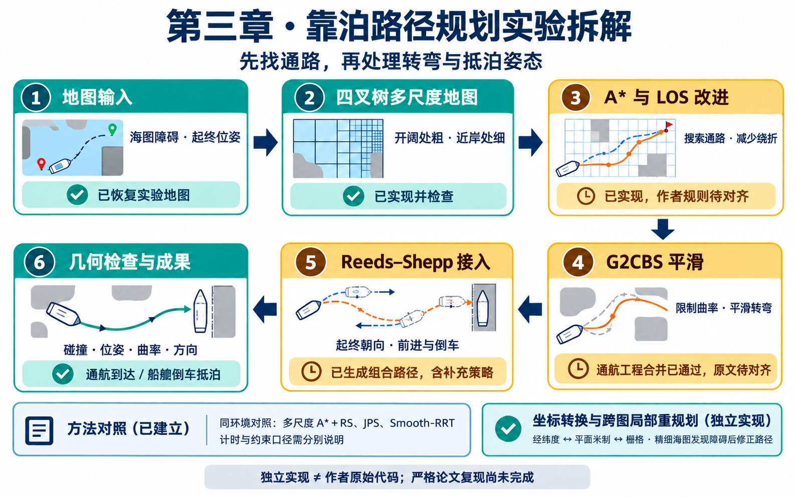
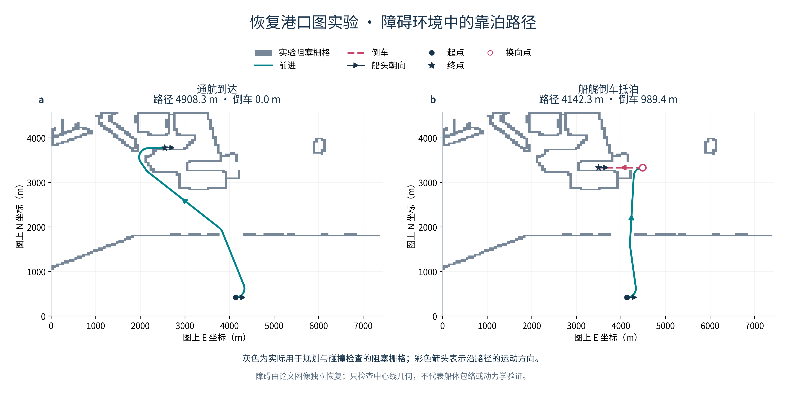
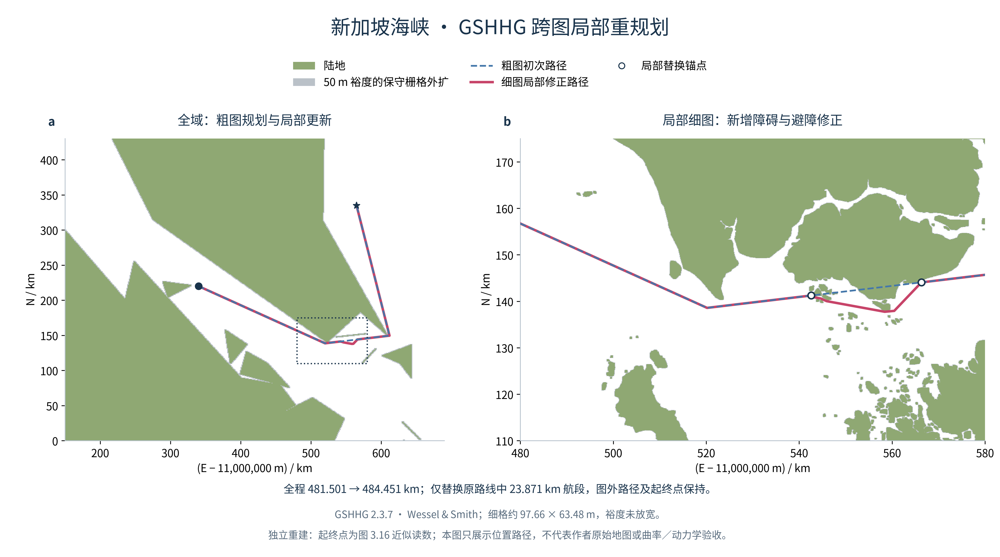
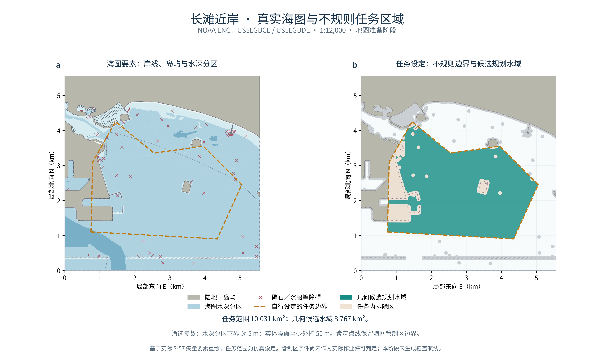
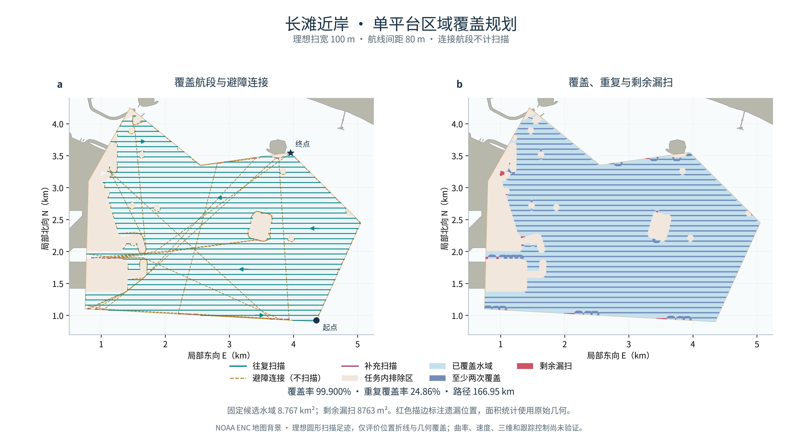
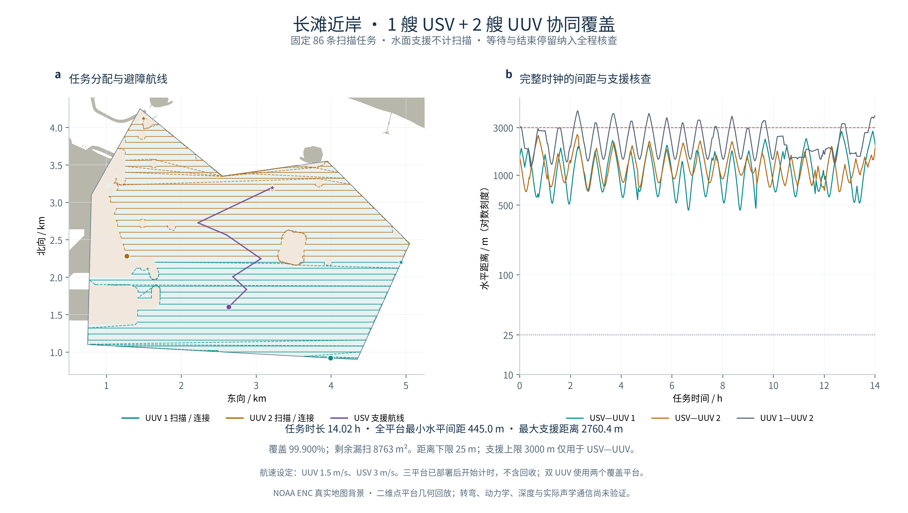
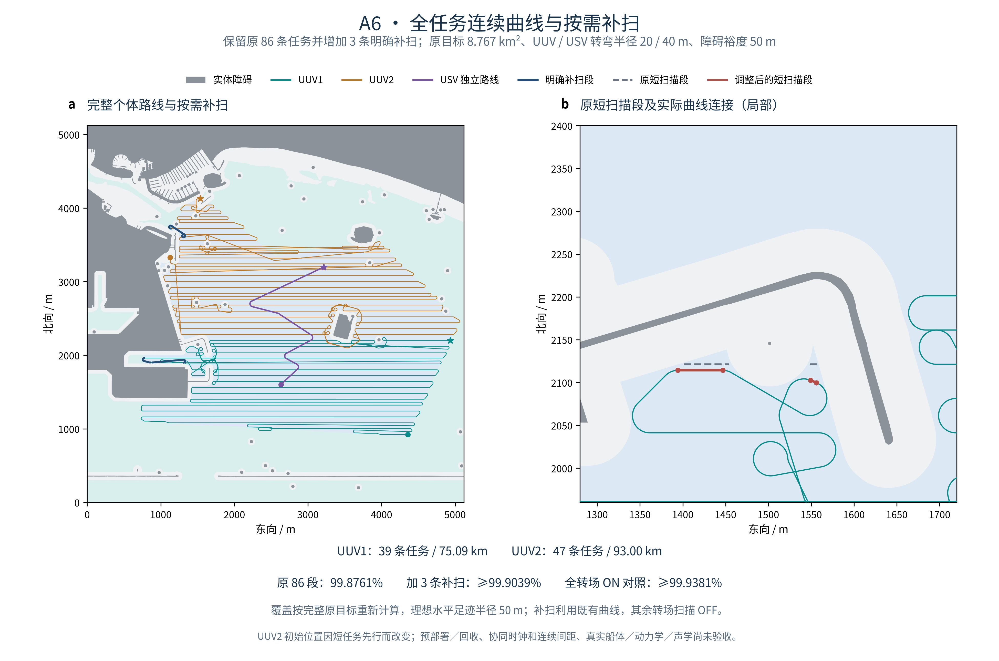
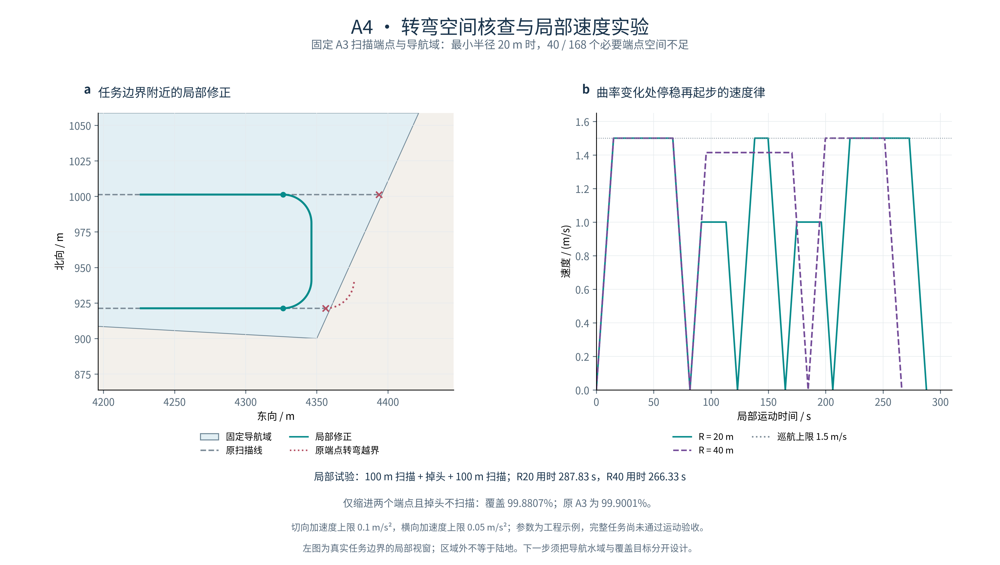
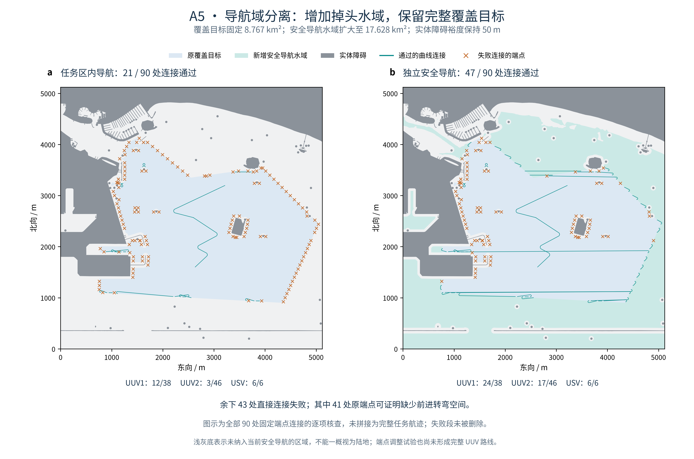
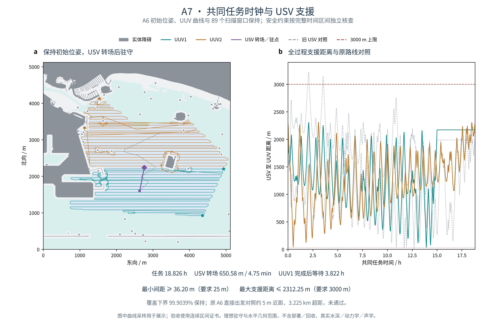

# 文献实验

**船舶靠泊路径规划与 USV/UUV 协同覆盖 · Python 独立学习实现**

以韩旭（2023）博士论文《船舶靠泊路径规划与模型预测航迹保持控制》第三章为基础，包含靠泊路径规划方法的独立实现，以及真实海图中的区域覆盖与协同支援扩展。

**一句话理解第三章：给船舶做一套“靠泊导航”——先在开阔处粗、近岸处细的地图找出避障通路，再把转弯变平滑，安排最后的朝向和进退动作，让船按要求抵达泊位。**

[框架图](#1框架图) · [项目结构](#2项目结构) · [学习路线](#3学习路线) · [文献实验解读](#4文献实验解读) · [成果展示](#5实验复现结果展示) · [运行指南](#6项目运行指南)

## 1、框架图



## 2、项目结构

```text
hanxu-berthing-reproduction/
├── README.md                     项目简介、成果与运行入口
├── configs/                      地图、算法参数、固定随机种子
├── src/berthing_planner/          搜索、平滑、覆盖与协同规划核心
├── scripts/                      地图恢复、实验运行、对照与绘图
├── tests/                        标准库算法检查
├── research_tests/               地图预处理检查
├── docs/                         方法、实验、来源、参数说明与成果图示
├── reports/                      固定合成示例与可浏览的结果
├── third_party/                  第三方代码来源与许可
├── requirements-reconstruction.txt  地图恢复／绘图环境版本记录
├── data/                         本地原始／处理数据目录
└── outputs/                      每次运行的结果、配置、快照与哈希
```

<details>
<summary>展开核心算法模块</summary>

```text
src/berthing_planner/
├── quadtree.py               四叉树与几何查询
├── raster_map.py             恢复地图与规划图接口
├── search.py                 普通 A*、父节点连接改进
├── curves.py                 基本 G2CBS 与曲线检查
├── g2_bisection.py           短航段角度二分构造
├── g2_merge.py               明确标注的短转向工程合并
├── reeds_shepp.py            RS 接口与候选检查
├── rs_families.py            RS 解析路径族
├── stitching.py              平滑前段与 RS 的组合接入
├── stern_axis.py             船艉轴线接入补充策略
├── jps.py                    JPS 对照
├── smooth_rrt.py             Smooth-RRT 对照
├── coordinates.py           墨卡托投影与栅格坐标
├── gshhg.py                 真实海岸线读取与裁剪环
├── occupancy.py             填陆地图四叉树与几何查询
├── replanning.py            细图受阻航段局部替换
├── coverage.py              扫描航线与关闭扫描的避障连接
├── cooperative_allocation.py  两艘 UUV 的任务分带与路线
├── mission_timing.py        折线基线赋时、等待与间距核查
├── curved_timing.py         变速曲线共同时间轴与连续距离证书
├── scheduled_timing.py      多次曲线转场、段间等待与支援范围分类
├── motion_feasibility.py    转弯空间必要条件与局部启停速度律
├── joint_coverage.py        扫描位置／朝向／顺序候选与分层搜索
├── maneuver_search.py      有界前进位姿搜索与曲线连接
└── pipeline.py               合成港口学习流程
```

</details>

## 3、学习路线

1. **先看整体效果：** 阅读第 5 部分，再运行合成港口演示，分清“找到通路”和“满足靠泊姿态”的区别。
2. **弄清地图和搜索：** 从 [S1 四叉树动手实验](docs/experiments.md#s1)开始，理解粗细区块、邻接、LOS 和 A*。
3. **逐个处理转弯与抵泊：** 学习 G2CBS 的曲率限制，再看 RS 如何安排起终朝向、前进和倒车。
4. **回到论文条件：** 比较恢复地图上的路径与方法对照，逐项检查参数、计时、节点和约束口径。
5. **最后攻克缺口：** 短转向合并、作者策略对齐，以及第 3.3 节坐标转换与跨图局部重规划。

## 4、文献实验解读

### 为什么要把这些方法组合起来？

靠泊规划同时面临三个问题：

1. 地图划得太细会增加搜索量。
2. 直接找到的折线可能转不过去。
3. 抵达终点时还要满足船头朝向和倒车要求。

因此，本章依次处理“地图规模、路径转弯、抵泊姿态”，为后续运动规划与控制提供路径。

### 各个模块具体解决什么？

| 模块与原文位置 | 通俗解释 | 本项目如何拆成实验 |
| --- | --- | --- |
| 四叉树，图 3.1—3.4 | 空旷水域少放节点，靠近障碍时细分，把计算用在需要精细判断的位置 | 1、恢复障碍地图；<br>2、检查区块、邻接、端点归属与可达性。 |
| A* 与 LOS，图 3.5—3.7 | A* 找整体通路；能直接连通时，减少沿区块逐级连接造成的绕折 | 1、先用 Dijkstra 核查普通 A*；<br>2、再比较两种父节点规则解释（当前采用明确标注的 Theta 式回退）。 |
| G2CBS，图 3.8 | 把保留的折角变成受曲率限制的弯道；转弯空间不足时还需处理相邻转向 | 1、检查基本构造与角度二分；<br>2、通航工程合并与全段检查通过；<br>3、船艉完整平滑及作者合并规则仍待解决。 |
| RS，图 3.9—3.13 | 用直线和圆弧组合起终姿态，允许前进、倒车，并惩罚过长倒车 | 1、检查位姿、半径与方向切换；<br>2、核查 RS 接入；<br>3、船艉算例采用明确补充的轴线策略。 |
| 坐标与重规划，第 3.3 节 | 将经纬度、平面距离和栅格位置统一；精细海图发现新障碍后修正局部路线 | 1、核对来源与公式；<br>2、投影与栅格转换通过独立验证；<br>3、真实 GSHHG 跨图局部重规划通过（独立条件，作者原图待对齐）。 |

以上对应论文第三章；真实海图覆盖与 USV/UUV 协同属于独立应用扩展。[方法差异与适用范围](docs/methods.md) · [文献、数据与许可](docs/sources.md)

## 5、实验复现结果展示

[靠泊路径与方法对照](#berthing-results) · [跨图重规划](#cross-chart-results) · [覆盖与协同扩展](#coverage-results) · [驻守支援成果](#a7-results)

本节区分论文相关独立实验与应用扩展。论文原图、原表未全部严格对齐；应用结果采用明确的二维模型，不能代替真实船体控制或声学验证。

### 5.1 靠泊路径与方法对照

恢复港口图实验包含通航到达与船艉倒车抵泊。障碍、方向与几何核查一并展示；合成演示与恢复图数值分别记录。

<a id="berthing-results"></a>
#### 通航与船艉倒车抵泊



左侧为通航到达，右侧为船艉倒车抵泊。灰色为实验实际使用的恢复障碍栅格，青色为前进、红色虚线为倒车；深色箭头标出起终船头朝向，空心圆为换向点。

<a id="关键数据"></a>

<table width="840">
  <thead>
    <tr>
      <th width="170">恢复港口图算例</th>
      <th width="125">路径长度</th>
      <th width="115">倒车距离</th>
      <th width="110">方向切换</th>
      <th width="125">最大曲率</th>
      <th width="195">中心线几何检查</th>
    </tr>
  </thead>
  <tbody>
    <tr>
      <td align="left">通航到达</td>
      <td align="right"><strong>4908.3 m</strong></td>
      <td align="right">0 m</td>
      <td align="right">0 次</td>
      <td align="right">0.005 /m</td>
      <td align="left">通过</td>
    </tr>
    <tr>
      <td align="left">船艉倒车抵泊</td>
      <td align="right"><strong>4142.3 m</strong></td>
      <td align="right"><strong>989.4 m</strong></td>
      <td align="right">1 次</td>
      <td align="right">0.005 /m</td>
      <td align="left">通过</td>
    </tr>
  </tbody>
</table>

#### 独立方法对照


方法对照共 **77 次正式试验、15 次预热**；下表为基线地图中位数。RRT 每组 10 个固定种子，确定性方法各重复 5 次。

<table width="840">
  <thead>
    <tr>
      <th width="275">独立重建的方法</th>
      <th width="125">路径长度</th>
      <th width="115">本机时间</th>
      <th width="325">计时内容</th>
    </tr>
  </thead>
  <tbody>
    <tr>
      <td align="left">多尺度 A*＋RS</td>
      <td align="right">4908.3 m</td>
      <td align="right">1.474 s</td>
      <td align="left">搜索、平滑前段、两端 RS 及内部检查</td>
    </tr>
    <tr>
      <td align="left">JPS，10 m 网格</td>
      <td align="right">4705.6 m</td>
      <td align="right">0.136 s</td>
      <td align="left">网格搜索</td>
    </tr>
    <tr>
      <td align="left">Smooth-RRT，30° 转角限制</td>
      <td align="right">6032.0 m</td>
      <td align="right">1.703 s</td>
      <td align="left">树生长＋贪心简化</td>
    </tr>
    <tr>
      <td align="left">Smooth-RRT，60° 转角限制</td>
      <td align="right">6004.5 m</td>
      <td align="right">0.251 s</td>
      <td align="left">树生长＋贪心简化</td>
    </tr>
  </tbody>
</table>

JPS 与同网格普通 A* 最短路一致。JPS 和当前 Smooth-RRT 输出仍是折线，不满足本次连续曲率与起终航向要求；各方法的计时与节点口径也不同，不能据此直接排名靠泊效果或宣称同约束速度优势。[完整方法对照](docs/experiments.md#paper-comparison)

<a id="cross-chart-results"></a>
### 5.2 真实岸线跨图重规划



- **真实数据**：GSHHG 2.3.7 粗、细岸线；图中填充陆地，并保守外扩 50 m 裕度。
- **实际效果**：初次路径进入细图后穿过 191 个阻塞格，局部修正后为 0；全程由 **481.501 km** 变为 **484.451 km**。
- **保留原路线**：只替换原路径中 **23.871 km** 航段，全球起终点、图外前后段不变，裕度没有放宽。
- **复现边界**：端点是图 3.16 的近似读数，海图分辨率为独立设置；栅格裕度比精确矢量 50 m 更保守，结果尚未与作者原图严格对齐。[实验报告](docs/experiments.md#cross-chart)

<a id="coverage-results"></a>
### 5.3 真实海图覆盖与协同扩展

按“地图 → 覆盖 → 分工 → 曲线约束 → 共同时间轴 → 策略对照”展示。A7 为驻守支援参考，A8 在相同 UUV 任务下比较收紧支援范围后的移动成本；不同阶段的运动模型不直接作为效率排名。

#### 真实海图与任务区域（A1）



应用扩展使用两幅 **1:12,000 NOAA ENC**，任务范围 **10.031 km²**，筛选后得到 **8.767 km²**、保持连通的几何候选水域。

- **地图准备完成**：保留真实岸线、岛屿、浅水与障碍；候选区域与原始障碍最小间距 **50.48 m**。
- **边界说明**：任务范围、5 m 水深下界和至少 50 m 裕度为仿真设定；海图管制信息单独保留，当前只评价几何空间。
- **阶段关系**：本地图已作为 A2 单平台覆盖实验的固定输入。[地图实验说明](docs/experiments.md#a1)

#### 单平台区域覆盖（A2）



- **覆盖效果**：理想扫宽 **100 m**、间距 **80 m**；66 条常规扫描腿加 20 条补扫腿后，覆盖 **99.900%**，剩余漏扫 **8763 m²**，重复覆盖 **24.862%**。
- **完整路线**：扫描 **109.570 km**，避障与转场连接 **57.385 km**，总长 **166.955 km**；连接腿不计扫描，整条路径未检出阻塞格碰撞。
- **保留边界**：原始 **8.767 km²** 目标没有缩小；离散小区的漏扫单独保留。该实验只评价几何折线与理想足迹，有限曲率路线和协同模型另有实验。[实验说明](docs/experiments.md#a2)

#### 多平台分工与回放（A3）



- **任务分工**：原有 86 条扫描任务完整保留，UUV 1 承担 **39 条、75.16 km**，UUV 2 承担 **47 条、75.71 km**；USV 沿 **3.10 km** 的航线转场并驻点支援。
- **时间效果**：UUV 设为 **1.5 m/s**、USV 设为 **3 m/s**；预部署后的任务时长为 **14.02 h**。同样任务排序的单 UUV 对照为 **28.23 h**，双 UUV 使用两个覆盖平台。
- **全程核查**：三平台原始阻塞格碰撞均为 **0**；全时钟最小水平间距 **445 m**，最大 USV–UUV 支援距离 **2760 m**，满足本次 **25 m / 3000 m** 设定。
- **覆盖与边界**：仍为 **99.900%**，保留 **8763 m²** 漏扫；已生成可拖动时间、播放与暂停的本地回放。该折线基线只验证二维几何与时序；有限转弯曲线见 A6–A8，真实动力学、声学及部署／回收不在验证范围。[实验说明与回放入口](docs/experiments.md#a3)

#### 有限曲率路线与按需补扫（A6）



- **完整路线**：两艘 UUV 保留原 **39 / 47 条任务**，路线分别为 **75.09 / 93.00 km**；USV 独立路线 **3.18 km**。UUV / USV 最小转弯半径设为 **20 / 40 m**，只前进、保持原 **50 m** 障碍裕度。
- **短段修复**：调整扫描位置与朝向；UUV2 将邻近三条短任务放到开头连续完成，因此初始位置随之改变。原 **8.767 km²** 目标与全部 86 个原任务 ID 均保留。
- **按需补扫**：仅原 86 个调整后扫描段覆盖 **99.8761%**；明确增加 **3 个曲线补扫任务**后，保守覆盖下界达到 **99.9039%**，漏扫面积不超过 **8424 m²**。其余转场保持扫描关闭。
- **代价与范围**：补扫沿用现有曲线，在当前模型内不增加航行距离和运动时间，合计增加约 **14.9 分钟**扫描开启。已验证个体几何、启停速度和理想 50 m 水平圆形足迹；协同时钟和连续间距见 A7/A8 实验，部署／回收不在验证范围。[实验说明、策略对照与运行入口](docs/experiments.md#a6)

<details>
<summary><strong>转弯约束与导航域核查（A4/A5，支撑实验）</strong></summary>

#### 转弯空间与局部运动核查（A4）



- **空间核查**：在固定导航域、只前进且不能原地转向的模型下，最小半径 **20 m** 时，至少 **40 / 168** 个必要扫描端点空间不足，涉及 **36 条任务**。
- **局部修正**：构造半径 **20 / 40 m** 的掉头曲线并加入启停、切向与横向加速度限制；六组局部实验独立审计通过，原始闭格碰撞均为 **0**。这是局部运动验证，完整任务尚未通过运动验收。
- **覆盖影响**：名义 20 m 方案只退回两个端点，掉头不扫描时覆盖从 **99.9001%** 降为 **99.8807%**；沿用原足迹数值模型时，开启转弯扫描的对照仍低于 99.9% 门槛。原完整目标与 A3 基线均保留。
- **建模结论**：任务边界不等于障碍边界，A5 已分开安全导航水域与覆盖目标，完整个体曲线与协同时钟分别见 A6、A7/A8 实验。[核查推导、参数对照与运行入口](docs/experiments.md#a4)

#### 安全导航域与转弯连接（A5）



- **导航域分离**：覆盖目标仍为 **8.767 km²**，安全导航水域扩大至 **17.628 km²**；原 50 m 障碍裕度保持，新增水域只用于通行和掉头。
- **逐段连接**：保留原 86 条扫描任务，90 处必需连接中，通过整段曲线检查的数量从 **21 处增至 47 处**。UUV / USV 最小转弯半径设为 **20 / 40 m**。
- **失败定位**：余下 43 处中，**41 处原端点缺少必要转弯空间**；另两处仅为当前候选搜索失败。端点调整后仍卡在两条短扫描段和一处绕障连接，尚未形成完整 UUV 路线。
- **结果边界**：该对照只评价导航域与曲线连接；A3 的覆盖率与 14.02 h 属于不同的折线模型。[实验解读、失败原因与运行入口](docs/experiments.md#a5)

</details>

<a id="a7-results"></a>
#### 共同任务时钟与驻守支援（A7）



- **怎样协作**：保留 A6 三平台初始位姿、两艘 UUV 曲线和全部 **89 个扫描窗口**；USV 从原起点转场约 **651 m**，约 **4.75 分钟**后到达支援驻点并驻守。
- **任务时间**：共同任务约 **18.826 小时**，UUV1 先完成后等待约 **3.822 小时**；原目标、50 m 障碍裕度及 **99.9039% 理想覆盖下界**保持。
- **全过程核查**：最小水平间距保守下界 **36.20 m**，最大支援距离保守上界 **2.31225 km**，满足 **25 m / 3 km** 要求。原 A6 三条独立曲线直接同时出发会出现约 **5 m** 近距和 **3.225 km** 超距，不能直接作为协同结果。
- **验证与范围**：连续时间区间核查与干净代码复跑通过，提供共同时间轴回放。本阶段是二维运动与理想驻守模型，真实控制、洋流、深度、声学及部署／回收仍需后续验证。[实验解读与连续时间核查](docs/experiments.md#a7) · [数值汇总](docs/curved_cooperation_a7_summary.json)

#### 移动支援与范围对照（A8）


- **对照条件**：保持 A7 三平台初始位姿、两艘 UUV 曲线／速度和 **89 个扫描窗口**，比较原驻守与分段移动；25 m 安全间距和原 50 m 障碍裕度不变。
- **收紧支援范围**：在 **2300 m** 条件下，原驻守方案超距；分 11 次转场的移动方案通过，最大支援距离保守上界 **2295.48 m**，最小间距保守下界 **41.99 m**。
- **航程代价**：USV 从 **0.651 km** 增至 **10.173 km**，约为原来的 **15.64 倍**；任务仍为 **18.826 小时**，理想覆盖下界仍为 **99.9039%**。移动支援的收益和航行成本需一起衡量。
- **适用边界**：初始位置已要求支援范围至少 **2289.56 m**；2290 m 下当前两套方案均失败，尚不能据此判定所有策略无解。独立连续核查通过；当前是离线二维规划与理想等待，真实控制、洋流及声学仍需后续验证。[实验解读与完整对照](docs/experiments.md#a8) · [数值汇总](docs/support_sensitivity_a8_summary.json)

## 6、项目运行指南

### 环境准备

| 运行内容 | 环境要求 |
| --- | --- |
| 合成港口演示、核心算法测试 | Python **3.12**，只使用标准库 |
| 真实海图处理、覆盖规划与结果绘图 | Python 3.12，以及 [requirements-reconstruction.txt](requirements-reconstruction.txt) 中的依赖 |
| 海图读取、栅格生成与独立坐标核查 | GDAL 命令行工具、GEOS 动态库、PROJ；不由 Python 依赖文件自动安装 |

真实海图流程已验证的环境为 macOS、Python 3.12.14、GDAL 3.8.5、GEOS 3.14.1、PROJ 9.7.1。Python 依赖版本以仓库记录为准。

首次使用，在终端执行：

```bash
git clone https://github.com/xxz007/hanxu-berthing-reproduction.git
cd hanxu-berthing-reproduction
python3.12 -m venv .venv
source .venv/bin/activate
```

已有本地科研环境时，可直接激活现有环境并进入项目目录，无需重新创建。

### 第一步：快速体验靠泊规划

```bash
python scripts/run_demo.py
```

脚本使用合成港口地图，运行通航到达与船艉抵泊两个算例，并在 `outputs/` 下自动新建带时间戳的目录。终端会打印结果位置，用浏览器打开其中的 **`index.html`**，即可查看路径、指标与回放；`metrics.json` 和轨迹 CSV 保存在同一目录。

这是教学演示入口；第 5 部分的真实海图结果按下面的 A1→A8 分阶段流程生成。

### 第二步：运行真实海图覆盖、协同与运动核查

先在已激活的环境中准备 Python 依赖，并让原生工具进入 PATH。GDAL / PROJ 的可执行文件与 GEOS 动态库需要能被系统或脚本发现。

```bash
python -m pip install -r requirements-reconstruction.txt
ogrinfo --version
command -v ogr2ogr gdal_rasterize proj
```

地图脚本支持通过 `--gdal-bin`、`--geos-lib` 指定位置，详见各脚本的 `--help`。

<details>
<summary>macOS 使用 Postgres.app 工具链的路径示例</summary>

若使用该安装位置，可在当前终端设置；其他安装应替换为自己的目录。

```bash
export PATH="/Applications/Postgres.app/Contents/Versions/18/bin:$PATH"
```

</details>

流程为：**海图准备（A1）→ 单平台覆盖（A2）→ 分工基线（A3）→ 运动与导航核查（A4/A5）→ 个体曲线与补扫（A6）→ 协同时间轴（A7）→ 支援范围对照（A8）**。A8 固定 UUV 任务，以两套 USV 策略评价范围与航程代价；当前为离线二维规划和理想等待，真实控制、声学及部署／回收不在本次验收范围。

原始海图和完整运行数据没有随仓库上传，需要自行下载或使用本地保存的固定快照。NOAA 在线文件可能更新；如果大小或 SHA 校验失败，脚本会停止并保留下载文件，应先核对来源版本，再继续运行。

<details>
<summary><strong>展开完整运行命令（在项目根目录执行）</strong></summary>

以下步骤使用同一组目录变量；每次运行新建目录，任一步失败即停止，不覆盖已有结果。

```bash
(
set -e
berthing_run="outputs/$(date -u +%Y%m%dT%H%M%SZ)_reproduce"
mkdir "$berthing_run"

# A1：下载固定海图，生成任务区域并独立核查
python scripts/download_open_chart_stage_a.py \
  --output-dir "$berthing_run/archives"
python scripts/prepare_open_chart_stage_a.py \
  --archives-dir "$berthing_run/archives" --output-dir "$berthing_run/a1_map"
python research_tests/audit_open_chart_stage_a.py \
  --prepared-dir "$berthing_run/a1_map" --json-out "$berthing_run/a1_audit.json"

# A2：生成 2.5 m 栅格、单平台扫描路线与覆盖结果
python scripts/prepare_coverage_grid.py \
  --prepared-dir "$berthing_run/a1_map" --n 2048 --output-dir "$berthing_run/grid"
python scripts/run_open_chart_coverage.py \
  --prepared-dir "$berthing_run/a1_map" --grid-dir "$berthing_run/grid" \
  --output-dir "$berthing_run/a2"
python research_tests/audit_open_chart_coverage.py \
  --prepared-dir "$berthing_run/a1_map" --grid-dir "$berthing_run/grid" \
  --run-dir "$berthing_run/a2" --json-out "$berthing_run/a2_audit.json"
python scripts/plot_open_chart_coverage.py \
  --prepared-dir "$berthing_run/a1_map" --run-dir "$berthing_run/a2" \
  --audit-json "$berthing_run/a2_audit.json" --output-dir "$berthing_run/a2_figure"

# 仅允许重新生成的 A2 有计算耗时差异，科学结果须保持一致
python scripts/freeze_equivalent_a2_inputs.py \
  --a2-run-dir "$berthing_run/a2" --output-config "$berthing_run/a3_config.json"

# A3：两艘 UUV 分工、一艘 USV 支援，并核查完整任务时钟
python scripts/run_cooperative_coverage.py \
  --a2-run-dir "$berthing_run/a2" --prepared-dir "$berthing_run/a1_map" \
  --grid-dir "$berthing_run/grid" --config "$berthing_run/a3_config.json" \
  --output-dir "$berthing_run/a3"
python research_tests/audit_cooperative_coverage.py \
  --run-dir "$berthing_run/a3" --a2-run-dir "$berthing_run/a2" \
  --prepared-dir "$berthing_run/a1_map" --grid-dir "$berthing_run/grid" \
  --json-out "$berthing_run/a3_audit.json"
python scripts/plot_cooperative_coverage.py \
  --prepared-dir "$berthing_run/a1_map" --run-dir "$berthing_run/a3" \
  --audit-json "$berthing_run/a3_audit.json" --output-dir "$berthing_run/a3_figure"
python scripts/build_cooperative_replay.py \
  --prepared-dir "$berthing_run/a1_map" --run-dir "$berthing_run/a3" \
  --audit-json "$berthing_run/a3_audit.json" --output "$berthing_run/replay.html"

# A4：复跑六组转弯半径／预留空间实验、独立审计和图件
python scripts/run_motion_sensitivity.py \
  --a3-run-dir "$berthing_run/a3" --prepared-dir "$berthing_run/a1_map" \
  --grid-dir "$berthing_run/grid" --output-dir "$berthing_run/a4_study"

# A5：保留覆盖目标，扩展安全导航水域，核查连接与端点调整
python scripts/prepare_navigation_domain.py \
  --prepared-dir "$berthing_run/a1_map" --output-dir "$berthing_run/a5_nav"
python scripts/run_headland_connectors.py \
  --a3-run-dir "$berthing_run/a3" --prepared-dir "$berthing_run/a1_map" \
  --navigation-dir "$berthing_run/a5_nav" --output-dir "$berthing_run/a5_fixed"
python scripts/classify_connector_obstructions.py \
  --trial-dir "$berthing_run/a5_fixed" --navigation-dir "$berthing_run/a5_nav" \
  --json-out "$berthing_run/a5_obstructions.json"
python scripts/run_adapted_headland_routes.py \
  --a3-run-dir "$berthing_run/a3" --prepared-dir "$berthing_run/a1_map" \
  --navigation-dir "$berthing_run/a5_nav" --output-dir "$berthing_run/a5_adapted"
python research_tests/audit_headland_navigation.py \
  --prepared-dir "$berthing_run/a1_map" --navigation-dir "$berthing_run/a5_nav" \
  --trial-dir "$berthing_run/a5_fixed" --adapted-dir "$berthing_run/a5_adapted" \
  --obstructions-json "$berthing_run/a5_obstructions.json" --json-out "$berthing_run/a5_audit.json"

# A6：联合扫描位姿／顺序，生成完整个体曲线并独立核查
python scripts/run_joint_coverage.py \
  --a3-run-dir "$berthing_run/a3" --a5-run-dir "$berthing_run/a5_adapted" \
  --prepared-dir "$berthing_run/a1_map" --navigation-dir "$berthing_run/a5_nav" \
  --output-dir "$berthing_run/a6"
python research_tests/audit_joint_coverage.py \
  --run-dir "$berthing_run/a6" --a3-run-dir "$berthing_run/a3" \
  --a5-run-dir "$berthing_run/a5_adapted" --prepared-dir "$berthing_run/a1_map" \
  --navigation-dir "$berthing_run/a5_nav" --json-out "$berthing_run/a6_audit.json"

# 新增明确补扫任务，其余转场扫描保持关闭
python scripts/schedule_repair_scans.py \
  --run-dir "$berthing_run/a6" --audit-json "$berthing_run/a6_audit.json" \
  --prepared-dir "$berthing_run/a1_map" --output-dir "$berthing_run/a6_repair"
python research_tests/audit_repair_scans.py \
  --repair-dir "$berthing_run/a6_repair" --run-dir "$berthing_run/a6" \
  --route-audit-json "$berthing_run/a6_audit.json" --prepared-dir "$berthing_run/a1_map" \
  --json-out "$berthing_run/a6_repair_audit.json"
python scripts/plot_joint_coverage.py \
  --run-dir "$berthing_run/a6" --repair-dir "$berthing_run/a6_repair" \
  --prepared-dir "$berthing_run/a1_map" --navigation-dir "$berthing_run/a5_nav" \
  --audit-json "$berthing_run/a6_audit.json" --repair-audit-json "$berthing_run/a6_repair_audit.json" \
  --output-dir "$berthing_run/a6_figure"

# A7：共同任务时间轴、USV 转场／驻守和连续间距证书
python scripts/run_curved_cooperation.py \
  --a6-run-dir "$berthing_run/a6" --repair-dir "$berthing_run/a6_repair" \
  --route-audit-json "$berthing_run/a6_audit.json" --repair-audit-json "$berthing_run/a6_repair_audit.json" \
  --prepared-dir "$berthing_run/a1_map" --navigation-dir "$berthing_run/a5_nav" \
  --output-dir "$berthing_run/a7"
python research_tests/audit_curved_cooperation.py \
  --run-dir "$berthing_run/a7" --a6-run-dir "$berthing_run/a6" --repair-dir "$berthing_run/a6_repair" \
  --prepared-dir "$berthing_run/a1_map" --navigation-dir "$berthing_run/a5_nav" \
  --json-out "$berthing_run/a7_audit.json"
python scripts/plot_curved_cooperation.py \
  --run-dir "$berthing_run/a7" --a6-run-dir "$berthing_run/a6" --audit-json "$berthing_run/a7_audit.json" \
  --prepared-dir "$berthing_run/a1_map" --navigation-dir "$berthing_run/a5_nav" \
  --output-dir "$berthing_run/a7_figure"
python scripts/build_curved_cooperation_replay.py \
  --run-dir "$berthing_run/a7" --audit-json "$berthing_run/a7_audit.json" \
  --prepared-dir "$berthing_run/a1_map" --navigation-dir "$berthing_run/a5_nav" \
  --output "$berthing_run/a7_replay.html"

# A8：固定 UUV 任务，比较原驻守与移动支援的适用范围和代价
python scripts/run_support_sensitivity.py \
  --a7-run-dir "$berthing_run/a7" --a7-audit-json "$berthing_run/a7_audit.json" \
  --prepared-dir "$berthing_run/a1_map" --navigation-dir "$berthing_run/a5_nav" \
  --output-dir "$berthing_run/a8"
python research_tests/audit_support_sensitivity.py \
  --run-dir "$berthing_run/a8" --a7-run-dir "$berthing_run/a7" \
  --prepared-dir "$berthing_run/a1_map" --navigation-dir "$berthing_run/a5_nav" \
  --json-out "$berthing_run/a8_audit.json"
python scripts/plot_support_sensitivity.py \
  --run-dir "$berthing_run/a8" --a7-run-dir "$berthing_run/a7" --audit-json "$berthing_run/a8_audit.json" \
  --prepared-dir "$berthing_run/a1_map" --navigation-dir "$berthing_run/a5_nav" \
  --output-dir "$berthing_run/a8_figure"

printf '结果目录：%s\n' "$berthing_run"
)
```

若已有固定的 `US5LGBCE.zip` 和 `US5LGBDE.zip`，可跳过下载，把 A1 的 `--archives-dir` 改为其所在目录；两个文件仍须通过配置中的大小与哈希核验。连接 NOAA 遇到问题时，下载脚本另提供 `--noaa-cname` 选项，具体方式见 [A1 实验说明](docs/experiments.md#a1)。

</details>

### 第三步：查看结果与运行检查

| 想查看的内容 | 本次运行目录下的位置 |
| --- | --- |
| 合成港口路径与回放 | 演示目录中的 `index.html`、`metrics.json` |
| A1 海图与任务区域 | `a1_map/`、`a1_audit.json` |
| A2 单平台覆盖 | `a2/`、`a2_figure/`、`a2_audit.json` |
| A3 分工与折线回放 | `a3/`、`a3_figure/`、`a3_audit.json`、`replay.html` |
| A4 转弯空间与局部运动 | `a4_study/study_summary.json`、`a4_study/cases/` |
| A5 导航域与连接核查 | `a5_nav/`、`a5_fixed/`、`a5_adapted/`、`a5_obstructions.json`、`a5_audit.json` |
| A6 个体曲线与补扫 | `a6/`、`a6_repair/repair_schedule.csv`、`a6_repair/result.json`、`a6_figure/` |
| A7 共同时钟与曲线回放 | `a7/result.json`、`a7/certificates/`、`a7_audit.json`、`a7_figure/`、**`a7_replay.html`** |
| A8 范围对照与移动轨迹 | `a8/range_sweep.csv`、`a8/mobile_trace.csv`、`a8/certificates/`、`a8_audit.json`、`a8_figure/` |

HTML 回放下载后可在浏览器离线打开。各运行目录的 `result.json`、`config.json` 与 `provenance.json` 用于核对结果、实际参数和来源哈希；独立审计结果单独保存。

需要检查代码时，在项目根目录执行：

```bash
PYTHONPATH=src python -m unittest discover -s tests
PYTHONPATH=src:scripts:research_tests python -m unittest discover -s research_tests
```

详细条件见 [实验说明](docs/experiments.md)，方法差异见 [方法与适用范围](docs/methods.md)，文献、数据和第三方许可见 [来源说明](docs/sources.md)。
