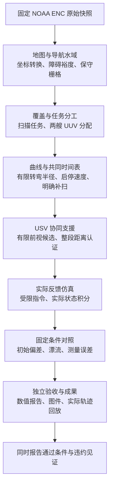
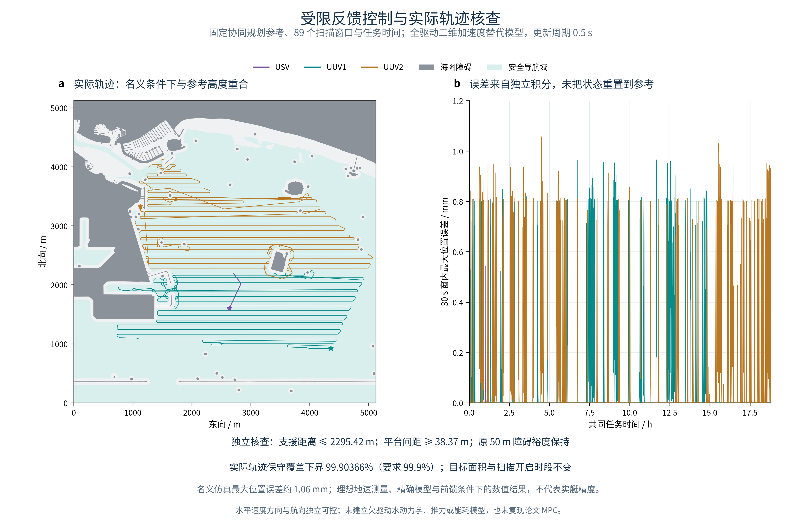
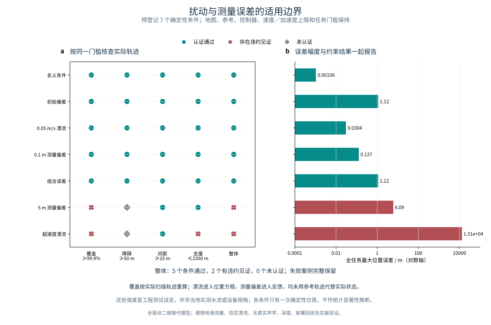

# 文献实验

**船舶靠泊路径规划与 USV/UUV 协同覆盖 · Python 独立学习实现**

以韩旭（2023）博士论文《船舶靠泊路径规划与模型预测航迹保持控制》第三章为起点，扩展到真实海图中的协同覆盖、受限反馈仿真与误差条件核查。

**一句话理解：先在地图上找到能转过去的路，再安排多平台何时扫描、何时支援，最后让仿真平台实际跟着参考轨迹走，并检查覆盖和安全距离。**

当前默认入口是 `run.py`：从固定原始 ENC 开始，连续生成规划、实际轨迹、条件对照、图件和回放。模型采用**全驱动二维加速度双积分器与独立航向**；这是声明模型下的完整实验流程，严格论文复现、论文 MPC 和实艇验证仍未完成。

[框架图](#1框架图) · [项目结构](#2项目结构) · [学习路线](#3学习路线) · [实验解读](#4文献实验解读) · [成果展示](#5实验复现结果展示) · [运行指南](#6项目运行指南)

## 1、框架图



完整流程由功能模块直接调用，历史失败诊断和旧方案对照另有可选入口。[集成实验说明](docs/experiments.md#integrated) · [原第三章方法框架](docs/assets/chapter3_framework_r8.png)

## 2、项目结构

```text
hanxu-berthing-reproduction/
├── run.py                           完整实验入口
├── README.md                        项目说明、成果与使用方法
├── configs/
│   ├── experiment.json              总配置：功能组件、控制器、条件与周期
│   ├── components/                  固定海图、覆盖、曲线与支援参数
│   └── regression.json              固定科学结果与派生数据校验值
├── src/berthing_planner/
│   ├── experiment/                  可直接调用的实验服务
│   │   ├── workflow.py              按功能连接完整流程
│   │   ├── chart.py / grid.py        海图处理与保守栅格
│   │   ├── coverage.py / allocation.py  扫描与任务分配
│   │   ├── candidates.py / routes.py 扫描候选与连续曲线
│   │   ├── scanning.py / schedule.py 扫描开关与共同时间表
│   │   ├── support.py               USV 支援规划
│   │   ├── control.py               实际反馈仿真
│   │   └── figures.py / replay.py / report.py  图件、回放、报告
│   ├── validation/                  独立几何、时钟、控制与交付检查
│   ├── tracking.py                  受限反馈与解析状态积分
│   ├── curved_timing.py / scheduled_timing.py  曲线赋时与区间界
│   ├── coverage.py / joint_coverage.py / maneuver_search.py
│   └── quadtree.py / search.py / curves.py / reeds_shepp.py / …
│                                    第三章方法与通用规划算法
├── scripts/                         结果检查与可选参考实验命令
├── tests/ / research_tests/          算法、独立审计与回归检查
├── docs/                            方法、来源、实验说明与成果图
├── third_party/                     第三方来源与许可
├── data/                            本地数据目录
└── outputs/                         每次独立运行生成的完整结果
```

## 3、学习路线

1. **先看整体效果：** 阅读第 5 部分，再运行合成港口演示，分清“找到通路”和“满足靠泊姿态”的区别。
2. **弄清地图和搜索：** 从 [S1 四叉树动手实验](docs/experiments.md#s1)开始，理解粗细区块、邻接、LOS 和 A*。
3. **逐个处理转弯与抵泊：** 学习 G2CBS 的曲率限制，再看 RS 如何安排起终朝向、前进和倒车。
4. **回到论文条件：** 比较恢复地图上的路径与方法对照，逐项检查参数、计时、节点和约束口径。
5. **最后攻克缺口：** 短转向合并、作者策略对齐，以及第 3.3 节坐标转换与跨图局部重规划。

学习集成实验时，可顺着 `workflow.py` 的“地图 → 覆盖 → 曲线 → 协同 → 实际反馈 → 独立核查”逐段查看输入与输出。

## 4、文献实验解读

靠泊规划要同时处理地图搜索量、转弯空间、终点朝向与进退动作。区域覆盖扩展又增加了扫描是否开启、多平台时间安排及支援距离约束，因此每个模块都需要单独验证，再在同一任务中联合检查。

| 功能 | 解决的问题 | 实验如何核查 |
| --- | --- | --- |
| 多尺度搜索与靠泊 | 开阔处少搜索，近障碍细分；满足抵泊姿态 | 1、Dijkstra 核查普通 A*；<br>2、比较父节点规则；<br>3、核查平滑、位姿、曲率与方向切换。 |
| 地图与覆盖 | 确定障碍、导航域与完整扫描目标 | 1、固定 ENC 与投影；<br>2、检查保守闭格；<br>3、保留完整目标分母，计算覆盖和漏扫。 |
| 曲线与任务时间表 | 将扫描任务变成有限半径、有限速度的轨迹 | 1、联合调整扫描位姿与顺序；<br>2、赋启停速度；<br>3、明确扫描与等待时段，并登记补扫。 |
| 协同支援 | 让 USV 支援两艘 UUV，并保持平台间距 | 1、有限前视搜索支援站与转场；<br>2、检查全部时间区间；<br>3、同时验证支援范围、间距与障碍裕度。 |
| 实际反馈与条件对照 | 检查仿真平台能否跟上参考轨迹 | 1、受限控制指令驱动实际状态积分；<br>2、重算实际覆盖与距离；<br>3、保留误差条件中的通过和违约结果。 |

第三章靠泊部分采用独立解释与工程补充；协同覆盖与反馈属于应用扩展。恢复地图、Theta 式回退、短转向合并和 RS 接入等差异见 [方法说明](docs/methods.md)，文献及数据见 [来源与许可](docs/sources.md)。

## 5、实验复现结果展示

### 实际轨迹与障碍环境



固定约 **8.767427 km²** 目标，执行 **89 个扫描时段**，共同任务时长 **18.825825 h**。USV 采用 **2 次转场**，航程 **685.679 m**。图中显示实际状态积分轨迹；参考轨迹与实际轨迹分别记录。

<table width="840">
  <thead><tr><th width="250">名义实际轨迹指标</th><th width="300">独立核查结果</th><th width="290">门槛</th></tr></thead>
  <tbody>
    <tr><td>覆盖率保守下界</td><td><strong>99.90392%</strong></td><td>≥ 99.9%</td></tr>
    <tr><td>最大支援距离保守上界</td><td><strong>2295.416 m</strong></td><td>≤ 2300 m</td></tr>
    <tr><td>最小平台间距保守下界</td><td><strong>38.375 m</strong></td><td>≥ 25 m</td></tr>
    <tr><td>最小障碍间距保守下界</td><td><strong>50.589 m</strong></td><td>≥ 50 m</td></tr>
    <tr><td>最大位置跟踪误差</td><td><strong>0.001057 m</strong></td><td>理想替代模型数值结果</td></tr>
  </tbody>
</table>

控制周期 0.25、0.5、1 s 的名义仿真均通过核查。毫米级误差来自理想测量和精确替代模型，不能视为实艇精度。

### 固定条件对照



<table width="840">
  <thead><tr><th width="300">条件</th><th width="170">约束结论</th><th width="190">最大位置误差</th><th width="180">实际覆盖下界</th></tr></thead>
  <tbody>
    <tr><td>名义</td><td>通过</td><td>0.001057 m</td><td>99.90392%</td></tr>
    <tr><td>初始位置与航向偏差</td><td>通过</td><td>1.11803 m</td><td>99.90394%</td></tr>
    <tr><td>0.05 m/s 漂流</td><td>通过</td><td>0.03037 m</td><td>99.90392%</td></tr>
    <tr><td>0.1 m 测量偏差及小幅测量扰动</td><td>通过</td><td>0.12744 m</td><td>99.90419%</td></tr>
    <tr><td>组合误差</td><td>通过</td><td>1.11803 m</td><td>99.90422%</td></tr>
    <tr><td>5 m 测量偏差</td><td><strong>有违约见证</strong></td><td>6.08722 m</td><td>99.89112%</td></tr>
    <tr><td>超速度漂流</td><td><strong>有违约见证</strong></td><td>13126.5 m</td><td>3.75007%</td></tr>
  </tbody>
</table>

共 **5 个条件通过、2 个有违约见证**。5 m 测量偏差的覆盖上界也低于门槛；超速度漂流造成明显跟踪、覆盖与支援违约。每条件一次确定性仿真，不作随机总体或统计显著性推断。全任务最大误差包含初始偏差，不能直接理解为稳态误差。

完整数值见 [集成实验结果](docs/experiment_results.json)，解释与模型范围见 [结果报告](docs/closed_loop_results.md)。模型允许独立侧向加速度，没有真实欠驱动水动力、推力/能耗、深度、声学及实艇验收。

### 第三章靠泊与跨图参考成果


通航路径 **4908.3 m**；船艉抵泊 **4142.3 m**，含倒车 **989.4 m**、一次方向切换。船艉采用显式轴线补充，RS 接头不保证全局 G²；不是原图、原表的严格数值复现。真实 GSHHG 跨图实验将细图碰撞由 **191 格降至 0 格**，保持原端点，仅替换局部受阻航段。[靠泊、方法对照与跨图说明](docs/experiments.md#paper)

## 6、项目运行指南

### 环境与固定输入

已验证环境为 **Python 3.12**；完整实验使用 NumPy、SciPy、Pillow、PyMuPDF、Matplotlib，固定版本见 [requirements-reconstruction.txt](requirements-reconstruction.txt)。海图预处理还需要现有 **GDAL、GEOS C 与 PROJ**；本机验证版本为 3.8.5 / 3.14.1 / 9.7.1，并需要可显示中文的字体。其他平台与原生几何库版本尚未做字节一致性验证。

```bash
python3.12 -m venv .venv
source .venv/bin/activate
python -m pip install -r requirements-reconstruction.txt
```

将固定的 `US5LGBCE.zip` 和 `US5LGBDE.zip` 放入 `data/raw/enc/`。来源、版本、大小和 SHA 记录在 [海图配置](configs/components/chart.json)；运行会拒绝不匹配的输入。NOAA 在线图幅会更新，当前下载不一定仍与固定快照一致。

### 一次运行完整实验

```bash
python run.py --archives-dir data/raw/enc --output-dir outputs/full_experiment
```

也可从官方地址下载后核对固定版本：

```bash
python run.py --download --output-dir outputs/downloaded_experiment
```

总配置为 [experiment.json](configs/experiment.json)。每次使用新的输出目录，已有结果不会覆盖。所有中间地图、参考与实际状态都在本轮重新计算；默认流程不运行历史失败诊断和旧方案对照。

```text
outputs/full_experiment/
├── configuration/           本次总配置与实际使用参数
├── inputs/                  已核对的原始 ENC 快照
├── map/                     海图、导航域与栅格
├── planning/                覆盖、分工、曲线、扫描时间表、协同参考
├── control/                 名义与不同周期的实际轨迹
├── conditions/              固定误差条件与条件汇总
├── validation/              各模块独立核查与科学回归结果
├── figures/                 PNG、PDF、SVG 成果图
├── report/                  results.md、summary.json、replay.html
├── logs/                    本轮功能计算日志
└── manifest.json            来源、环境、计算状态与文件校验值
```

查看 `report/results.md`，在浏览器打开 `report/replay.html`。回放每 30 s 显示一帧；安全结论由完整控制区间核查给出。

### 核查结果与可选实验

```bash
python scripts/verify_experiment.py --run-dir outputs/full_experiment --json-out outputs/full_experiment_check.json
PYTHONPATH=src:research_tests python -m unittest discover -s tests -q
PYTHONPATH=src:research_tests python -m unittest discover -s research_tests -q
```

固定回归检查覆盖参考任务、9 次实际轨迹仿真的 45 份派生文件，以及 5 个通过和 2 个违约结论。重新检查时保持代码、配置与已完成目录不变，将检查报告写到新路径。

第三章入门可运行 `python scripts/run_s1.py` 和 `python scripts/run_demo.py`。其他参考实验及旧命令仍可单独运行，见 [实验目录](docs/experiments.md#reference-experiments)。
