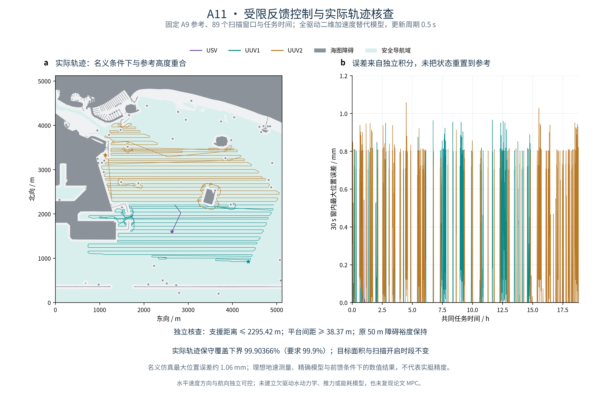
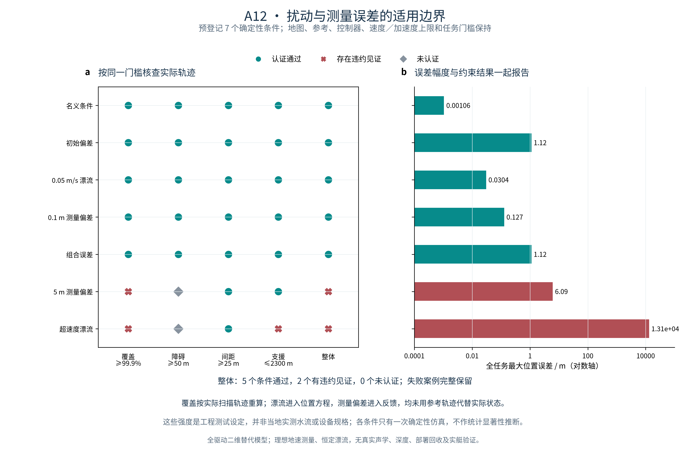

# 固定海图上的规划、反馈与误差对照

本项目在同一真实海图和固定覆盖目标上，完成了二维规划、全驱动替代模型的受限反馈仿真，以及保留失败条件的扰动对照。结论限于声明模型与配置，不等同于实艇可执行性或原论文 MPC 复现。

## 规划与支援代价

NOAA 两幅固定 ENC 经处理后形成约 **8.767427 km²** 的完整目标。A6 保留 86 个原扫描任务并增加 3 个明确补扫窗口；A7/A8/A9 采用同一组 UUV 参考轨迹、速度律和初始位姿。

| USV 支援方案 | 航程 | 转场次数 | 支援距离上界 | 适用条件 |
| --- | ---: | ---: | ---: | --- |
| A7 转场后驻守 | 0.650581 km | 1 | 2312.24 m | 满足 3 km，未满足 2300 m |
| A8 窗口内移动 | 10.173334 km | 11 | 2295.48 m | 满足 2300 m |
| A9 长前视改进 | 0.685679 km | 2 | 2295.30 m | 满足同一 2300 m 要求 |

A9 较 A8 减少 **93.26%** USV 航程；共同任务仍为 **18.825825 h**。有限候选的改进不等于全局最优或实际节能。

## 实际反馈轨迹

参考位置、速度与加速度进入前馈／反馈控制器，受限控制指令再进入独立仿真器积分实际状态。名义 0.5 s 周期下最大位置误差约 **1.06 mm**；0.25、0.5、1 s 三个周期均通过实际轨迹核查。理想测量和精确替代模型下的数值误差不代表实艇精度。

固定原目标、89 个扫描时段和 50 m 障碍裕度保持。名义实际轨迹的主流程覆盖保守下界约 **99.90366%**；独立审计另得支援距离上界 **2295.42 m**、平台间距下界 **38.37 m**。主流程与独立审计采用不同紧度的保守包络，因此覆盖下界略有差别，针对的是同一实际轨迹。

## 预设条件的适用边界

每条件一次确定性仿真，名义条件复用 A11；各条件共享同一地图、参考、控制器、执行器上限和任务门槛。下表覆盖列为独立审计保守下界。

| 条件 | 整体判定 | 最大位置误差 | 覆盖下界 |
| --- | --- | ---: | ---: |
| 名义 | 通过 | 0.00105666 m | 99.90392% |
| 初始偏差 | 通过 | 1.11803 m | 99.90394% |
| 0.05 m/s 漂流 | 通过 | 0.0303714 m | 99.90392% |
| 0.1 m 测量偏差 | 通过 | 0.127443 m | 99.90419% |
| 组合误差 | 通过 | 1.11803 m | 99.90422% |
| 5 m 测量偏差 | 有违约见证 | 6.08722 m | 99.89112% |
| 超速度漂流 | 有违约见证 | 13126.5 m | 3.75007% |

5 m 位置测量偏差条件的覆盖上界也低于 99.9%，因此有明确的覆盖违约见证。超速度漂流条件中，UUV 的 1.8 m/s 东向漂流超过其 1.65 m/s 水相对速度上限，在驻守／逆流参考段无法提供所需补偿，所选固定参考不能被跟踪，且出现覆盖与支援距离违约。这两个条件没有被删除或修改门槛来取得“全部通过”。

这些幅度是工程测试值，并非当地实测海流、设备规格或随机总体样本。当前结论不能推广为任意噪声或海况下的安全保证。

## 模型与验证范围

- 模型是全驱动平面加速度双积分器与独立航向加速度，允许侧向加速与驻点补偿；速度与航向未施加真实欠驱动耦合。
- 控制周期内指令保持，实际位置用解析积分更新；控制／速度限幅、反馈指令、参考积分和实际状态积分均有检查。
- 覆盖、导航包络与间距使用完整控制区间的保守界。回放的 30 s 显示帧不用于安全验收。
- 未识别真实水动力系数、推力与能耗，也未验证声学、三维、部署回收或实艇。原论文原图／原表和 MPC 的严格复现仍未完成。
- 代码和声明模型验收不能代替学习者解释与导师验收。

[模型与公式](methods.md#closed-loop) · [实验参数与命令](experiments.md#a11) · [控制来源](control_sources.json)

## 复跑与展示

在 README 声明环境中，使用 `scripts/run_closed_loop_reproduction.py` 从固定原始 ENC 开始生成规划、实际反馈、误差条件和图件。顶层验收文件将流程完成与条件安全分别记录；`actual_tracking_replay.html` 提供本地离线演示。

[统一运行入口](experiments.md#a13) · [A11 数值](tracking_control_a11_summary.json) · [A12 数值](tracking_robustness_a12_summary.json)

A13 已在干净代码副本中从固定原始海图重建完整数据链：35 步规划子流程、11 步顶层编排，786 份输出哈希核对、209 核心测试与 121 科研检查通过。9 次实际轨迹仿真的 45 份派生文件与两张 PNG 复现一致。预登记 7 条件仍为 5 个通过、2 个有违约见证，未将完成流程等同于所有条件安全。[A13 数值记录](closed_loop_a13_summary.json)。

初始偏差和组合条件的全任务最大误差包含预设零时刻偏差，不应直接当作稳态误差。各条件的时间加权位置 RMSE 与末时刻误差另存于 [A12 数值](tracking_robustness_a12_summary.json)。
