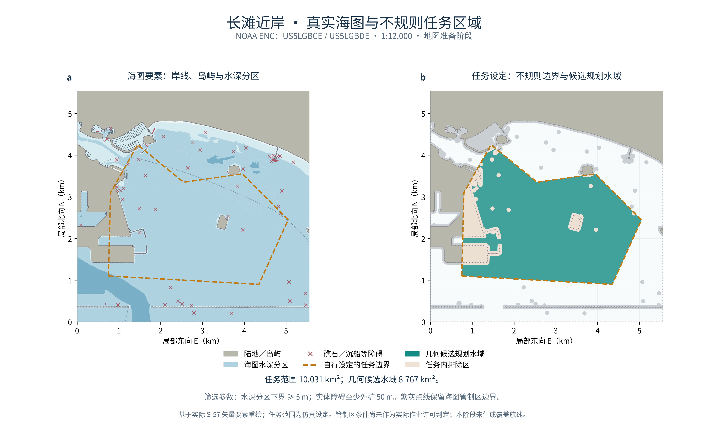

# A1：真实海图与不规则任务区域

本阶段已将长滩近岸的真实 NOAA ENC 转换成可检查的矢量地图，并固定一个含障碍孔洞的不规则仿真任务区域。下一阶段在此输入上生成单平台覆盖航线。



## 1．选区与数据

选区为加利福尼亚州长滩近岸，经度 **118.20°W—118.14°W**、纬度 **33.72°N—33.77°N**，局部范围约 **5.560 × 5.546 km**。地图来自 NOAA 的原始 S-57 文件，图件按实际矢量要素重绘。官方 ENC 可按图幅下载，也可通过 GIS 服务获取要素。[NOAA ENC 下载入口](https://charts.noaa.gov/ENCs/ENCs.shtml)、[官方 GIS 说明](https://nauticalcharts.noaa.gov/learn/encdirect/)。

| 项目 | 固定输入 |
| --- | --- |
| 图幅 | US5LGBCE、US5LGBDE |
| 编绘比例尺 | 两幅均为 1:12,000 |
| 目录版本 | 2026-10-30T04:52:47Z；获取于 2026-10-31 |
| 图幅版本 | 均为第 1 版、第 1 次更新；更新发行日期 2026-04-22 |
| 输入文件 | 每幅 `.000` 基础文件与 `.001` 更新文件；原 ZIP 及配套说明完整保留 |
| 坐标 | WGS84 椭球、局部墨卡托；E 向东、N 向北，单位 m；原点为选区西南角 |

目录日期反映本次目录快照，不代表所有水深观测都采集于该日。源图幅更新版本已通过 DSID 核对；GDAL 按 `UPDATES=APPLY` 读入更新，未只使用基础文件。[GDAL S-57 更新说明](https://gdal.org/en/stable/drivers/vector/s57.html)。

本选区提取 **16 类、559 条**要素，包括陆地、岸线、岸线构筑物、水深分区、等深线、障碍物、水下礁石、沉船、覆盖范围、管制区、缆线及管线等。全部保留类别与条数见[来源和检查记录](../docs/open_chart_stage_a_sources.json)。

## 2．任务区域怎样得到

任务边界是自行设定的七顶点凹多边形；它表示仿真任务范围。区域内允许存在陆地和障碍，实际候选区域由以下规则扣除得到。

1. 只保留真实海图覆盖内的区域。
2. 水深只使用 `DEPARE` 分区，要求分区下界 `DRVAL1 ≥ 5 m`；浅水和未知水深不纳入候选。
3. 陆地、岸线、岸线构筑物、障碍物、礁石和沉船周围保留至少 **50 m** 几何间距。
4. 明确禁止进入、禁止潜水和应避开区域的 `RESTRN` 标记按配置排除；其他管制信息原样保留为背景条件。
5. 与任务多边形求交，保存候选区域、孔洞和被排除部分。

首个边界候选在西侧纳入了约 2,655 m² 的隔离小水域。选区设计阶段将西侧任务顶点设为 E=750/800 m，得到一个连通的首轮任务；初始配置与诊断保留。原始海图、障碍物和水深数据均未修改。

缓冲构造另有显式 **0.5 m 近似补偿量**，并补偿圆弧弦近似；传给 GEOS 的构造距离为 **50.517311 m**。随后对完整候选区域与原始障碍检查距离，得到 **50.479980 m**。50 m 验收值没有降低。

**5 m 水深下界、50 m 裕度及任务边界都是首版工程设定。**水深分区不是连续海底地形，实际潜器的深度与离底间距后续另行建模。

## 3．当前得到什么

| 指标 | 结果 |
| --- | ---: |
| 任务多边形面积 | 10.031250 km² |
| 几何候选规划水域 | 8.767427 km² |
| 任务内排除面积 | 1.263823 km² |
| 候选水域连通分区 | 1 个，保留内部障碍孔洞 |
| 任务超出海图覆盖面积 | 0 m² |
| 候选与障碍缓冲区相交面积 | 约 1.05 × 10⁻¹⁴ m²，数值误差量级 |
| 候选与原始障碍最小间距 | 50.479980 m |
| 提取要素的无效几何 | 0 / 559 |

这些面积描述地图筛选结果；覆盖航线尚未生成，当前没有任务覆盖率或轨迹跟踪结果。

本选区的几何候选水域落在带条件的海图管制提示覆盖内。源属性中的 `RESTRN=8` 表示“entry restricted”，与“entry prohibited”分列；两者的编码来自随 GDAL 分发的 S-57 属性表。所有管制区边界和属性已保留，当前结果只作为仿真几何输入，实际作业条件与许可未作判定。

## 4．如何检查

- **原始输入**：两个 ZIP 均核对官方目录中的大小与固定 SHA-256；下载脚本重新获取后仍与固定快照一致。完整哈希见来源记录。
- **几何检查**：检查源要素有效性、任务覆盖、区域求交、排除关系及与原始障碍的最小距离；不使用静默几何修复。
- **独立抽查**：使用 NumPy 射线法检查固定 10 m 网格的 **308,580 个格心**。其中 145 个位于多边形边界，按 10⁻⁷ m 边界容差单独报告；其余 **308,435 个内部点**没有区域越界、漏扣陆地、深度分区不合格或分区重叠／缺口。
- **坐标检查**：64 个位置分别做 PROJ 正、逆核对；最大平面差 **4.94 × 10⁻⁸ m**，逆变换最大差 **4.34 × 10⁻¹³°**。任务面积另用鞋带公式核对。
- **回归检查**：104 项标准库测试、20 项科研预处理检查通过。
- **图件检查**：两图绘图区对齐；PDF 最小字号 9 pt，碰撞审计 0 fail / 0 warn；PNG、可编辑 PDF/SVG 均保存。PNG 为项目预览用途的 300 dpi 图件。

格心抽查属于有限采样；完整矢量检查与格心检查分别记录。当前仍未验证覆盖航段、曲率、船体包络、潮位、三维净空、交通或跟踪控制。

## 5．这一阶段的复跑入口

使用已具备 GDAL CLI（本轮 3.8.5）、GEOS C API（本轮 3.14.1）及 NumPy/Matplotlib 的科研环境；本轮没有安装新依赖。GDAL 和 GEOS 用于地图预处理，原规划标准库环境保持独立。

```bash
python scripts/download_open_chart_stage_a.py \
  --output-dir data/raw/noaa_stage_a_snapshot

python scripts/prepare_open_chart_stage_a.py \
  --archives-dir data/raw/noaa_stage_a_snapshot \
  --output-dir outputs/open_chart_stage_a_map

python scripts/plot_open_chart_stage_a.py \
  --prepared-dir outputs/open_chart_stage_a_map \
  --output-dir outputs/open_chart_stage_a_figure

python research_tests/audit_open_chart_stage_a.py \
  --prepared-dir outputs/open_chart_stage_a_map \
  --json-out outputs/open_chart_stage_a_audit.json
```

每个输出目录必须是新目录。GDAL/GEOS 不在自动发现位置时，可传 `--gdal-bin` / `--geos-lib`；独立坐标审计支持 `--proj-bin`。本轮下载使用了脚本的 `--noaa-cname` 选项，通过官方 DNS 公布的 AWS 别名连接，保留官方主机名和 TLS 校验，未改全局网络设置。

NOAA 下载地址可能随更新改变文件内容；哈希不一致时脚本停止并保留下载文件，应核查新版本后另建配置，不能直接覆盖本快照。

原始 ZIP、完整说明、提取要素、GeoPackage、候选区域 GeoJSON、代码快照及所有尝试保存在本地独立运行目录。GitHub 保存代码、配置、来源元数据、报告和生成预览图。

## 6．下一阶段

在固定区域上明确仿真扫宽与航线间距，生成条带覆盖航段，再用现有 A* 处理障碍绕行与航段连接。随后检查连续性、漏扫、重复覆盖、总长度和转弯；通过后扩展至 USV/UUV 多平台。
