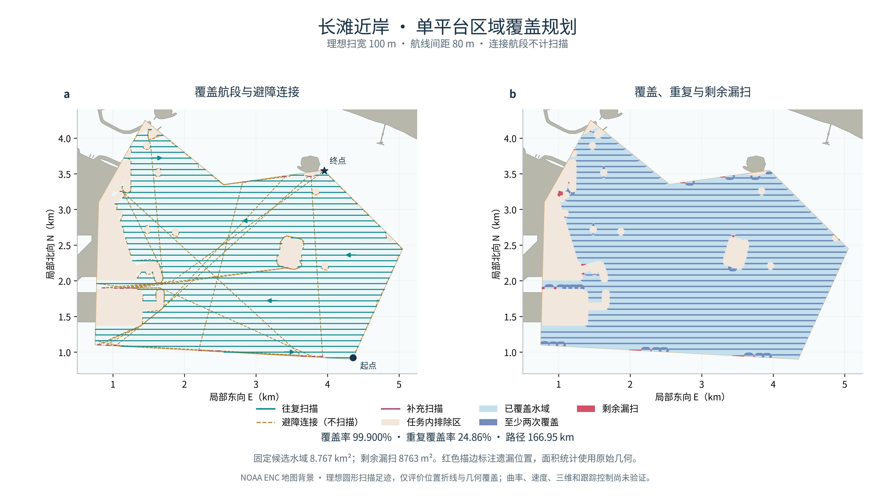

# A2：单平台区域覆盖规划

已在 A1 固定的真实海图候选水域上生成连续的单平台搜索折线。按理想扫宽100m、航线间距80m、连接段关闭扫描的约定，66条常规扫描腿加20条补扫腿后，精确几何覆盖率为 **99.900%**，达到本阶段预先设定的99.9%目标；**8762.851m²剩余漏扫明确保留**。



左图显示所有常规扫描、补扫和避障连接；右图显示足迹并集、至少被两条扫描腿覆盖的区域及剩余漏扫。地图背景来自A1真实NOAA ENC，任务区域没有换图、缩小或清除障碍。

## 1．固定输入与模型

| 项目 | 本轮设置 |
| --- | --- |
| 原始目标 | A1候选面，8,767,426.837145586m²，孔洞与文件SHA保持不变 |
| 海图 | NOAA ENC US5LGBCE / US5LGBDE，1:12,000，版本见A1来源记录 |
| 规划格 | `[0,0,5120,5120]m`，2048²，2.5m闭格 |
| 扫描足迹 | 理想水平圆，半径50m；只在主动扫描腿开启 |
| 扫描行 | 东西方向，间距80m；请求相位40m，吸附格心后实际41.25m |
| 连接 | 优先直接LOS，必要时已有Theta式A*及显式LOS shortcut |
| 补扫 | 从大到小考察漏扫面，选择有正面积增益的可达短扫描腿，最长40m；最多64次 |
| 本轮验收 | 原目标不变、整条位置路径安全、覆盖至少99.9%、独立检查通过 |

100m扫宽和80m间距给出相邻平行扫幅20%的名义宽度重叠。下文“重复覆盖率”使用另一个定义：**至少两条主动扫描腿覆盖的区域面积 / 原始目标面积**。

完整定义和方法修订见[实验约定](../docs/coverage_a2_protocol.md)，全部固定参数见[配置](../configs/open_chart_coverage_a2.json)。100m足迹属于仿真设定，未绑定实际声呐、平台深度、探测概率或扫描驻留时间。

## 2．首轮失败与处理

5m保守格把原来连通的A1候选面离散成三个四连通分区。首轮尝试访问全部扫描区间时，A*明确报出无法连接；没有跳过该错误或清除阻塞格。

随后只做一次2.5m细化。细化恢复了原5m图中425m²小区与主区的连接，但仍有3个格区：主区8,730,225m²、小区3156.25m²、单格区6.25m²。两版全部分区及失败记录保留。原候选经1m几何内缩仍连通、2m时开始分裂，显示细颈对离散化敏感；这不是船体可通过宽度的认证。

修订版明确区分扫描中心域和传感器覆盖目标：选最大四连通格区作为起点导航域，生成其全部请求扫描腿；其他小区仍完整保留在原始目标中，由实际扫描足迹判断是否覆盖。**覆盖分母始终是8,767,426.837m²，未改为导航格区面积。**修订规则在运行前写入配置，初版配置、源码及失败日志保留。

最终对未访问格区额外核对：

| 未访问的扫描中心格区 | 完整格区面积 | 足迹覆盖面积 | 剩余漏扫 |
| --- | ---: | ---: | ---: |
| 505格小区 | 3156.25m² | 237.137m² | 2919.113m² |
| 单格小区 | 6.25m² | 6.25m² | 0m² |

这些漏扫已包含在总漏扫面积内。未访问小区没有从目标、覆盖统计或图件中删除。

## 3．结果

| 指标 | 结果 |
| --- | ---: |
| 常规往复扫描覆盖率 | 99.454521% |
| 加入补扫后的精确覆盖率 | **99.900052%** |
| 已覆盖面积 | 8,758,663.986m² |
| 剩余漏扫面积 | **8762.851m²，约0.099948%** |
| 至少两次覆盖的面积 | 2,179,714.447m² |
| 重复覆盖率 | **24.861507%** |
| 各腿面积累积后的冗余比例 | 19.987293% |
| 实际常规扫描行 | 41行，分成66条扫描腿 |
| 补扫腿 | 20条，本轮没有零长度扫描腿 |
| 关闭扫描的连接腿 | 85条 |
| 扫描总长度，含补扫 | **109.570km** |
| 避障与转场连接长度 | **57.385km** |
| 总路径长度 | **166.955km** |
| 位置折线方向变化 | 375次，包含连接折角，不表示倒车换挡 |
| 与原始实体障碍最小间距 | **51.664968m** |

覆盖统计使用圆形端帽每象限30段的内接多边形近似，略小于理想圆足迹。连接腿不增加覆盖面积。目标减去足迹并集的几何已完整保存，图中用红色填充及描边显示遗漏位置。

## 4．验证证据

- **输入完整性**：目标文件SHA与A1来源清单、A2配置三方相同；面积和孔洞没有改变。
- **保守格检查**：全部1,397,342个原始free闭格分别由原候选与1mm数值内缩候选做原生GEOS prepared Covers全检，0不通过。数值内缩只影响规划掩膜。
- **完整路径检查**：整条路径被原A1候选面覆盖；与原始障碍最小间距51.665m；全部线段通过规划图LOS。
- **独立碰撞**：NumPy对实际路径逐段与原始、未合并阻塞闭格做相交检测，0碰撞、0越界；没有调用树LOS。
- **独立覆盖**：10m格心网保留原始目标；87,713个闭候选格心中127个边界点单列，主统计使用87,586个内部点。按点到闭线段的解析距离、每条主动扫描腿至多一次计数，覆盖率99.906378%、重复率24.940059%、样本漏扫8200m²。
- **采样边界**：样本漏扫与精确几何相差562.851m²，覆盖率相差约0.00633个百分点；有限格心采样不能证明任意窄小漏扫不存在，因此精确几何和采样结果分别保存。
- **连续性与长度**：377个路径点与171条有序腿一致，最大连接缝隙0m，独立长度核对误差不超过5.82×10⁻¹¹m。
- **未访问小区**：独立四连通标记与逐格心足迹核查确认上述小区统计，所有实际路径点均在声明的主导航域。
- **回归测试**：114项标准库测试、42项科研预处理与审计检查通过。
- **完整复跑**：从干净导出的代码和固定原始ZIP重新准备A1，27份几何文件逐字节一致；2.5m规划格指纹相同，路线、分腿、科学指标及4份覆盖几何均一致，独立审计再次通过。生成时间等来源清单元数据允许变化，目标、障碍和源配置仍固定SHA。

## 5．当前限制

本轮通过的是声明模型下的位置折线与至少99.9%几何覆盖。剩余漏扫包括细颈附近的未访问区域和部分边界，不能写成100%完整覆盖。

补扫采用贪心顺序，20条补扫只增加0.7625km主动扫描，却增加约42.835km连接；总路线尚未优化。扫描方向、行相位、补扫访问顺序与不同起点均可作为后续对照因素。

位置折线存在瞬时方向变化，尚未验证有限转弯半径、连续曲率、速度、能耗、真实船体包络、潜器深度或控制。A1的海图水深分区、条件性管制提示与实际作业边界继续保留，不将几何通过等同真实任务授权或平台可执行性。

## 6．复跑入口

沿用已有科研环境：Python3.12.14、NumPy2.5.2、SciPy1.18.0、Matplotlib3.11.1；原生地图处理使用已有GDAL3.8.5、GEOS3.14.1。核心覆盖与A*模块保持标准库实现。本轮没有安装依赖。

先按A1报告生成固定地图输入，再在新目录运行：

```bash
python scripts/prepare_coverage_grid.py \
  --prepared-dir <A1地图目录> --n 2048 \
  --output-dir outputs/coverage_grid_a2

python scripts/run_open_chart_coverage.py \
  --prepared-dir <A1地图目录> \
  --grid-dir outputs/coverage_grid_a2 \
  --output-dir outputs/coverage_run_a2

python research_tests/audit_open_chart_coverage.py \
  --prepared-dir <A1地图目录> \
  --grid-dir outputs/coverage_grid_a2 \
  --run-dir outputs/coverage_run_a2 \
  --json-out outputs/coverage_audit_a2.json

python scripts/plot_open_chart_coverage.py \
  --prepared-dir <A1地图目录> \
  --run-dir outputs/coverage_run_a2 \
  --audit-json outputs/coverage_audit_a2.json \
  --output-dir outputs/coverage_figure_a2
```

地图闭格语义依据[GDAL ALL_TOUCHED说明](https://gdal.org/en/stable/programs/gdal_rasterize.html#cmdoption-gdal_rasterize-at)，原生包含、距离和足迹操作依据[GEOS C API](https://libgeos.org/doxygen/geos__c_8h.html)。PNG用于项目预览，PDF/SVG及图件检查结果保存在本地独立运行目录。

汇总数据与来源指纹见[机器可读记录](../docs/coverage_a2_summary.json)。原始海图、全部规划格、路线点、覆盖面、失败尝试和代码快照保存在本地；GitHub同步代码、配置、汇总、报告与生成图。
