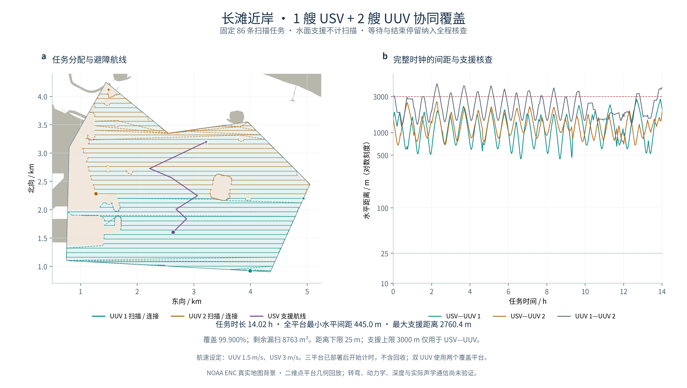

# A3：USV / UUV 任务分配与时间回放

在 A2 原有的完整扫描任务上，两艘 UUV 分担南北任务带，一艘 USV 根据两艘 UUV 的计划位置转场支援。本阶段已通过任务、地图与连续时序的独立核查，形成二维几何协同原型。



## 做了什么

1. 保留 A2 的 **66 条主扫描＋20 条补扫**，逐条登记来源，没有缩短或删除扫描线。原始 **8.767426837 km²** 目标、孔洞和残余小区保持不变。
2. 按任务中点的南北顺序分成两个连续任务带，以扫描长度和直线连接估计平衡工作量；同高度组优先完整保留。实际扫描间连接仍通过避障 LOS／Theta 式 A* 生成。
3. 将补扫按高度插入执行顺序，另生成同一排序方法的单 UUV 对照，区分重排与并行的影响。任务分配为确定性启发式，没有最优性证明。
4. UUV 以 **1.5 m/s**、USV 以 **3 m/s** 给位置折线赋时。两艘 UUV 本次可以同时开始，未使用额外出发延迟；可行间距由独立解析检查确认。
5. 在七个计划时刻取两艘 UUV 位置的中点，将 USV 支援锚点吸附到附近可达格心。锚点避开完整 UUV 路线 35 m，停留期间安全；锚点间避障连接，出发时隙与完整时钟再次核查。
6. 输出完整路线、等待、扫描状态、平台间距与可拖动时间的 HTML 回放。USV 和所有连接、等待段均不计扫描。

## 关键结果

| 平台 | 扫描任务 | 扫描长度 | 连接／支援长度 | 总路线 |
| --- | ---: | ---: | ---: | ---: |
| UUV 1，南侧 | 39 | 53.425 km | 21.734 km | **75.159 km** |
| UUV 2，北侧 | 47 | 56.145 km | 19.568 km | **75.713 km** |
| USV，水面支援 | 0 | 0 | 3.097 km | **3.097 km** |

两艘 UUV 的路线长度差约为总长的 **0.367%**。UUV 1 在 **13.918 h** 完成后原地等待 **369.443 s**，UUV 2 在 **14.021 h** 完成；全任务时钟为 **50,475.636 s**。USV 主要驻点支援，累计移动约 **17.21 min**，驻点和等待都纳入核查。

| 完整任务时钟的连续解析量 | USV—UUV 1 | USV—UUV 2 | UUV 1—UUV 2 |
| --- | ---: | ---: | ---: |
| 最小水平间距 | **445.000 m** | **679.446 m** | **1204.813 m** |
| 最大水平距离 | **2760.385 m** | **2552.195 m** | **4410.761 m** |

三对平台均满足本次设定的 **25 m** 最小水平间距。**3000 m** 支援上限只用于 USV 到每艘 UUV，不限制 UUV 之间的最大距离。所有间距均核查完整时域，包括开始等待和结束停留；这些不是从动画帧抽样得到的极值。

三平台完整路径都在原候选水域内，在原始未合并 2.5 m 阻塞栅格上均为 **0 碰撞**。距原始实体障碍的最小距离分别为：UUV 1 **51.675 m**、UUV 2 **52.078 m**、USV **282.785 m**。

覆盖足迹与 A2 保持一致：覆盖 **99.900052%**、漏扫 **8762.851 m²**、至少两次覆盖 **24.861507%**。每艘 UUV 各自的覆盖面积约为 **4.291 km²／4.527 km²**，两者有交叠，不能简单相加充当总覆盖面积。没有把转场、水面平台或等待计为扫描。

## 怎样理解时间变化

| 对照 | UUV 总路线 | 按 1.5 m/s 计算的任务时长 |
| --- | ---: | ---: |
| A2 原始单平台顺序 | 166.955 km | 30.918 h |
| A3 相同排序的单 UUV 对照 | 152.467 km | **28.235 h** |
| A3 两艘 UUV 分工 | 150.873 km | **14.021 h** |

单平台对照与双平台使用同一组 86 条扫描任务和同一排序方法。补扫重排先改变了连接长度，再由两个覆盖平台并行缩短完成时间；相对重排单平台的时间比为 **0.49659**。这不是同资源算法加速结论，也没有宣称最优。

USV 的 **3.097 km** 支援路线单独记录，三平台累计路程约 **153.970 km**。上表 UUV 总路线没有混入 USV 路程，也不代表总能耗。

## 验证证据

- **任务核对**：86 个源腿索引、任务清单、分配清单、活动几何腿与活动时间段逐一对应，每项执行恰好一次，端点只允许整线反转。
- **独立几何与时间**：原始阻塞格逐段相交检查；相对匀速运动的二次距离函数解析取极值，不导入生产分配／计时模块。
- **覆盖保持**：四份覆盖／重复／漏扫几何与 A2 逐字节核对，原目标 SHA、完整面积和覆盖指标一致。没有删去离散小区来提高结果。
- **输入防改**：固定 A2 result、config、provenance、原目标及原栅格的 SHA；在副本中改动 A2 来源账本、目标顶点或格值，均在创建结果目录前拒绝。
- **单元与科研检查**：**139 项标准库测试＋70 项科研预处理／审计检查通过**，包括任务遗漏／重复、错误扫描标志、时钟与速度篡改、动画采样间碰撞和停留边界。
- **图件与回放**：两面板对齐通过，最终 PDF 最小字号 9 pt，文字／路径碰撞审核 0 fail／0 warn。浏览器中检查时间拖动、播放、暂停、重置和结束状态；四个时刻的三平台位置与 Python 时钟一致，桌面和窄屏均无横向溢出。
- **干净导出复跑**：从准备提交的代码另行导出，使用固定 A2 输入，重建任务分配、路线、时间线和独立审计；正式交付记录保存在本地证据目录。

## 回放与阶段运行

本地证据根：`outputs/20261031T055445_118059Z_cooperative_coverage_a3/`。正式运行在 `run_formal/`，审计为 `independent_audit_formal.json`，图件为 `figure_formal/`，回放为 `replay_formal.html`。HTML 双击即可离线打开，可拖动时间、改变播放倍率并查看任务完成数量。

原始图形坐标和完整路线只留本地，HTML 也写入忽略的 outputs；GitHub 保留生成器、报告、数值汇总和成果预览图。其他机器需先按 A1／A2 报告恢复固定输入。

默认 A3 配置固定的是原 A2 快照。如果使用自己重新生成的 A2，先运行 `freeze_equivalent_a2_inputs.py --a2-run-dir <新A2目录> --output-config outputs/a3_equivalent_config.json`，再给 A3 运行命令增加 `--config outputs/a3_equivalent_config.json`。冻结工具只接受三项计算耗时的变化；任务、路径、覆盖指标、导航图或四份覆盖几何有任意变化都会拒绝。它创建新文件，不覆盖默认配置。

以下是本机阶段复跑入口，`outputs/a3_my_rerun` 必须为尚不存在的新目录：

```bash
source /Users/omo/Documents/AI-Research-Workbench/activate-research-env.zsh

python scripts/run_cooperative_coverage.py \
  --a2-run-dir outputs/20261031T044614_242722Z_open_chart_coverage_a2/run_formal \
  --prepared-dir outputs/20261031T044614_242722Z_open_chart_coverage_a2/fresh_A1 \
  --grid-dir outputs/20261031T044614_242722Z_open_chart_coverage_a2/grid_reproduced \
  --output-dir outputs/a3_my_rerun

python research_tests/audit_cooperative_coverage.py \
  --run-dir outputs/a3_my_rerun \
  --a2-run-dir outputs/20261031T044614_242722Z_open_chart_coverage_a2/run_formal \
  --prepared-dir outputs/20261031T044614_242722Z_open_chart_coverage_a2/fresh_A1 \
  --grid-dir outputs/20261031T044614_242722Z_open_chart_coverage_a2/grid_reproduced \
  --json-out outputs/a3_my_rerun/audit.json

python scripts/build_cooperative_replay.py \
  --run-dir outputs/a3_my_rerun \
  --prepared-dir outputs/20261031T044614_242722Z_open_chart_coverage_a2/fresh_A1 \
  --audit-json outputs/a3_my_rerun/audit.json \
  --output outputs/a3_my_rerun/replay.html
```

## 当前边界与下一步

三平台在本次计时开始时已分别部署在保存结果中的起点；没有模拟从同一母船释放、下潜、回收或返港。固定速度仅用于几何路线赋时，折线拐角仍有瞬时航向变化。支援范围只是二维水平距离，没有声学遮挡、带宽、丢包或传播时延模型。

下一步先给当前扫描与连接加入有限转弯半径和速度约束，逐条检验是否仍能避障、保留覆盖和满足时序；再扩展部署／回收、深度净空与通信约束。现有 A1／A2／A3 基线均保留。原论文严格第三章复现依然未完成。
