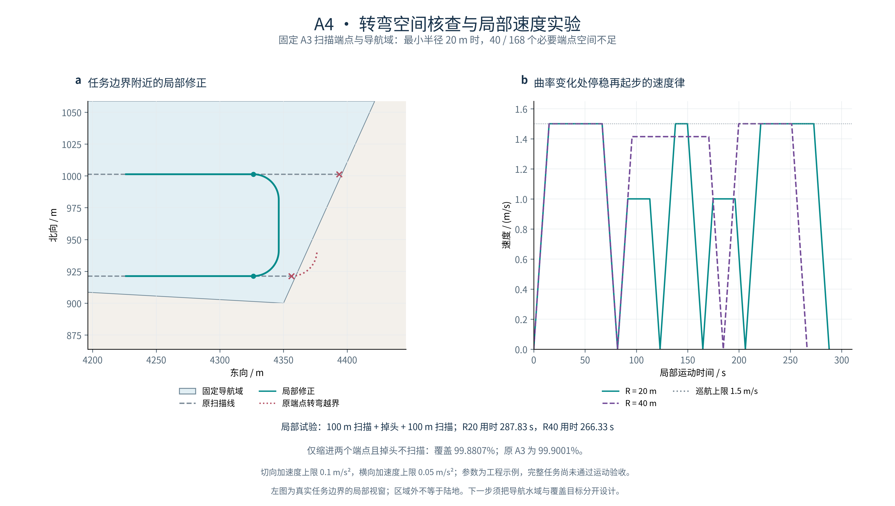

# A4：转弯空间核查与局部速度实验

在固定 A3 扫描端点与导航域、只前进且不能原地旋转的模型下，**至少 40 / 168 个必要扫描端点不满足 20 m 最小转弯半径的空间条件**。本轮已完成不可行证书、局部掉头构造、启停速度与覆盖变化实验；完整任务的运动验收与重新计时未放行。



## 为什么要做这一步

A3 的两艘 UUV 原路线分别有 **124、204 次**非零折线航向跳变，最大均达 **180°**；USV 有 **5 次**，最大约 **131.63°**。点平台折线可以这样表示路线，但具有有限转弯半径的平台需要额外空间改变朝向。

本轮保持原始 **8,767,426.837 m²** 覆盖目标、海图障碍与 50 m 障碍裕度不变。A3 结果没有改写，**14.02 h 继续作为 A3 点平台、分段匀速条件下的基线时间**。

20 m 转弯半径、1.5 m/s 巡航上限、0.1 m/s² 切向加速度和 0.05 m/s² 横向加速度均为应用扩展的工程示例，不是具体 UUV 的硬件参数，也不替换原靠泊算例的曲率设置。

## 如何判定扫描端点没有足够空间

用包含整个原候选水域的凸外包边界给出必要条件。设某条外边界的外向单位法线为 n，扫描末端的前进方向为 u；当 n·u > 0 时，平台正朝边界外行驶。设当前到这条边界的法向距离为 d，航向与外向法线夹角为 θ，则必要条件为：

**d ≥ R × (1 − |sin θ|)**

因为路径曲率绝对值不能超过 1/R，沿弧长的航向变化率也不能超过 1/R。以最快允许速度向远离边界的方向改变航向，在前进方向不再朝外之前，仍至少产生右侧给出的外向位移。在这个固定最小半径模型下，单纯降低速度或停留不能增加几何转弯空间。进入扫描线的端点用反向几何曲线检查同一必要条件，并不允许实际倒车。

代表性原端点的外向余量只有 **3.052 m**，20 m 半径要求至少 **11.768 m**，差 **8.716 m**。单就这条支持边界而言，半径必要上界约为 **5.187 m**；这并不保证更小半径能通过所有其他约束。

| 最小半径 | 已证实空间不足的端点约束 | 涉及的扫描任务 |
| --- | ---: | ---: |
| 5 m | 17 / 168 | 15 |
| 10 m | 27 / 168 | 23 |
| 20 m | 40 / 168 | 36 |
| 40 m | 41 / 168 | 37 |
| 80 m | 41 / 168 | 37 |

这里检查 86 个扫描任务中需要与其他航段衔接的端点；首个扫描起点的预部署、最后扫描终点后的回收不在 A3 时钟内，因此不计入。一个任务的进入和离开是两个约束。**未被此必要条件否定的端点仍需继续检查内部障碍、凹边界和实际可连通曲线**。

原任务凸包在浮点边界上出现约 **1.32×10⁻¹³ m** 的包含误差。证明用外包凸包绕中心相对放大 **10⁻⁶** 后，重新通过完整候选面包含检查；这是更宽松的外包证明区域，失败证书仍然保守。实际导航域、障碍、扫描路线与覆盖分母均未扩张。

## 一个关键的建模发现

**任务边界不等于真实障碍边界。** A1 为首版实验把候选水域裁剪在任务多边形内，A3 又沿用它作为导航域，因此部分扫描线伸到边界附近后就没有掉头余地。所选局部修正与原始实体障碍的最小距离下界约为 **559.10 m**；这里首先暴露的是导航域与覆盖区域被绑定的问题，不能把图中任务区域外的灰白背景都称为陆地。

这次不可行结论仅针对已声明的导航域与前进模型，不能推广为真实 UUV 必然无法转弯。下一步应先从海图中重建包含任务区外掉头空间的安全导航域，保持原覆盖目标不变；任务区外仍须满足海图、水深和障碍裕度等筛选条件。

## 局部修正怎么做

选择同一 UUV 的 `scan_000`、`scan_001` 两条相邻常规扫描线，行距 **80 m**。名义 20 m 半径方案把两个衔接端点分别退回 **30.0 m、67.5 m**，用两个四分之一圆弧与中间 **40 m** 直线连接，前后各保留 **100 m** 扫描段作局部运动实验。

- 圆弧与直线位置、切线方向连续；最大曲率 **0.05 /m**，没有原地航向跳变或倒车。
- 曲率仍在直线／圆弧接点跳变，所以它是 **G1** 连接；在这些接点停稳后再起步，保证速度和转弯角速度在接点为零，不声称全局 G2 连续。
- 局部完整曲线的保守包络位于原候选面内；原始未合并 2.5 m 闭格审计为 **0 碰撞**，包含采样点之间的圆弧误差裕度。
- 这只修正两个端点并检验一段局部路线，其他任务连接没有重新规划。

## 局部速度与时间

每个运动基元使用起终速度为零的三角形／梯形速度律。速度同时受巡航上限及 `v² × |κ| ≤ a_lat` 限制；采用切向加速度 0.1 m/s²。

| 局部掉头模板 | 线路总长 | 弯道速度上限 | 局部总时间 |
| --- | ---: | ---: | ---: |
| R = 20 m，两段圆弧＋中间直线 | 302.832 m | **1.000 m/s** | **287.832 s** |
| R = 40 m，半圆 | 325.664 m | **1.414 m/s** | **266.333 s** |

20 m 模板虽然更短，但弯道限速更低，而且按本实验规则多两处停车切换，所以用时更长。这是两种模板和启停规则的联合比较，不是单独改变半径的因果结论，也不能推广为半径越大越快。

这些时间仅对应“100 m 扫描＋掉头＋100 m 扫描”。不包含真实推进、洋流、能耗、船体、深度、跟踪控制或执行器验证；也没有替换 A3 的全任务时钟。

## 覆盖会怎样变化

名义 20 m 模板只退回两个端点，其他 **84 条**扫描足迹保持原样，原完整目标仍作为分母。掉头不扫描时，覆盖从 **99.900052%** 降至 **99.880653%**，额外漏扫约 **1700.782 m²**。

作为探索性对照，另考察 20／40 m 半径、2.5／5／10 m 额外预留，以及掉头连接期间关闭／开启理想圆形扫描足迹。全部六组保留，没有选择性删除失败结果：

| 掉头半径 | 额外预留 | 掉头不扫描的覆盖率 | 掉头开启理想扫描的覆盖率区间 |
| --- | ---: | ---: | ---: |
| 20 m | 2.5 m | 99.887737% | 99.896784%—99.896796% |
| 20 m | 5 m | 99.885440% | 99.896066%—99.896080% |
| 20 m | 10 m | 99.880653% | 99.894359%—99.894375% |
| 40 m | 2.5 m | 99.867304% | 99.893745%—99.893762% |
| 40 m | 5 m | 99.864328% | 99.892808%—99.892827% |
| 40 m | 10 m | 99.857923% | 99.890690%—99.890711% |

转弯扫描开启时，圆弧用弦线的最大偏差不超过 **0.01 m**，分别构造内、外缓冲包络，给出覆盖面积上下界。其余扫描足迹沿用 A2 的固定多边形近似；上表区间针对该固定数值模型。**这六组上界均低于 99.9%**，没有通过局部掉头就恢复原阶段覆盖门槛。理想圆形足迹在转弯时继续扫描也是新增的传感假设，未验证真实声呐。

这些是一个固定地图上的确定性参数对照，不是六个独立统计重复；不计算显著性。

## 怎样验证

- **必要空间**：独立审计用外向法线点积和 `R × (1 − sqrt(1 − (n·u)²))` 重算，检查全部候选顶点确实位于证明用支持半平面内；不导入生产证书函数。
- **连续圆弧碰撞**：按解析圆弧的弓高建立完整曲线包络，再对原始闭格做按弓高膨胀的独立线段／矩形相交检查，没有只查动画帧。
- **局部速度**：独立积分加速、匀速和减速三阶段，核对长度、时钟、速度、切向与横向加速度上限及位置／切线衔接。
- **覆盖**：重建全部原扫描足迹，与 A3 原覆盖面积仅差约 **3.73×10⁻⁹ m²**；同时用原完整目标上的 10 m 内部样点做独立扫描覆盖核查，有限采样与原生面积分开报告。
- **来源与回归**：A1 目标、任务边界、实体障碍、原栅格与 A3 科学结果固定哈希。A3 重新生成时只允许 `total_computation_seconds` 改变；在副本中修改扫描端点会在创建结果目录前拒绝。
- **检查结果**：**152 项标准库测试、78 项科研检查通过**；六组局部实验独立审计全部通过，意味着各项计算与失败结论被核对，不意味着全任务运动验收通过。
- **干净复跑**：单次运行六组实验的生成器已从干净代码导出执行；结果 JSON、局部轨迹 CSV、所有几何文件及 PNG 与分步运行一致。
- **图件**：两个面板对齐、PDF 最小 9 pt 字号、文字／路径碰撞 0 fail／0 warn；左图明确为局部视窗。

## 运行入口与输出

先按 README 运行 A1→A2→A3，再执行：

```bash
python scripts/run_motion_sensitivity.py \
  --a3-run-dir <A3结果目录> --prepared-dir <A1地图目录> \
  --grid-dir <2.5m栅格目录> --output-dir <新的A4实验目录>
```

生成 `study_summary.json`、`cases/` 六组实验、各组独立审计 JSON、`figure/` 下 PNG／PDF／SVG。每组中的 `local_motion.csv` 给出局部时间、位置、航向、速度、曲率与基元编号；可直接用于动手检查速度律。航向按 [-π, π) 表示，计算航向变化率前应先展开角度。输出保留本地，仓库只同步代码、配置、数值摘要和成果图。

单组入口为 `scripts/run_motion_feasibility.py`，独立检查入口为 `research_tests/audit_motion_feasibility.py`。固定参数见 [A4 配置](../configs/motion_feasibility_a4.json)。

## 接下来做什么

1. 从同一开放海图构造独立的安全导航域，给任务边界外预留掉头空间；原 8.767 km² 覆盖目标与障碍裕度保持不变。
2. 修复所有扫描衔接及 USV 航线，逐条验证位置、切线、半径、启停速度与完整曲线碰撞，再重算全目标覆盖。
3. 对新圆弧与加减速轨迹重建协同时钟及连续距离界。A3 的分段匀速直线二次距离式不能直接用于新轨迹，因此本轮没有放行全任务重新计时。

原论文严格第三章复现的作者条件差异继续保留；本轮是应用扩展中的运动约束实验。
