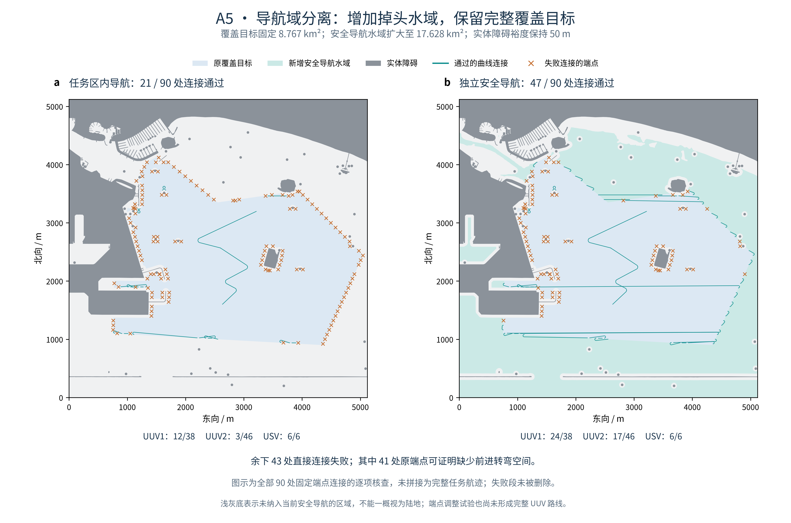

# A5：独立导航域与转弯连接核查

本阶段把“需要扫描的区域”和“允许航行的安全水域”分开。在不缩小原覆盖目标、不降低障碍裕度的条件下，更多原扫描端点可以通过限制转弯半径的曲线连接；完整 UUV 任务仍未通过。

## 1. 固定条件与改变的部分

- 目标沿用 A1 完整 **8,767,426.837 m²**，目标文件 SHA-256 为 `12183e2b7a1ef72109b8b1886ae93f50bc7619d6d7eb05d8927820cbdeda14ea`。
- 海图沿用固定 NOAA ENC `US5LGBCE` / `US5LGBDE` 快照，不重新下载替换；导航水域仍要求海图覆盖、DEPARE 水深下界至少 5 m，排除原实体障碍缓冲区、禁止码 7/11/14 和无覆盖区。5 m 是海图筛选设定，不代表已验证真实 UUV 深度或离底高度。
- 原 50 m 实体障碍裕度和离散化补偿保持；不清障碍、不填孔、不删小目标分区。新导航水域只取消任务多边形裁剪，并限定在原 5120 m × 5120 m 窗口。
- 第一组试验保留 A3 全部 **86 条扫描任务的端点、方向和分工顺序**；核查两艘 UUV 的 38 + 46 处连接及 USV 的 6 条支援连接。USV 原点模型未定义航向，这次明确用相邻支援锚点的向量分配切向航向。
- UUV / USV 最小转弯半径分别为 **20 / 40 m**，只前进、禁止原地转向。这些是工程试验参数。

新安全导航水域为 **17,628,413.234 m²**，在目标外增加 **8,860,986.397 m²** 可导航水域。完整原目标均在其中；与原始实体障碍的最小距离为 **50.479501 m**。新增水域用于通行和掉头，**不加入覆盖率分母**。

## 2. 固定端点连接结果



| 平台 | 任务内导航域 | 独立安全导航域 | 必需连接数 |
| --- | ---: | ---: | ---: |
| UUV1 | 12 | 24 | 38 |
| UUV2 | 3 | 17 | 46 |
| USV | 6 | 6 | 6 |
| 合计 | **21** | **47** | **90** |

这里的“通过”指端点位姿满足、曲率满足、整段曲线位于对应安全水域，且对原始实体障碍的距离下界至少 50 m。不是把 47 段不连续曲线拼成完整任务。

连接器枚举 LSL、RSR、LSR、RSL、RLR、LRL 六类前进 Dubins 曲线，并处理精确单圆弧退化情形。标量公式改编自固定版本 [PythonRobotics 官方实现与说明](https://atsushisakai.github.io/PythonRobotics/modules/5_path_planning/dubins_path/dubins_path.html)，版本、哈希与 MIT 许可见 [来源登记](../docs/dubins_sources_a5.json) 和 [许可证](../third_party/PythonRobotics.LICENSE)。候选按解析长度排序，逐条检查；这不是完整的障碍空间最短路径算法。

圆弧转为弦线时保留最多 0.02 m 的弓高界，并对整条弦线的误差包络做原生全包含检查，补偿圆形缓冲多边形误差。独立审计另用圆心旋转公式和更细的 0.01 m 包络复算成功曲线，而非只检查端点或少量图上采样点。

## 3. 为什么还剩 43 处失败

剩余 43 处中，**41 处在原端点位姿不变时存在可验证的必要转弯空间障碍**。

证明使用前进运动的外包可达矩形。以端点朝向为局部 x 轴，曲率绝对值不大于 1/R；对弧长 0 < s < πR/2，有：

- 前向位移位于 `[R sin(s/R), s]`；
- 侧向位移绝对值不超过 `R [1 − cos(s/R)]`。

如果整个外包矩形与安全导航域严格分离，那么任意符合约束的前进曲线都无法到达该弧长。只在 s 小于起终位姿间已知路径长度下界时出具证书；入端点用反向几何核查，不表示允许平台倒车。独立审计复核矩形、长度界和严格间距。

另外两处是 UUV1 `scan_020 → scan_083`、UUV2 `scan_046 → scan_072`：直接曲线候选未找到合格解，但没有得到上述受阻证书，**不能据此宣称物理无解**。

## 4. 端点调整试验与保留的失败

第二组试验保留每个任务 ID、原分工和原顺序，显式探索扫描反向、10–40 m 端点退回、20/40 m 延长及短扫描段切向穿越。每个候选仍须位于相同安全水域；修改导致的原足迹损失单独计算。分层图搜索保留备选节点，无法接通时再尝试原 A3 转场骨架附近的有限绕行候选，不跳过失败任务。

- **UUV1**：`scan_018`（52.5 m）和 `scan_019`（7.5 m）在本次有限候选集中没有同时通过安全与必要转弯空间检查的方案。
- **UUV2**：候选图在第 22 个任务 `scan_045` 处中断，即 `scan_044 → scan_045`；已测试直接边和有限绕行。表示当前搜索失败，不是全部连续路径或重新排序都无解。
- **USV**：六条曲线可以连续连接，总长 **3,182.944 m**。采用每个几何段连接处停稳再起步、巡航上限 3 m/s、切向加速度上限 0.1 m/s²、横向加速度上限 0.05 m/s²，独立运动时间约 **1,516.445 s**。这不含跟随 UUV 的等待，也不是协同任务总时间；仍未验证船体、操纵动力学或控制跟踪。

两艘 UUV 的完整路线均未生成，所以本轮**没有发布新的任务覆盖率、任务总时间或协同间距验收结果**。A3 的 99.900052% 和 14.021 h 继续标记为旧点折线基线，不转用于新曲线。曲率在直线/圆弧接头可跳变；速度模型在这些接头停稳，不等于全局 G² 平滑或真实平台可执行性。

## 5. 可复跑入口

在 README 第 6 部分的 A1 → A2 → A3 流程之后，使用同一轮 `a1_map` 和 `a3` 目录：

```bash
# 每个输出目录应为尚不存在的新目录
python scripts/prepare_navigation_domain.py \
  --prepared-dir "$berthing_run/a1_map" --output-dir "$berthing_run/a5_nav"
python scripts/run_headland_connectors.py \
  --a3-run-dir "$berthing_run/a3" --prepared-dir "$berthing_run/a1_map" \
  --navigation-dir "$berthing_run/a5_nav" --output-dir "$berthing_run/a5_fixed"
python scripts/classify_connector_obstructions.py \
  --trial-dir "$berthing_run/a5_fixed" --navigation-dir "$berthing_run/a5_nav" \
  --json-out "$berthing_run/a5_obstructions.json"
python scripts/run_adapted_headland_routes.py \
  --a3-run-dir "$berthing_run/a3" --prepared-dir "$berthing_run/a1_map" \
  --navigation-dir "$berthing_run/a5_nav" --output-dir "$berthing_run/a5_adapted"
python research_tests/audit_headland_navigation.py \
  --prepared-dir "$berthing_run/a1_map" --navigation-dir "$berthing_run/a5_nav" \
  --trial-dir "$berthing_run/a5_fixed" --adapted-dir "$berthing_run/a5_adapted" \
  --obstructions-json "$berthing_run/a5_obstructions.json" --json-out "$berthing_run/a5_audit.json"
```

配置固定原 A1 科学几何及 A3 科学结果哈希；A3 只允许总计算耗时字段变化。结果、原始候选、受阻证书、失败节点、配置和输入/代码哈希保存在本地新目录中。独立审计的通过表示**本次连接核查及失败记录可信**，不表示完整任务运动验收通过。

### 核查与复跑证据

- **168 项标准库算法检查、83 项科研检查**通过。
- 20 m 间距共 **65,536** 个海图样点，单独排除 **85** 个数值边界点后，独立 NumPy 筛选与新导航域 **0 差异**；原生整面差集也确认原目标完整保留，导航域没有实质越出海图覆盖／合格水深或进入排除区。浮点布尔运算产生的面积残差低于 0.001 m² 容差，未修改海图边界修补。
- 对两种导航域下共 **68 条成功连接记录**独立检查圆弧、位姿、曲率及全曲线误差包络；最小障碍距离下界 **50.762498 m**，接头位置误差小于 **5×10⁻¹³ m**。原／新导航中相同成功连接分别计数，不表示 68 条互不重复的全新航段。
- **41 处必要空间受阻证书**独立复算通过；USV 启停速度曲线的距离积分、时钟和加速度界通过。
- 更改 A3 科学结果、原目标文件或伪造导航域自身摘要的三类输入检查，均在生成输出前被拒绝。
- 从干净代码导出重新生成导航域、固定端点试验，几何与结果文件逐字节一致；端点调整试验另独立重复一次，结果文件逐字节一致。没有把后者表述为完整的干净导出复跑。
- 正式图两面板对齐通过，PDF 最小字号 **9 pt**，文字碰撞检查 **0 FAIL / 0 WARN**，已目视检查。初版标签重叠图保留在本地，正式展示使用修订版。

公开的数值汇总见 [A5 汇总](../docs/headland_navigation_a5_summary.json)。完整海图、坐标、候选与日志仍保存在本地，不随 GitHub 上传。

## 6. 下一步实验

先处理两条短扫描任务和狭窄通道：让扫描方向、端点位置、任务顺序与转弯连接共同参与规划，保留原完整覆盖目标和 50 m 裕度。需要重新计算全目标足迹，不能通过删除难点任务或缩小分母达标。取得完整曲线后，再重建变速时钟与曲线连续间距检查；A3 的直线匀速二次距离公式不能直接套用。

原论文第三章的作者地图、参数和严格数值对齐缺口仍单独保留；A5 是开放海图应用扩展，不算原论文完整复现。
