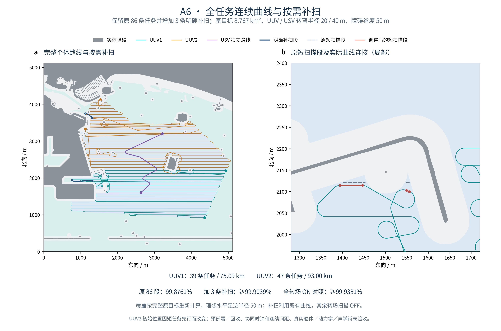

# A6：完整个体曲线与按需补扫

本阶段已把两艘 UUV 的全部原扫描任务接成符合声明转弯半径的连续曲线，并明确新增 3 个补扫任务，使理想覆盖的保守下界达到 **99.9039%**。原 **8.767 km²** 目标、50 m 障碍裕度与原 86 个任务 ID 完整保留。这里验收的是个体二维运动与理想足迹；协同任务时钟和连续间距尚未验收。

浅蓝为原覆盖目标，浅青为目标外的安全导航水域，灰色为实体障碍；深蓝标出新增补扫段。右图只裁剪显示窗口，左图保留完整目标。图中的 USV 是独立运动路线，没有表示它已按新 UUV 时钟完成支援。

## 1. A5 的连接为何需要联合调整

A5 保持原扫描端点时只接通 47/90 处连接，调整端点后仍卡在短扫描段及狭窄通道。问题涉及前后任务的可到达朝向：一个短段单独能驶出，不代表按原任务顺序可以先驶入，再以该朝向离开。

A6 同时探索：短段位置平移、32 个朝向、多个长度、长段端点退回，以及任务顺序。所有 A5 合格候选均强制保留，避免有限代价裁剪删除已接通的子链。连接按整层逐级升级：直接 Dubins 曲线 → 有限航路点绕行 → 有预算的前进位姿搜索；更复杂阶段只在整个较简单阶段无法接通时启用。

顺序采用声明的有限优先级，找到首个完整顺序后停止。UUV1 保留源任务顺序；UUV2 将邻近短任务调整为 **`scan_048 → scan_072 → scan_044`**，先完成这一组，再进行其余任务。该组后置的有限搜索结果保留为失败记录；前置方案成功不代表全局最优顺序。

**UUV2 初始位置因此改变。** 本轮沿用预部署后开始计时的边界，没有计入如何到达新起点，也未验证回收。UUV1 有 17 个、UUV2 有 40 个任务的扫描几何发生变化；保留的是任务身份与完整目标，不是原 A3 的全部端点。

## 2. 完整个体曲线结果

| 平台 | 原扫描任务 | 新增补扫 | 路线长度 | 独立运动时间 |
| --- | ---: | ---: | ---: | ---: |
| UUV1 | 39 | 2 | 75.088 km | 15.004 h |
| UUV2 | 47 | 1 | 92.997 km | 18.826 h |
| USV | 0 | 0 | 3.183 km | 0.421 h |

时间属于各平台自身的启停模型，不含协同等待与部署／回收。A3 的 14.02 h 属于点折线、匀速基线；新约束和初始位置边界已有变化，不能直接作为等条件快慢比较。

- UUV / USV 最小转弯半径为 **20 / 40 m**；只前进，不原地旋转。曲线为位置与航向连续的 G¹ 直线／圆弧组合。
- 巡航速度上限分别为 UUV **1.5 m/s**、USV **3 m/s**；切向加速度上限 **0.1 m/s²**，横向加速度上限 **0.05 m/s²**。
- 每个几何原语接头停稳再起步。曲率可跳变，尚未验证全局 G²、转向执行器、加加速度、真实船体和控制跟踪。
- 成功路线整体位于固定 A5 安全导航水域；独立弦线误差包络检查得到原始实体障碍距离下界 **50.587199 m**。未放松障碍裕度。

## 3. 分开核算三种扫描策略

| 扫描策略 | 保守覆盖下界 | 99.9% 门槛 | 解释 |
| --- | ---: | --- | --- |
| 仅原 86 个调整后扫描段开启 | **99.8761%** | 未达到 | 普通转场全部关闭 |
| 原 86 个扫描段 + **3 个明确补扫任务** | **99.9039%** | 达到 | 其余转场仍关闭，发布的补扫方案 |
| 全部 UUV 转场扫描开启 | **99.9381%** | 达到 | 单列策略对照 |

发布的补扫方案覆盖区间约为 **99.903918%–99.903998%**，漏扫面积上界约 **8423.96 m²**，没有声称 100%。区间来自几何近似的内／外包络，不是统计置信区间。

三个补扫任务都位于已有转场曲线上。按保证新增覆盖面积贪心选择，逐次独立复核每次增量；未证明补扫任务数全局最少。

| 补扫任务 | 平台 | 开启时长 | 保证新增覆盖面积 |
| --- | --- | ---: | ---: |
| repair_001 | UUV2 | 366.334 s | 988.436 m² |
| repair_002 | UUV1 | 148.806 s | 730.588 m² |
| repair_003 | UUV1 | 378.449 s | 717.354 m² |

累计增加扫描开启 **893.589 s（约 14.9 min）**。航线与独立运动速度曲线完全不变，所以本模型内额外航行距离与运动时间为 0。导出的开启时段使用各平台自身的局部时钟；未来加入出发延迟和等待后，需要映射到共同任务时钟。

足迹仍为**理想水平 50 m 圆形传感范围**，不含遮挡、姿态、真实深度、声呐性能或能耗验证。补扫是明确的新任务，不把全转场开启的对照结果算成原 86 段策略通过。

## 4. 独立验证与复现边界

本轮新增 14 项标准库与 11 项科研检查，累计 **182 / 94 项**通过。完整路线与补扫各有独立审计，核查任务无遗漏／重复、连续接头、前进方向、曲率、整段安全包络、速度积分与传感足迹。

- 对全部 586 个几何原语重新计算圆弧及接头，位置接头误差最大约 **1.44×10⁻¹² m**，航向误差约 **2.06×10⁻¹⁵ rad**；这些是数值一致性误差，不是实际控制精度。
- 生产与独立审计分别使用至多 0.02 m / 0.01 m 弓高的圆弧包络。直线足迹上界使用等宽矩形和外接端点圆多边形，并带 1 μm 数值外扩，避免把整条长扫描带放大；原有内接数值足迹下界保持。
- 独立 NumPy 用圆心／扇区公式直接计算点到圆弧距离。在完整目标内 **350,612** 个 5 m 格点上，补扫策略的点估计为 **99.9090%**；整面保守下界为 **99.9039%**。有限格点估计不作为面积验收依据。
- 较早 20 m 探针对“全转场开启”的点估计为 99.8903%，细化为 5 m 后为 99.9432%；两次记录都保留。边界和细小漏扫区存在格点混叠，正式门槛采用完整矢量面的保守面积界。
- 规划入口的 A3／A5／导航输入，以及补扫入口的路线／审计匹配／目标输入，合计六类改动均在生成输出前拒绝。科学输入固定，仅 A6 总计算耗时允许在重跑时变化。
- 正式图的面板对齐、PDF 最小 9 pt 字号、文字碰撞 **0 FAIL / 0 WARN** 和目视检查通过。绘图窗口裁剪不修改任务、轨迹或覆盖统计。

从干净代码导出、使用固定 A1／A3／A5 输入重做 A6 与补扫，两项独立审计通过；A6 科学 JSON 仅总计算耗时不同，补扫 JSON 仅源结果哈希不同，9 份覆盖几何与补扫时段 CSV 共 **10 个文件逐字节一致**，正式 PNG 复跑也逐字节一致。核对与源哈希见本地证据；公开汇总见 [A6 数值汇总](../docs/joint_coverage_a6_summary.json)。本地完整海图、坐标、原始运行记录与协作文件不上传。

## 5. 运行入口与下一阶段

README 第 6 部分已给出 A1→A6 的完整命令。A6 使用固定 A1 / A3 / A5 输入；新增运行入口依次为：

1. `scripts/run_joint_coverage.py`：生成个体曲线、扫描位置／顺序及策略对照。
2. `research_tests/audit_joint_coverage.py`：独立核查完整个体路线和足迹。
3. `scripts/schedule_repair_scans.py`：安排明确补扫，导出 `repair_schedule.csv`。
4. `research_tests/audit_repair_scans.py`：核对补扫身份、时段、增量和全目标覆盖。
5. `scripts/plot_joint_coverage.py`：只绘制匹配的已通过审计结果。

新增算法为本项目的有限工程候选与搜索，沿用的 Dubins 标量公式来源见 [A5 来源登记与 MIT 许可](../docs/dubins_sources_a5.json)。不是作者代码，也不是全局最优或连续空间无解证明。

下一阶段 **A7**：给两艘 UUV 和 USV 建立共同任务时钟，重新编排支援与等待，独立验证变速曲线上的连续最小间距和支援距离。A3 的匀速直线距离公式不直接套用，A6 各平台独立时间也不直接作为最终任务时间。

本阶段属于开放海图应用扩展；原论文第三章的严格数值复现状态仍单独保留。
