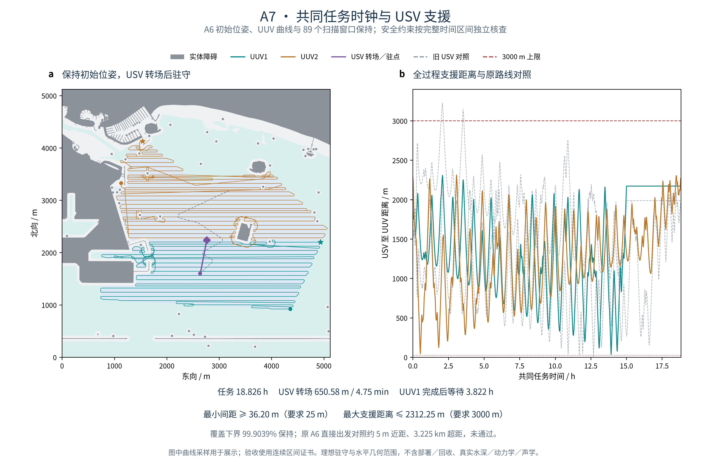

# A7：共同任务时钟与连续间距核查

记录日期：2026-11-03（America/New_York）。本阶段接续 A6 已通过的个体曲线与三段明确补扫，将三平台放到同一时间轴，重新安排 USV 支援并核查全过程距离。



## 结果与对照

保持 A6 三平台初始位姿、两艘 UUV 的曲线及启停速度律；USV 从原起点沿半径不小于 40 m 的前进曲线到达支援驻点，随后理想驻守。两个 UUV 无需延迟出发，UUV1 先完成后显式等待。全部 86 个原扫描任务、3 个补扫窗口及原目标保留，等待和其余普通转场不扫描。

| 指标 | A7 结果 |
| --- | ---: |
| 共同任务时长 | 67,772.971212 s / 18.825825 h |
| UUV1 / UUV2 航行距离 | 75,087.831248 / 92,997.134512 m |
| UUV1 完成后等待 | 13,759.809637 s / 3.822169 h |
| USV 转场距离 / 到达时间 | 650.580543 m / 284.885139 s |
| USV 到达后驻守时间 | 67,488.086073 s |
| 全过程最小水平间距保守下界 | 36.200432 m；要求 ≥ 25 m |
| 全过程最大 USV–UUV 支援距离保守上界 | 2,312.242297 m；要求 ≤ 3,000 m |
| 独立整段几何核查的最小实体障碍距离下界 | 50.585982 m；原裕度 50 m 保留 |
| 理想覆盖下界 / 漏扫面积上界 | 99.90391756% / 8,423.957462 m² |

覆盖直接继承已独立审计的 A6 三补扫结果：UUV 的路径、扫描几何和速度律均未改变，扫描窗口只映射到共同时间轴。本轮未重新计算重复覆盖率；旧 A2/A3 重复率不代表 A7。

**负对照也保留。** 若让 A6 的三条独立曲线直接在零时刻出发，并在结束处等待，USV–UUV2 出现约 **5.000016 m** 的近距见证，USV–UUV1 出现 **3,225.405590 m** 的超距见证。因此，不能直接取 A6 个体耗时的最大值就宣布协同通过。A7 保留相同初始条件，改变 USV 路线后才满足约束；其任务时长恰好仍由 UUV2 决定。

| 平台对 | 最小距离下界 | 最小距离见证 | 最大距离见证 | 最大距离上界 |
| --- | ---: | ---: | ---: | ---: |
| UUV1–UUV2 | 870.967565 m | 871.016958 m | 4,120.195113 m | 4,120.242087 m |
| USV–UUV1 | 36.200432 m | 36.250000 m | 2,308.414435 m | 2,308.463977 m |
| USV–UUV2 | 43.701852 m | 43.750001 m | 2,312.196674 m | 2,312.242297 m |

3,000 m 上限只约束 USV 与各 UUV，不约束两艘 UUV 之间的距离。见证来自具体时刻，外侧上下界覆盖整个连续时间区间。

## 实验流程

1. 核对 A6 路线、补扫与两份通过的独立审计，固定目标、障碍与 A5 安全导航域的 SHA；改变科学内容即拒绝运行。
2. 给 A6 三条原曲线建立共同时间轴，保存上述负对照及全部时间区间证书。
3. 按固定出发时隙检查 UUV 间距。本例零延迟已通过，两艘 UUV 曲线及速度律保持。
4. 在安全导航域的 25 m 网格中筛选驻点：距完整 UUV 路线至少预留 30 m、支援范围另留 50 m；先按最坏静态支援距离排序，再按路线间距等条件排序。
5. 从原 USV 初始位姿搜索前进 Dubins 转场曲线，检查整段导航域包含及障碍裕度，按启停速度赋时，再核查所有平台对。
6. 将 89 个扫描窗口映射到全局时钟，写入出发前等待和完成后等待，生成解析运动回放。

候选驻点最多 20 个；出发时隙、航向及曲线族均有固定预算。本例第一个驻点及零延迟方案通过。该选择不构成连续空间或任务时间的全局最优证明；有限搜索失败也不等于真实无解。

## 连续时间怎样核查

对每条直线／圆弧，使用加速、匀速和减速阶段的弧长积分计算位置；航向由解析曲线确定。每个连接处停稳，保持位置与航向连续（G1），不声称全局 G2 或真实艇体动力学可行。

在区间 `[a,b]` 取中点 `m`，以两平台从中点到左右端点的累计弧长之和较大者为 `R`，并加入数值外扩及接头位置误差总和。由位移不超过行进弧长，区间内任意时刻的距离都位于：

```text
max(0, d(m) − R) ≤ d(t) ≤ d(m) + R
```

区间覆盖完整任务时间，包括转弯、加减速和等待。优先二分可能包含全局极值的区间，直到极值见证与外侧界的间隙均不超过 0.05 m；不收敛不会判为通过。**0.05 m 是数值极值区间宽度要求，不是实际跟踪精度或定位精度。** CSV 帧和图上采样只用于展示。

## 验证证据

- **193 项标准库算法测试、99 项科研检查通过**，含帧间交叉、圆弧内部近距、等待平台被接近、缺失证书区间及伪造界／见证拒绝等专项检查。首次标准库命令缺少 `PYTHONPATH=src` 仅导致导入失败；补正后全量通过，原日志保留。
- 独立实现以圆心旋转和三相速度积分重算，复核全时段证书、89 个扫描窗口和 25,005 行共同时间 CSV；最大位置数值差约 `9.84e-12 m`。全曲线导航包含、曲率、速度和加速度另核查。
- 干净代码导出重跑后，科学结果一致，仅总计算耗时不同；12 份派生文件（含 7 份区间证书及 2 份 CSV）与 PNG 逐字节一致。A6 科学内容、补扫内容、失败审计及导航文件变化四类负控制均在创建输出前拒绝。
- 浏览器实际核对桌面／390 px 窄屏、拖动、播放／暂停、重置和结束；12 时刻共 36 个平台状态与独立公式一致，补扫及等待状态正确，无脚本错误或外部网络请求。
- 图件保留障碍、目标和安全导航背景；双面板对齐、PDF 最小 9 pt、渲染碰撞 0 fail / 0 warn 及目视检查通过。源代码检查的 TIFF、600 dpi 和常见期刊宽度提示不适用于本次 GitHub 预览约定；交付 300 dpi PNG、可编辑 PDF/SVG，不宣称某期刊投稿验收。

公开数值汇总见 [curved_cooperation_a7_summary.json](../docs/curved_cooperation_a7_summary.json)，完整命令见 [README 运行指南](../README.md#6项目运行指南)。本地证据目录由忽略的 `outputs/a7_latest_local.json` 指向，含正式运行、独立审计、原始失败日志、干净复跑、回放与图件核查；原始海图、完整坐标／CSV／HTML 和协作交接文件不上 GitHub。

## 解释范围与下一步

A7 完成了声明模型内的共同任务时钟和协同距离核查：二维点平台、有限曲率前进曲线、启停速度、显式等待、理想水平扫描足迹和固定 3 km 几何支援范围。USV 转场后理想驻守约 18.75 小时，尚未验证洋流下驻守、能耗、深度／三维避碰、声学链路、真实船体及控制跟踪，也不计部署与回收。路径和条件变化后必须重新出具证书，不能沿用本例通过结论。

下一步建议 A8 固定本基线，检查更严格支援范围下驻守方案的适用边界，并与移动支援方案对照；之后再接跟踪控制及环境扰动。支援半径变化须作为明确的新实验条件，不能修改本轮 25 m／3 km 验收门槛。原博士论文第三章的严格原图／原表对齐仍单独记录，应用阶段通过不替代该验收。
