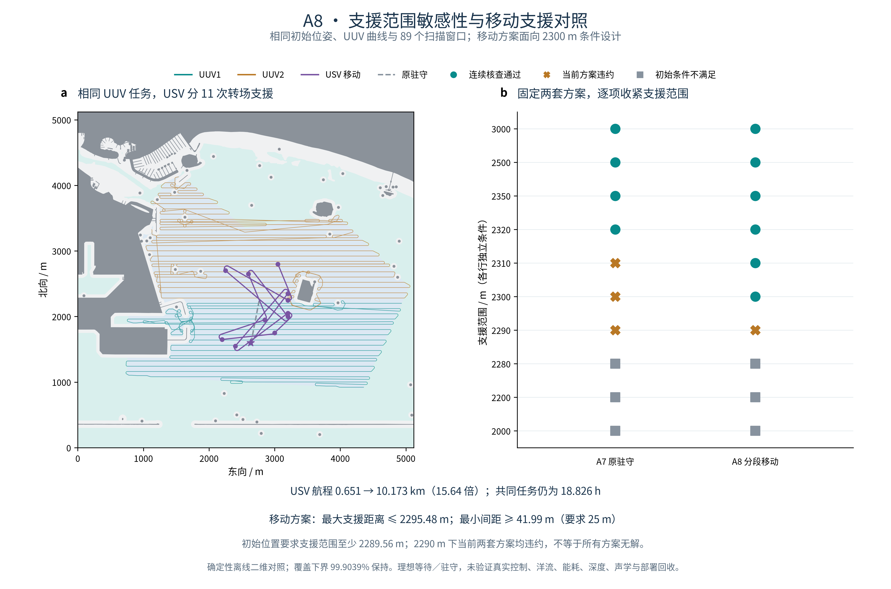

# A8：支援范围敏感性与移动支援对照

记录日期：2026-11-03（Asia/Singapore）。固定 A7 的三平台初始位姿、两艘 UUV 的曲线／速度律、共同任务时长及 89 个扫描窗口，比较原驻守与分段移动两套 USV 支援策略。移动方案通过 2300 m 支援范围，但其 USV 航程约为原方案的 15.64 倍；本阶段用于明确适用边界和代价，不宣称移动方案全局最优。

图左灰色为实体障碍，浅色背景区分安全导航水域与覆盖目标；紫色为实际生成并核查的 USV 曲线。平面航迹相交不等于同一时刻碰撞，安全验收依赖共同时间轴上的连续间距。图右是逐项条件，纵向行距不代表支援半径的数值比例。圆点、叉号、方块分别表示连续核查通过、当前方案存在违约见证、初始条件不满足。

## 结果与代价

| 指标 | A7 原驻守 | A8 分段移动 |
| --- | ---: | ---: |
| USV 航程 | 650.580543 m | 10,173.334219 m |
| USV 实际运动时间 | 284.885139 s | 4,364.177730 s |
| USV 转场次数 | 1 | 11 |
| 最大支援距离保守上界 | 2,312.242297 m | 2,295.476047 m |
| USV–UUV 最小间距保守下界 | 36.200432 m | 41.995330 m |
| 共同任务时长 | 18.825825 h | 18.825825 h |
| 2300 m 支援范围 | 原方案超距 | 通过 |

移动方案额外航行 **9522.753677 m**；最大距离上界数值相差约 **16.77 m**，但没有缩短 UUV 决定的任务时长。航程和运动时间是已计算成本，不能据此直接计算能耗。本轮不把高频移动解释成更高效的策略；它是满足较紧支援范围的一个可行对照。

两艘 UUV 的轨迹和扫描时段完全保持，因此理想覆盖下界仍为 **99.90391756%**，没有通过删减任务、缩小目标、放宽 50 m 障碍裕度或改变 UUV 速度达标。UUV1 完成后等待沿用 A7；USV 所有等待与转场均不扫描。新 USV 全曲线的独立障碍距离下界为 **88.820145 m**，UUV 继续沿用已核查的原路线；不能将这个 USV 数值当作三平台共同最小障碍距离。

## 支援范围逐项比较

移动策略针对 **2300 m** 条件生成一次，然后与同一套 A7 驻守策略一起，在预先登记的 10 个支援范围上评价。它不是每个半径重新优化，也不是 10 份独立随机实验；不做显著性或平均性能推断。

| 支援范围 / m | A7 原驻守 | A8 分段移动 |
| --- | --- | --- |
| 3000、2500、2350、2320 | 连续核查通过 | 连续核查通过 |
| 2310、2300 | 当前方案超距 | 连续核查通过 |
| 2290 | 当前方案超距 | 当前方案超距 |
| 2280、2200、2000 | 初始条件不满足 | 初始条件不满足 |

**2290 m 下两套方案失败，不等于所有策略都无解。** 对相同初始位姿、从零时刻即要求支援的任务，USV 与 UUV2 的初始距离已为 **2289.562696 m**；比它更小的范围，在任何后续移动之前就已经违约。这是必要条件，与有限候选规划失败是不同结论。

另一个必要条件来自三角不等式：同一时刻 USV 同时处于两个 UUV 的半径 `R` 内，必须满足 `UUV间距 ≤ 2R`。原 UUV 曲线在已核查见证时刻的半间距为 **2060.097556 m**。本例初始位置要求更严格；两个条件均不构成包含障碍和速度限制的充分可行性证明。

在极值区间跨过阈值而没有违约见证时，程序输出 `unresolved_bounds`，不会强行判通过或判无解。当前十个条件没有出现这种不确定分类。

## 移动方案怎样生成

1. 用 A7 科学内容哈希及通过的独立审计固定输入，继续使用相同 A1 完整目标、A5 导航域和原障碍裕度。配置见 [support_sensitivity_a8.json](../configs/support_sensitivity_a8.json)。
2. 将 18.826 h 任务分成 **38 个最长 30 分钟的时间窗**。这是确定性离线规划，已知完整 UUV 时间表，不是实时控制器或 MPC。
3. 每个窗先核查 USV 继续保持当前位置是否满足全部连续时间约束；若通过就等待。
4. 若保持不通过，在预先限定的 50 m 网格中，按本窗两艘 UUV 的最坏预计距离排序，最多检查 12 个候选点。10 s 预测采样只用于候选排序；30 s 位置检查只用于拒绝已经出现违约的候选，不用于安全通过。
5. 从上一段实际终点和航向生成前进 Dubins 曲线，保持最小转弯半径 40 m、最高直线速度 3 m/s、切向加速度 0.1 m/s²、横向加速度 0.05 m/s²。整条曲线必须通过导航域包含与障碍裕度检查，并在本窗内到达。
6. 对转场及其后等待使用解析弧长时间律，核查整窗 25 m 间距和 2300 m 支援范围；最后对完整任务再次生成连续距离证书。所有段间等待显式保存，不用直线连接回放帧替代真实运动。

共选出 11 次转场，其余时间理想等待；累计运动约 72.74 min，累计等待约 17.61 h。每个原语接头停稳，位置和航向连续（G1）；没有全局 G2、实际船体或洋流下驻守验证。若有限候选中没有通过项，保存部分计划并标记搜索未解决，不能据此证明全局无解。

## 核查与可重复性

- **204 项标准库算法测试、105 项科研检查通过**，新增多航段累计弧长、段间等待、等待时碰撞、窗口时间变换、缺失证书不放行及阈值不确定等检查。
- 独立实现使用圆心旋转及三相速度积分，复核 **156 份整窗／全任务证书**，并重新核查继承的 UUV 间距证书。38 窗覆盖完整任务，初始条件、全部等待、UUV 源路径／速度与 89 扫描窗口保持。
- 独立复算 **15,075 行**三平台轨迹 CSV，最大位置数值差约 `9.84e-12 m`。该数值是两套计算公式的一致性，不能解释为真实定位精度。整段 USV 导航包含、障碍距离、转弯半径、速度和加速度另行检查。
- 干净代码导出重跑后，科学 JSON 一致，仅总计算耗时不同；**160 份派生文件及 PNG 逐字节一致**。A7 科学内容、失败审计、导航文件三类变化均在创建输出前拒绝。
- 两类独立审计负控制分别删除连续证书区间、伪造 2290 m 通过标签；即使重写对应哈希标记，数学核查仍拒绝。
- 图件为实算结果，双面板对齐、PDF 最小 9 pt、渲染碰撞 0 fail / 0 warn 及目视通过。交付约定为 GitHub 300 dpi PNG 预览与可编辑 PDF/SVG；没有期刊 TIFF 或尺寸验收声明。首次绘图语法错误及一次审计目录拼写错误均已修正，失败日志保留。

公开汇总见 [support_sensitivity_a8_summary.json](../docs/support_sensitivity_a8_summary.json)，完整运行入口见 [README](../README.md#6项目运行指南)。本地证据由忽略的 `outputs/a8_latest_local.json` 指向，包含固定计划、正式运行、独立审计、负控制、干净复跑和图件 QA。原始海图、完整路线坐标／CSV 与本地协作文件不上 GitHub。

## 适用范围与后续方向

A8 延续 A7 的二维点运动学、理想水平扫描与几何支援范围，未模拟真实声学通信、深度、洋流、能耗、定位误差、跟踪控制和部署回收。离线预知 UUV 任务、理想等待与有限候选策略都是实验假设，不能直接作为海上作业方案。

当前结果支持先优化 USV 航程、移动次数与支援裕度之间的取舍，再选择固定基线进入跟踪控制／扰动验证。2290 m 附近仍有初始必要下界与当前移动策略之间的空间，未证明最优所需支援范围。原博士论文第三章的严格原图／原表对齐继续独立记录，应用扩展通过不替代原文验收。
