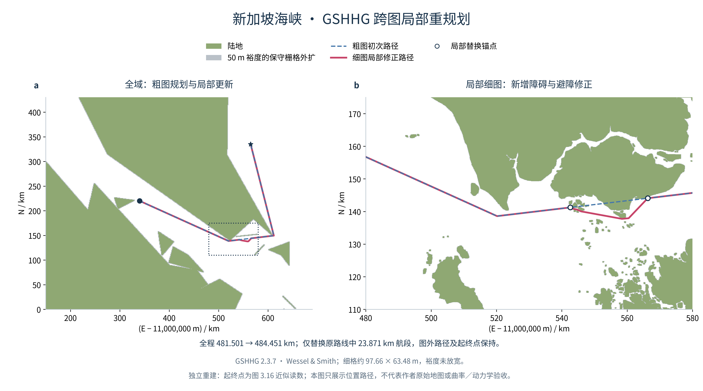

# R8：真实海岸线上的跨图局部重规划

2026-10-30（America/New_York）。已实现并验证第 3.3 节的独立实验链：经纬度／米制／栅格转换 → GSHHG 粗细海图 → 粗图寻路 → 细图发现碰撞 → 仅替换受影响航段。**本次真实数据算例通过，不等于作者图 3.16 的严格同值复现。**



## 输入条件与来源

- 数据来自 [GSHHG 官方 2.3.7 发布](https://github.com/GenericMappingTools/gshhg-gmt/releases/tag/2.3.7)的 native binary 压缩包，118617033 字节，SHA-256 为 `28600e8f7a08645aab43079326df6504212ec5ccb2b4bcf3b5f4f12ed60e82bc`。它与 [Zenodo 记录](https://doi.org/10.5281/zenodo.7007502)指向的 GMT netCDF 分发格式不同，不混用校验值。
- 按包内 README 解码大端 11 整数头和微度经纬度；L1／L3 填陆，L2／L4 填水，再保守阻塞所有岸线触及的格子。当前区域含粗图 10 个 L1，细图 122 个 L1 与 1 个 L2。
- 投影保持论文 `a=6378137,b=6356755,B0=L0=0`，使用经独立 PROJ 检验的标准 E/N 约定。[坐标审计](R8_坐标公式核查.md)记录原式轴向、单位和非零纬线尺度疑点。
- 起点 `(11340000,220000)` m、终点 `(11565000,335000)` m，是根据图 3.16 刻度近似读取后冻结的独立输入，**不是作者精确端点**。
- 粗图用 `c` 岸线、512×512 格，范围 E=11150000—11690000 m、N=0—430000 m；细图用 `f` 岸线、1024×1024 格，范围 E=11480000—11580000 m、N=110000—175000 m。分辨率与窗口是明确的工程选择，作者实际比例尺／栅格参数尚未确认。
- 冻结配置：[singapore_r8.json](../configs/singapore_r8.json)；完整数据及处理登记：[r8_data_sources.json](../docs/r8_data_sources.json)。数据许可见 [GSHHG.LICENSE.txt](../third_party/GSHHG.LICENSE.txt)。原始数据包及地图 JSON 只留本地。

## 50 m 裕度的具体含义

先建立保守的陆地格，再把距离这些**闭栅格矩形**不超过 50 m 的格子纳入阻塞。陆地从不清除；该规则不是对矢量海岸做精确 50 m 缓冲。

粗格约 1054.69×839.84 m，细格约 97.66×63.48 m。当前两图的 50 m 阈值均小于单格尺寸，实际相当于向相邻一格保守外扩，排除带大于精确海岸的 50 m。这能避免栅格边缘漏检，却会影响长度与通道可达性，**不能据此声称与论文 50 m 条件严格等价**。后续需作者网格参数或分辨率收敛核查。

默认禁止放宽裕度；显式开启 `--allow-margin-relaxation` 后，只有带裕度的修正失败才测试仅保留陆地的地图，并记录 `margin_relaxed=true`。真实陆地不会因回退而开放。本次正式结果没有触发回退。

## 实际结果

| 检查项 | 结果 |
| --- | --- |
| 粗图初始路径 | 481501.196734 m，4 个航路点；在粗图无碰撞 |
| 初始路径进入细图 | 与 191 个细图阻塞格相交，确实需要修正 |
| 最终全局路径 | 484451.486075 m；在各自有效海图范围通过几何检查 |
| 实际替换的原航段 | 23871.376277 m，不是重新规划整条路线 |
| 细图内保留的原前／后段 | 66680.813591 m／13782.947569 m |
| 全局起终点及图外前后段 | 逐坐标保持，未移动端点或清格 |
| 地图与裕度 | 细图 386951 个陆地格均保留；含裕度 401088 个阻塞格 |
| 裕度放宽 | 否，保留 50 m 保守闭格条件 |

先按粗图完成整体 A*／Theta 式寻路，再在细图内按固定 100 m 空间步长定位首次与末次受阻区间，向外预留 200 m 锚点余量。每个采样区间仍做整段闭矩形检测，不是只检测样点。仅在两个锚点之间运行搜索，最后拼回原前后段。

跨海图边界插入的锚点使用 1 微米内缩以适配半开栅格归属，全球起终点不变；单次连续穿越是当前实验接口的明确限制。图外航段仍由粗图验证，没有声称加载并检查了全球精细海图。

## 验证及独立审查

- 投影：4 组参数×412 点，共 1648 组 PROJ 正逆参考比较通过；最大正变换差约 `7.51e-9 m`、逆变换差约 `5.26e-13°`。
- 四叉树：全空／全阻塞区域均合并；邻接、点归属和闭矩形 LOS 与旧小图参考核对。局部重规划覆盖小障碍、采样点之间障碍、多个受阻区间、无路和阻塞端点。
- 栅格化：另用既有 GEOS 3.14.1 独立裁剪原始 GSHHG，核查粗图全部 262144／细图全部 1048576 格中心，漏填陆地点为 0；独立四边相交检查粗 54／细 5023 条岸线边，漏阻塞岸线格为 0。
- 路径：独立检查原始未合并阻塞格，不调用规划树 LOS。最终全局 12 段对全部细图阻塞格无碰撞，包含海图微米级接缝；粗图和图外片段也通过各自检查。
- 失败策略：合成阻断例证明默认不放宽；显式放宽才尝试 0 m，真正的陆地墙在放宽后仍失败。
- 图示：面板对齐、最低 10 pt 字号和 PDF 文字碰撞审计通过；完整源数据／脚本哈希、失败草图及修正版本地保留。统计不确定性不适用于这条固定几何算例。

正式地图：`outputs/20261031T022012_163786Z_gshhg_r8_maps/`；最终运行：`outputs/20261031T023200_004692Z_cross_chart_r8/`。两份独立审查位于 `outputs/20261031T022449_528138Z_r8_integration_review/` 和 `outputs/20261031T022721_853622Z_r8_independent_review/`；早期同路径输出保留未覆盖。

## 复跑入口

主规划与下载脚本只使用标准库。地图处理和绘图使用项目已有科研环境；没有为本轮安装新依赖。每条命令创建新输出，后续参数替换为该步实际输出目录。

```bash
.venv/bin/python scripts/download_gshhg.py
python scripts/build_gshhg_maps.py
.venv/bin/python scripts/run_cross_chart_r8.py --map-dir outputs/<本次地图目录>
python scripts/plot_cross_chart_r8.py \
  --map-dir outputs/<本次地图目录> --run-dir outputs/<本次规划目录> \
  --output-dir outputs/<新的绘图目录>
```

运行脚本核对地图包输入哈希，绘图脚本核对结果和实际地图哈希，避免把不同版本的障碍背景与航迹混画。README 的完整项目运行指南仍按用户要求暂不展示，本报告只提供本阶段的复跑证据入口。

## 仍不能宣称完成的事项

本例是位置折线规划，不保证曲率、起终航向、船体包络或动力学。作者精确端点、地图版本／比例尺、网格尺寸和裕度离散化仍未知，图 3.16 严格同值未验收。裁剪输出是供偶奇填充使用的环，部分凹面跨窗后会自接触；本次与 GEOS 独立核查没有漏陆，但不把它称为可直接输出的合法 OGC 单多边形。读入窗口仅支持 0—180°E 的非换日线区域。
