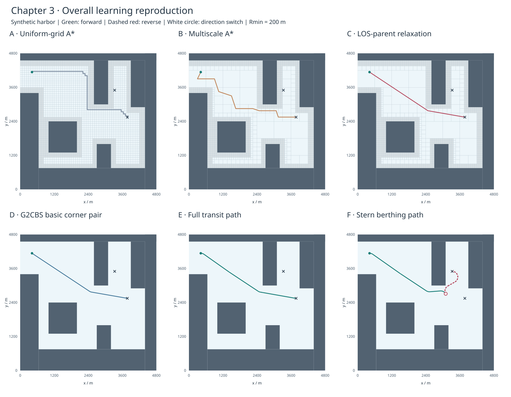

# 第三章整体流程基线 v0.1

日期：2026-10-29，America/New_York。固定配置和程序本机实际运行，非论文表3.3抄录。先整体再局部的学习实验。

[打开回放与六阶段图](baseline/v0.1/index.html) · [实际配置](baseline/v0.1/config.json) · [完整指标](baseline/v0.1/metrics.json) · [环境和源代码哈希](baseline/v0.1/environment.json)

## 配置和来源

- 合成矩形港口4800×4800 m，深度6，最小单元75 m。搜索障碍余量150 m；独立曲线碰撞对原始障碍加30 m余量。
- 使用论文第37、42、44页的两个起终位姿，最大曲率0.005 m⁻¹，对应最小半径200 m。
- 倒车权重2、起段锚点选择、末段最后1/3按约100 m采样尝试、仅共边邻接均是明确配置／补全。没有使用长滩港原图。
- 源码固定版本见[来源记录](../docs/05_sources.md)。完整参考文献127尚未成功获取；G2CBS基本构造依据带MIT许可的独立实现并独立检查。

## 实际结果

| 算例 | 长度m（采样近似） | 倒车m（基元精确和） | 方向切换 | 末段方向 | 最大曲率m⁻¹ |
| --- | ---: | ---: | ---: | --- | ---: |
| transit | 3796.1 | 0.0 | 0 | 前进 | 0.005 |
| stern_berthing | 4265.2 | 1129.5 | 1 | 倒车 | 0.005 |

四叉树叶数：2935（空闲173）；同最细尺度均匀网格：4096（空闲1334）。目前填充陆地内部占据，四叉树仍会细分有障碍区域；尚未按论文只保留外缘点。叶数不是内存测试结果。

| 算例 | 搜索方式 | 长度m | 曾入open的不同节点 | 入closed的不同节点 | 搜索耗时s（单次） |
| --- | --- | ---: | ---: | ---: | ---: |
| transit | baseline | 5086.9 | 750 | 719 | 0.69269 |
| transit | multi | 4589.6 | 66 | 46 | 0.07829 |
| transit | improved | 3790.1 | 45 | 16 | 0.08747 |
| stern_berthing | baseline | 4989.5 | 688 | 661 | 0.63952 |
| stern_berthing | multi | 4842.6 | 82 | 70 | 0.09804 |
| stern_berthing | improved | 4107.3 | 81 | 67 | 0.20319 |

计数包含显式start、goal节点；closed即弹出处理节点数。原文“展开”描述与本表各字段不能未经核对直接等同。搜索时间包括邻接、LOS和堆操作，地图构建另计，排除HTML、绘图和文件输出；没有预热／重复计时，不能由此作稳定加速结论。不同图的邻接几何亦不同，不把四邻域均匀A*当作具有相同优化问题的最优性证明。

## 验证

- 35项标准库测试通过，含固定种子40对随机位姿，见[完整日志](baseline/v0.1/test_results.txt)。
- S1仍是10叶、9空闲、1障碍，总面积64、无重叠；[迁入后的S1基线](S1_baseline.md)独立保留。
- 两条完整路径通过独立的起终位姿残差、相邻段位置／船首角衔接、末段方向和曲率检查。位置误差阈值1e-5 m、朝向1e-7 rad，均为计算几何数值残差，不是船舶控制精度。
- 三次曲线用控制点凸包递归细分作保守碰撞检测；RS圆弧用弦段和弓高余量检测。不是仅检查路径采样点。有限浮点检查不等于形式化证明。
- G2CBS曲率用解析导数和数值极值检查，RS曲率由基元精确给出；上界容差相对1e-4。转角对内部及相邻直线满足位置、切向、曲率连接检查；RS段及其衔接处允许曲率跳变。
- 网页回放已核对船艉抵泊末端显示倒车、x=3330、y=3500、船首0°。回放按几何采样序号推进，没有真实时间或停船动力学。

## 仍未完成

原始港口地图、图像预处理、作者父节点更新、完整G2CBS短转角合并、3.3节地理标定与重规划、Smooth-RRT和JPS、表3.3数值和重复性能实验。不能用本结果声称论文全部复现或真实船舶可跟踪。

## 自己第一次运行建议

先不改参数运行 `scripts/run_demo.py`，记录“为什么A*折线不能直接作为靠泊轨迹，G2CBS与RS各改变了什么”。再只把倒车权重改成1或4，看末段序列与倒车长度是否变化；不变也是有效结果，需要结合有限候选与障碍解释。暂不同时改地图和半径，以免无法判断变化来源。
