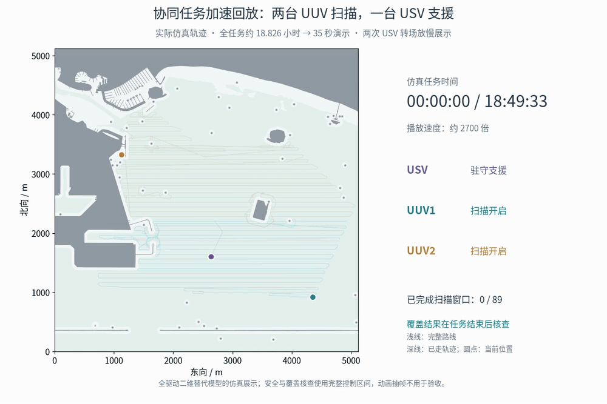
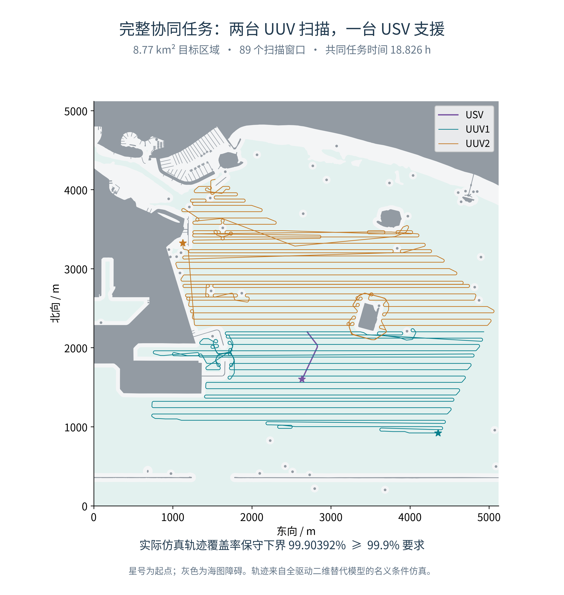
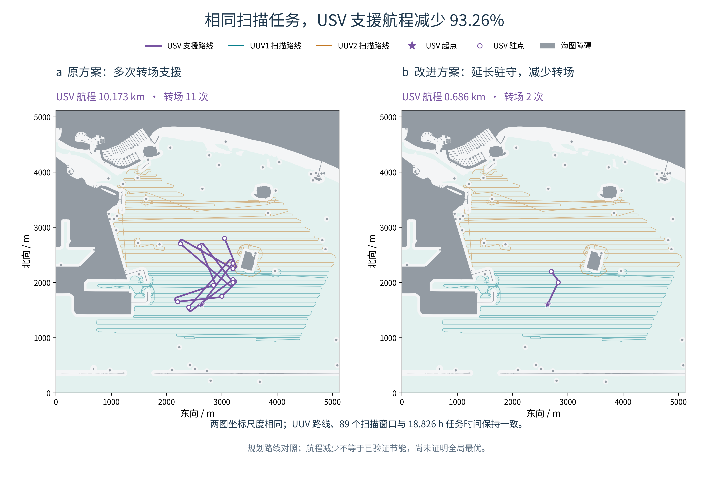
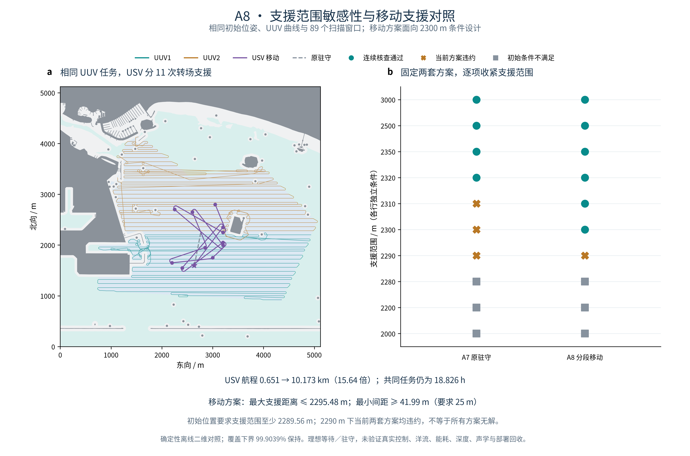
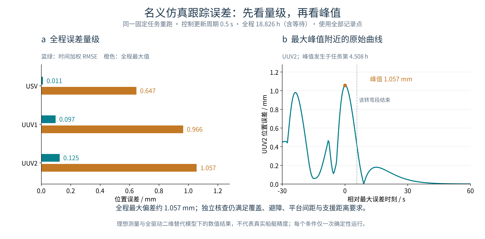
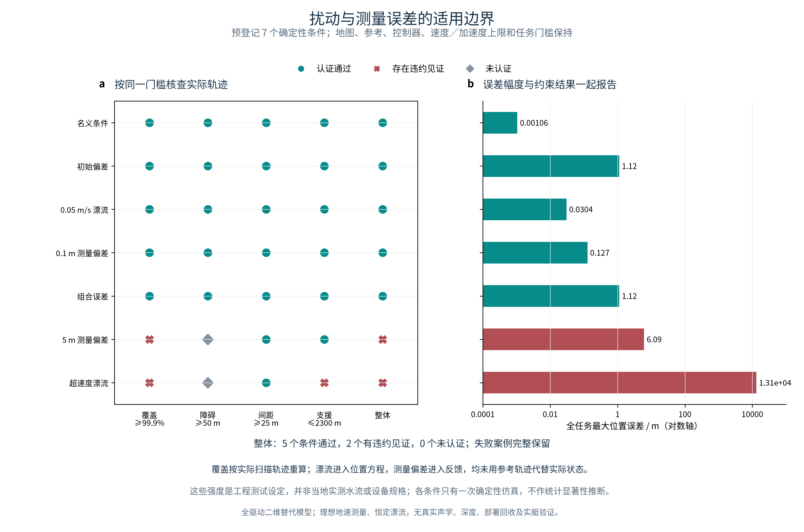
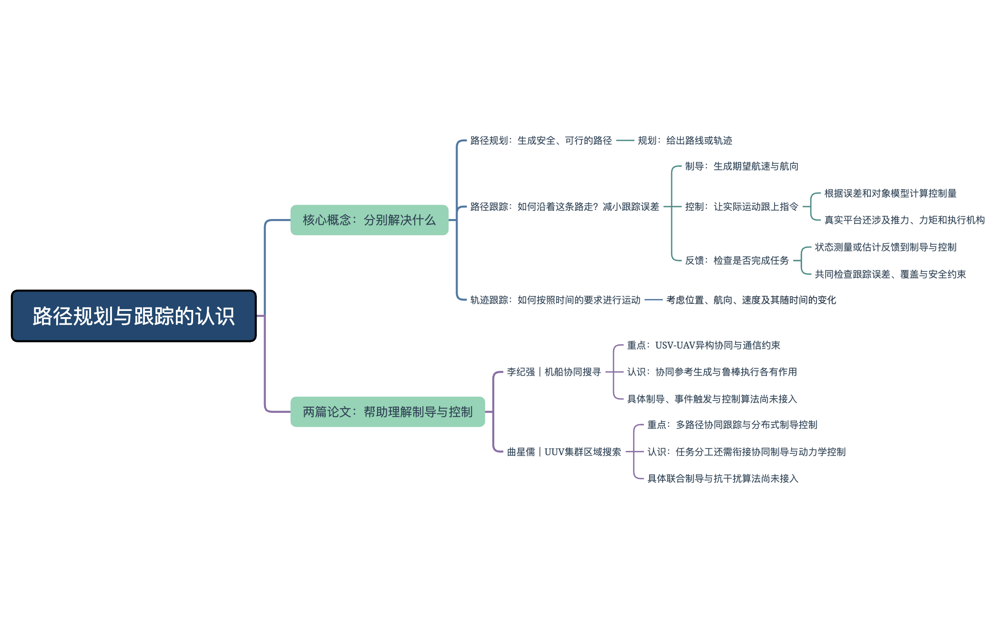

# 本周工作量汇报

**汇报时间：2026年11月10日**  
**工作区间：11月3日至11月10日，完成情况记录截至11月9日。**

本期工作分为两部分：第一部分介绍协同覆盖实验中解决的问题与形成的结果；第二部分介绍文献阅读、对现有工作的重新认识，以及组会后启动的船舶运动与控制基础学习。

| 工作主线 | 本期重点 | 形成的成果 |
| :--- | :--- | :--- |
| 协同覆盖实验与成果 | 任务衔接、USV支援改进、执行误差核查与完整集成 | 89个扫描窗口接入共同时间轴；USV航程减少93.26%；七类条件五通过、两违约；形成可复跑实验与图件 |
| 文献阅读与控制基础学习 | 梳理规划、制导与控制的关系，按组会反馈补充基础 | 两篇论文的框架对照、认知导图与三阶段学习路线；已启动第一讲，后续控制仿真待开展 |

**已有基础与本期继续解决的问题**

在本统计周期开始前，已经有靠泊规划方法的主要实现，以及真实海图上的覆盖分工和个体曲线路线。本期在这些基础上继续推进，重点从“生成路线”转向三个问题：**多条路线怎样组成一个完整任务？同样的任务能否减少USV移动？执行出现偏差后，任务是否仍能完成？**

课程作业不计入本次科研工作量。已有地图、算法与曲线路线作为本期工作的基础，不重复计为新增成果；后续学习计划与已完成实验分别说明。

## 一 协同覆盖实验与成果

### 问题一 怎样把已有路线组织成完整协同任务

**为什么要这样做**

单个平台的路线分别可行，并不代表多个平台同时执行也满足要求。两台UUV需要明确各自何时扫描、转弯和等待，USV则需要在相应时段提供支援；最后还要检查实际走出来的轨迹是否完成覆盖、是否保持了安全距离。

**本期做了什么**

- 沿用既有海图、覆盖分工和曲线路线，将两台UUV的扫描窗口、启停速度和USV支援安排接入同一个任务时钟。
- 统一登记扫描与非扫描时段，避免把转场、等待等过程误计为有效扫描；将89个扫描窗口映射到共同时间轴。
- 检查多平台同时执行时的间距和支援距离。11月3日完成了3000 m支援范围下的驻守方案核查，之后在同一任务时间轴上继续开展2300 m支援范围下的移动策略改进。
- 在最终集成实验中，依据实际反馈轨迹重新核查覆盖和各类距离约束。以下动画与轨迹图展示的是后续改进支援策略后的最终名义运行。

**35秒看完整协同过程**

约18.826 h的仿真任务压缩为35 s回放；两次USV转场各展示约4 s，结尾停留2 s。右侧显示仿真时间、当前倍速、平台状态与已完成扫描窗口数。[打开MP4视频](meeting-assets-20261110/mission-accelerated.mp4)

*看图重点：观察两台UUV怎样完成各自的扫描，再看USV何时转场。动画来自已核查的实际仿真状态，仅调整展示速度；窗口完成数不等于实时覆盖率。*

**完整任务轨迹与最终结果**

| 最终名义运行指标 | 核查结果 | 任务要求 |
| :--- | ---: | :--- |
| 扫描窗口 | 89个 | 按共同时间表执行 |
| 共同任务时长 | 约18.826 h | 固定UUV任务下的总时长 |
| 实际覆盖率独立下界 | **99.903920%** | 不低于99.9% |
| 最大支援距离保守上界 | **2295.416 m** | 不超过2300 m |
| 最小平台间距保守下界 | **38.375 m** | 不低于25 m |
| 最小障碍间距保守下界 | **50.580 m** | 不低于50 m |

**得到什么结果：** 在声明的模型和条件下，把覆盖分工、曲线运动、扫描时段、支援安排和实际反馈衔接成了一个完整任务，并能按同一组任务要求核查结果。安全结论来自完整时间区间与实际覆盖核查，动画用于展示过程。

任务能够衔接以后，接下来关注USV为了提供支援付出了多少移动代价。

### 问题二 同样的任务能不能让USV少走一些路

**为什么要这样做**

支援范围收紧到2300 m后，原驻守方案出现超距，需要USV移动支援。原移动方案已经能满足约束，但转场次数较多，因此进一步检查：哪些往返是可以减少的，能否让一次驻守支撑更长的后续任务？

**本期做了什么**

- 固定两台UUV的路线、启停速度、89个扫描窗口、三平台初始条件与共同任务时长，建立相同条件下的支援策略对照。
- 在2300 m支援范围、25 m平台间距和50 m障碍裕度要求下，优先核查USV能否继续原地保持；必须移动时，再选择支援驻点和转场路线。
- 结合后续任务时段调整驻点与转场时机，使一次驻守覆盖更多后续任务，减少反复往返。
- 候选路线筛选后，继续用完整时间区间核查距离要求，保留原移动方案作为比较基线。

**先看支援路线发生了什么变化**

*看图重点：紫色线为USV支援路线，左右坐标尺度相同；两台UUV的扫描任务保持一致。原方案多次往返，改进方案通过延长驻守和调整转场时机，仅保留两次转场。图示为规划路线对照。*

| 比较指标 | 原移动方案 | 改进移动方案 |
| :--- | ---: | ---: |
| USV支援航程 | 约10.173 km | **约0.686 km** |
| 转场次数 | 11次 | **2次** |
| USV运动时间 | 约72.74 min | **约5.87 min** |
| 共同任务时长 | 约18.826 h | 约18.826 h |
| 扫描窗口数 | 89个 | 89个 |

**得到什么结果：USV航程减少93.26%，转场由11次降到2次。** 改进集中在支援艇的移动安排，UUV任务与共同任务时长保持不变。当前结果尚未证明全局最优，也不能把航程减少直接解释为真实能耗减少。

**再看支援范围与移动代价的关系**

- 在2300 m要求下，原驻守方案超距，原分段移动方案能够通过，但航程约为驻守方案的15.64倍，这构成了进一步减少移动的直接动机。
- 图中各支援范围用于核查两套固定策略，并不是在每个阈值下重新求解最优策略。2290 m下当前两套策略均失败，不能据此断言所有策略都无解；小于初始必要距离约2289.563 m时，零时刻就已经不满足要求。

支援路线得到改进后，还需要区分规划参考与实际执行，继续检查偏差会不会破坏任务要求。

### 问题三 执行出现偏差后任务还能满足要求吗

**为什么要这样做**

规划轨迹满足覆盖和距离约束，并不自动说明平台实际执行后仍能满足。初始偏差、环境漂流和测量误差可能改变实际轨迹，因此需要让模型实际运行，再根据实际结果重新计算覆盖与安全距离。

**本期做了什么**

- 接入受限反馈执行：由控制指令推动状态积分，得到实际轨迹，再重新检查覆盖、避障、平台间距和支援距离。
- 对0.25 s、0.5 s、1 s三种控制更新周期开展名义核查，观察采样周期改变后的跟踪误差和任务约束结果。
- 保持同一参考任务与核查门槛，设置七类固定条件，对照初始偏差、漂流、测量偏差和组合误差的影响。
- 11月6日沿用固定输入与控制参数，独立复跑0.5 s名义条件；轨迹数组与原基线一致，并重新整理误差统计和成果图。

**先看名义条件下的误差量级**

- **左图看整段任务：** 蓝绿色为时间加权均方根误差，橙色为全程最大值；统计范围包括扫描、转场和等待。
- **右图看最不利片段：** 选择全任务、全部平台中的最大误差点，展示UUV2峰值前30 s、后60 s的原始曲线。峰值发生在任务第4.508 h附近的转弯段，曲线没有进行平滑或放大误差。

| 平台 | 时间加权RMSE | 最大位置误差 |
| :--- | ---: | ---: |
| USV | 0.0113 mm | 0.6469 mm |
| UUV1 | 0.0975 mm | 0.9655 mm |
| UUV2 | 0.1252 mm | 1.0567 mm |

三种控制周期的全任务最大位置误差分别约为0.270 mm、1.057 mm和4.102 mm，名义条件下的任务约束均通过。不同平台承担的任务和等待时段不同，不能仅凭这些RMSE数值比较控制器优劣。

这些毫米量级结果来自理想测量与全驱动二维加速度替代模型，不能作为真实船艇精度。当前模型中的反馈执行，与第二部分正在补习的真实船舶运动、PID、模糊控制和LOS制导分别记录。

**再看加入偏差后的任务约束**

| 条件 | 任务约束结果 | 从结果中看到的问题 |
| :--- | :--- | :--- |
| 名义条件、初始偏差、小漂流、小测量偏差、预设组合误差 | **五类通过** | 在当前模型与固定条件下，覆盖和距离要求均通过核查 |
| 5 m位置测量偏差 | **存在覆盖违约** | 实际覆盖下界约99.891117%，其上界也低于99.9%门槛 |
| 超出补偿能力的漂流 | **存在明显违约** | 跟踪偏差扩大，覆盖不足并出现支援超距；实际覆盖下界约3.750068% |

超速度漂流条件中，UUV的1.8 m/s东向漂流超过其1.65 m/s相对水速度上限，固定参考无法持续跟踪。结果保留了这一失败边界，没有通过删除失败条件或降低门槛来取得全部通过。

**得到什么结果：** 七类固定条件中，五类通过、两类出现违约，进一步明确了当前方案的适用范围。每类条件只有一次确定性运行；最大误差包含起始设定偏差，不能直接作为稳态误差，也不据此作统计总体结论。

**本部分形成的完整成果**

在共同任务、支援策略和误差核查的基础上，将固定原始海图、任务规划、反馈执行、独立核查、图件与报告接成统一流程，形成统一入口、配置和本地交互回放。固定输入的干净副本复跑与数值一致性记录已经保存，后续可以沿同一套任务基线继续研究。

本部分结果限于声明的二维替代模型；真实欠驱动水动力、推力与能耗、真实声学通信、论文MPC及实艇验证仍待深入。后续需要研究：**更真实的运动与控制能力，会怎样影响现有路线和支援策略的可执行性？**

## 二 文献阅读与控制基础学习

### 从文献中重新梳理规划制导与控制的关系

**为什么要补这部分**

组会反馈指出，现有工作已经接触了一些规划方法，但还需要补上“船怎样沿路线运动、怎样纠正偏差、任务场景为什么需要这条路线”的基础。为此，本期将文献阅读和实验对应起来，先明确各模块解决什么问题，再选择后续要深入的内容。

**本期梳理了什么**

围绕李纪强和曲星儒的两篇博士论文，整理协同任务、参考生成与动力学控制的分工，并形成了本人修改后的23主题认知导图。

**导图中的三个重点**

- **规划与跟踪分别解决什么：** 路径规划给出几何路线；路径跟随关注沿路线运动并减小偏差；轨迹跟踪还涉及随时间变化的运动参考。阅读论文时，需要结合参考是否带时间要求、控制输入和评价指标来判断具体任务。
- **制导与控制怎样衔接：** 制导根据当前位置和参考路线生成期望运动；控制结合误差与模型计算控制量；实际测量或估计再反馈到系统，并检查最终任务效果。规划中的LOS可视性判断与LOS制导属于不同功能。
- **当前实验处在什么位置：** 已有规划与协同任务安排，也有简化模型中的反馈验证；更真实的欠驱动动力学、执行机构约束及协同制导控制仍需要继续学习和验证。

| 阅读材料 | 本期梳理的重点 | 对当前工作的帮助 |
| :--- | :--- | :--- |
| 李纪强《海事搜寻任务下机/船协同制导与鲁棒控制》 | 异构平台协同、参考生成、通信约束与鲁棒执行的分工 | 区分“协同任务安排好”与“平台实际跟得上”；目前的几何支援距离还不代表真实通信链路 |
| 曲星儒《面向区域搜索的UUV集群协同路径跟踪控制研究》 | 区域搜索、多路径协同跟踪、制导与动力学控制的衔接 | 对照两台UUV的覆盖分工和共同时间表，进一步明确后续协同制导与控制模块需要满足的模型和信息条件 |

**形成了什么认识：** 任务场景相近，可以帮助定位现有工作，但不能据此认定已经应用论文算法。本期成果属于框架阅读、概念整理和当前实验位置对照；两篇论文的具体制导律、事件触发机制和鲁棒控制器尚未接入。

### 按组会反馈启动船舶运动与控制基础学习

**本期做了什么**

11月7日将学习路线划分为三个阶段，按阶段能力与实践成果推进；11月9日启动第一阶段第一讲，开始补充船舶运动学、动力学及艏向响应的基础材料。

| 学习阶段 | 主要目标 | 当前进度 |
| :--- | :--- | :--- |
| 第一阶段 船舶基础与控制 | 理解模型、反馈与制导接口，逐步开展艏向控制、模糊控制对照和LOS路径跟随 | **第一讲已启动，仿真实践待开展** |
| 第二阶段 任务驱动的规划与控制 | 从区域扫描等具体任务生成航路点，衔接规划、制导、控制与任务效果评价 | 已形成后续学习路线 |
| 第三阶段 研究问题与方法验证 | 从系统中发现问题，阅读相关方法，设计有对照的研究实验 | 已形成后续学习路线 |

**第一讲已经开展的学习内容**

- 从纵荡、横荡、艏摇等运动认识船舶状态，区分地面坐标系与船体坐标系。
- 理解运动学描述“速度怎样改变位置与姿态”，动力学描述“力和力矩怎样改变速度”。
- 用一阶Nomoto模型理解舵角、转艏角速度与艏向之间的关系，认识转向响应需要时间。
- 将基础概念放回“规划参考—制导—控制—船舶运动—反馈”的过程，明确后续仿真中每个模块应承担的作用。

这里记录的是已经启动的学习与材料整理，尚不作为个人能力验收或已完成的控制仿真成果。

**下一步准备形成的实践成果**

1. **先建立艏向控制基线。** 使用明确参数的基础船舶模型，观察PID响应、误差与控制输入，解释模型和参数改变后为什么出现不同现象。
2. **再做模糊控制对照。** 在相同模型与任务下实现一种模糊控制方案，与调好的PID基线比较，明确改善了什么、代价是什么。
3. **最后连接LOS路径跟随。** 从直线和折线路径开始，把航路点、制导、控制与对象模型接起来，再逐步加入海流和输入约束。

后续学习将继续围绕明确任务推进：既看路径能否生成，也看平台能否执行，以及实际执行后覆盖和安全要求能否保持。

展开材料入口与完整复跑记录

- [本次汇报的原图与动画](meeting-assets-20261110/)
- [正式实验项目](https://github.com/xxz007/hanxu-berthing-reproduction/tree/main)
- [实验与方法说明](https://github.com/xxz007/hanxu-berthing-reproduction/blob/main/docs/experiments.md) · [最终数值结果](https://github.com/xxz007/hanxu-berthing-reproduction/blob/main/docs/experiment_results.json)
- [反馈执行与固定条件说明](https://github.com/xxz007/hanxu-berthing-reproduction/blob/main/docs/closed_loop_results.md) · [模型范围](https://github.com/xxz007/hanxu-berthing-reproduction/blob/main/docs/methods.md)

**复跑记录：** 11月5日已在干净代码副本中从固定原始海图重建完整实验，39个功能计算与核查步骤完成；209项核心测试、126项科研检查和451份输出哈希核对通过。九次轨迹运行的45份派生文件与固定基线一致，历史阶段检查数不累计。

本次根据已保存的项目结果和学习记录扩充汇报，没有新增科研仿真。各项结果的来源、模型假设和失败边界以正式实验说明及结果记录为准。

